# 내 컴퓨터에 개발자용 작업실 꾸미기

**작성자: 손재형 · GitHub: SonJH0**

> 내 컴퓨터에 개발 도구를 준비하고, 직접 만든 웹페이지를 Docker로 실행했습니다. 파일 수정이 반영되는 방식과 데이터가 남는 조건을 실험한 뒤, GitHub에 코드·설정·증거를 함께 기록했습니다.

이 문서는 처음 보는 사람에게 설명하는 순서로 구성했습니다. **각 단계에서 쉬운 설명, 실행 명령, 실제 결과, 사진을 한 화면에서 확인할 수 있습니다.** 긴 로그와 설정 파일은 해당 단계 또는 맨 아래에서 펼쳐볼 수 있습니다. 본문 결과는 실제 실습에서 발췌했으며, 생략한 부분은 생략이라고 표시했습니다.

**이번 결과물은 내 컴퓨터에서 실행한 개발 환경 실습입니다.** GitHub 저장소는 공개했지만, 웹 서버를 인터넷 서비스로 배포한 것은 아닙니다.

| 설명 순서 | 확인할 내용 |
|---|---|
| [1. 준비](#01-준비) | 도구의 역할·실행 환경 |
| [2. 폴더](#02-폴더) | 파일을 역할별로 나눈 이유 |
| [3. 터미널](#03-터미널) | 파일 생성·복사·이동·삭제와 경로 |
| [4. 권한](#04-권한) | 파일과 폴더의 읽기·쓰기·실행 권한 |
| [5. Docker](#05-docker) | 설치 점검·이미지·컨테이너·운영 |
| [6. 웹 서버](#06-웹-서버) | Dockerfile·커스텀 이미지·포트·네트워크 격리 |
| [7. 변경 반영](#07-변경-반영) | COPY와 바인드 마운트 비교 |
| [8. 데이터 보관](#08-데이터-보관) | 컨테이너 삭제 후 볼륨 데이터 유지 |
| [9. Git](#09-git) | 변경 이력·VS Code·GitHub 연결 |
| [10. 오류 해결](#10-오류-해결) | 실제 문제와 해결 과정 2건 |
| [11. 보너스](#11-보너스) | Compose·통신·운영·환경 변수·SSH |
| [12. 재현](#12-재현) | 평가자가 다시 실행하는 방법 |
| [13. 평가 확인표](#13-평가-확인표) | 가이드 항목별 결과 위치 |
| [14. 전체 기록](#14-전체-기록) | README 안에서 펼쳐보는 원 실행 로그 |

<a id="01-준비"></a>
## 1. 무엇을 준비했나요?

프로그램을 만들기 위한 도구를 갖추는 일은 작업실을 준비하는 것과 같습니다. 이번 과제에서는 다음 도구를 함께 사용했습니다.

| 도구 | 쉬운 뜻 | 실제 사용 |
|---|---|---|
| WSL Ubuntu | Windows 안에서 사용하는 Linux 작업 공간 | Linux 명령과 프로젝트 파일 관리 |
| 터미널 | 글자로 컴퓨터에 명령하는 창 | 파일 작업·Docker·Git 명령 실행 |
| VS Code | 파일과 코드를 편집하는 작업대 | WSL 프로젝트 열기와 통합 터미널 사용 |
| Docker Desktop | 컨테이너를 실행하는 환경 | Ubuntu와 NGINX 웹 서버 실행 |
| NGINX | 요청을 받으면 웹페이지를 보내주는 서버 | 직접 만든 HTML 제공 |
| Git | 파일 변경을 저장 지점으로 기록하는 도구 | 커밋으로 작업 이력 관리 |
| GitHub | 프로젝트와 이력을 인터넷에 보관·공유하는 서비스 | 공개 저장소에 제출 |

Windows에서 WSL Ubuntu를 열고, 그 안의 프로젝트 폴더에서 CLI 명령을 실행했습니다. Docker Desktop의 WSL 연동을 켜 Ubuntu에서 docker 명령을 사용할 수 있게 했습니다. Windows 프로그램 설치, 브라우저 확인, VS Code 로그인, GitHub 키 등록에는 각 프로그램의 화면도 사용했습니다.

| 환경 항목 | 실제 확인값 |
|---|---|
| Windows | Windows 11 Pro 64비트 / 10.0.26300 |
| 터미널·셸 | Windows Terminal, PowerShell 5.1, Ubuntu Bash 5.3.9 |
| Linux 작업 환경 | WSL2 / Ubuntu 26.04.1 LTS |
| 커널 | 6.18.54.1-microsoft-standard-WSL2 |
| Docker Desktop | 4.98.0 / WSL Integration 활성화 |
| Docker CLI·서버 | 29.9.2 |
| Docker Compose | v5.6.1 |
| Git | 2.53.0 |
| VS Code·WSL 확장 | 1.143.1 / 0.104.7 |
| 실험용 Ubuntu 컨테이너 | ubuntu:24.04 / 내부 출력 24.04.5 LTS |

WSL Ubuntu와 Docker의 Ubuntu 컨테이너는 서로 다른 공간입니다. WSL은 명령을 입력한 작업 환경이고, 컨테이너는 Docker로 추가 실행한 실험 공간입니다.

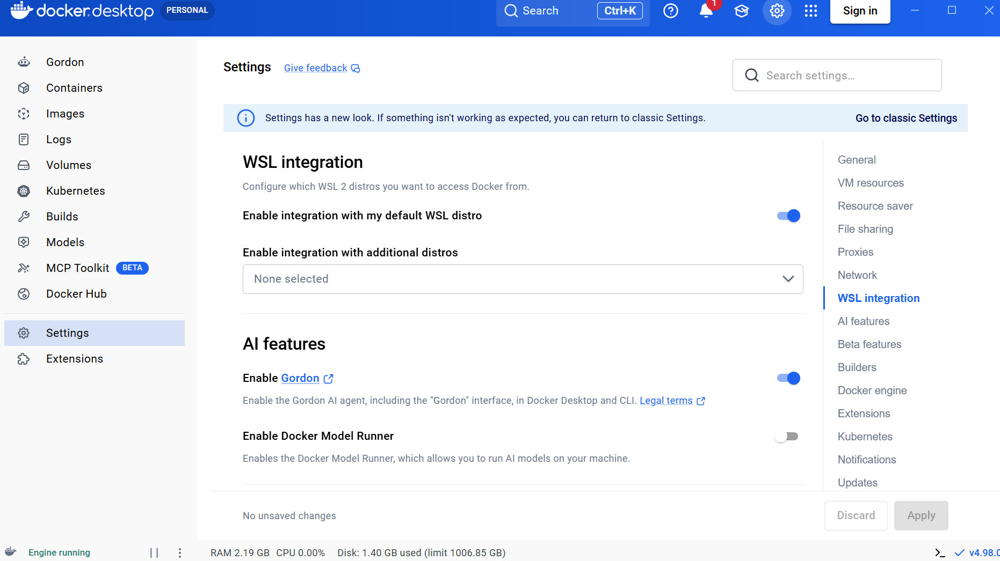

*Docker Desktop의 WSL 연동을 켠 화면.*

<a id="02-폴더"></a>
## 2. 폴더는 왜 나눴나요?

웹페이지를 수정할 때는 소스만, 실험 결과를 확인할 때는 기록만 찾도록 **역할별로 분리**했습니다. 최상위 README는 전체 설명을 맡습니다.

| 폴더·파일 | 역할과 포함 예 | 분리한 이유 |
|---|---|---|
| app/ | 웹 소스: index.html | 실제 제공할 페이지를 한곳에서 수정 |
| scripts/ | 반복 실행: reproduce.sh, bonus-single.sh 등 | 여러 명령을 순서대로 다시 실행 |
| bonus/ | 선택 과제 설정: compose/의 YAML과 NGINX 템플릿 | 기본 실습과 보너스 실행 설정 구분 |
| docs/ | logs/ 실행 기록, images/ 캡처, evidence/ 열람용 기록, 학습·문제 해결 문서 | 실행 파일과 증거 자료 구분 |
| Dockerfile | 커스텀 이미지 제작 지시서 | 서버와 콘텐츠 준비 방법 기록 |
| .dockerignore | Docker 빌드에 보낼 파일의 제외·포함 규칙 | 로그와 캡처를 웹 이미지에 넣지 않음 |
| .gitignore | Git 추적 제외 규칙 | 임시 실습 폴더와 개인 이메일 포함 원본 로그 제외 |
| README.md | 이 문서 | 설명·증거·재현 절차를 한곳에서 확인 |

로컬의 terminal-lab/과 permission-lab/은 파일·권한 실험용 폴더입니다. 폴더 자체는 Git 추적에서 제외하고, 실제 수행한 명령과 결과는 로그·사진으로 남겼습니다.

<a id="03-터미널"></a>
## 3. 글자로 파일을 다뤘습니다

마우스로 폴더를 열고 복사하는 일을 터미널 명령으로 수행했습니다. **절대 경로**는 /부터 전체 위치를 적는 주소이고, **상대 경로**는 현재 폴더를 기준으로 적는 주소입니다.

| 종류 | 실제 예 | 뜻 |
|---|---|---|
| 절대 경로 | /home/jaehyeong/developer-workstation/app | 전체 위치로 app 폴더 지정 |
| 상대 경로 | app | 프로젝트 폴더 안에서 app 지정 |
| 상위 폴더 | .. | 현재 위치에서 한 단계 위 |
| 홈 기준 표기 | ~/developer-workstation | 내 홈 폴더 아래의 프로젝트 |

다음은 실제 실행한 핵심 명령입니다. 파일이 없는 새 연습 폴더에서 수행한 순서이며, 재실행할 때는 기존 파일과 폴더가 있는지 먼저 확인합니다.

```bash
pwd
ls -la
mkdir terminal-lab
cd terminal-lab
touch empty.txt .hidden-demo
ls -la
echo "Hello, Linux!" > original.txt
cat original.txt
cp -v original.txt copy.txt
cat copy.txt
mv -v copy.txt renamed.txt
mkdir archive
mv -v renamed.txt archive/
ls -l archive
rm -v archive/renamed.txt
ls -la archive
rmdir archive
rm -v empty.txt .hidden-demo
cd /home/jaehyeong/developer-workstation
pwd
```

| 명령 | 컴퓨터에 시키는 일 |
|---|---|
| `pwd` | “현재 어느 폴더에 있는지 보여줘.” |
| `ls -la` | “숨김 파일을 포함해 파일 목록을 자세히 보여줘.” |
| `mkdir` | “폴더를 만들어줘.” |
| `cd` | “이 폴더로 이동해줘.” |
| `touch` | 이번 실습에서는 빈 파일을 만들었어. |
| `echo` | “이 글자를 출력해줘.” |
| `cat` | “파일 내용을 보여줘.” |
| `cp` | “파일을 복사해줘.” |
| `mv` | “파일을 옮기거나 이름을 바꿔줘.” |
| `rm` | “파일을 삭제해줘.” |
| `rmdir` | “빈 폴더를 삭제해줘.” |

**실제 출력 발췌:** .hidden-demo와 empty.txt는 크기 0으로 표시됐고, 복사본 내용도 원본과 같았습니다. 삭제 후 archive에는 .과 ..만 남은 것을 확인하고 빈 폴더를 삭제했습니다.

```text
/home/jaehyeong/developer-workstation
-rw-r--r-- 1 jaehyeong jaehyeong 0 Nov  4 07:02 .hidden-demo
-rw-r--r-- 1 jaehyeong jaehyeong 0 Nov  4 07:02 empty.txt
Hello, Linux!
'original.txt' -> 'copy.txt'
Hello, Linux!
renamed 'copy.txt' -> 'renamed.txt'
renamed 'renamed.txt' -> 'archive/renamed.txt'
removed 'archive/renamed.txt'
removed 'empty.txt'
removed '.hidden-demo'
/home/jaehyeong/developer-workstation
```

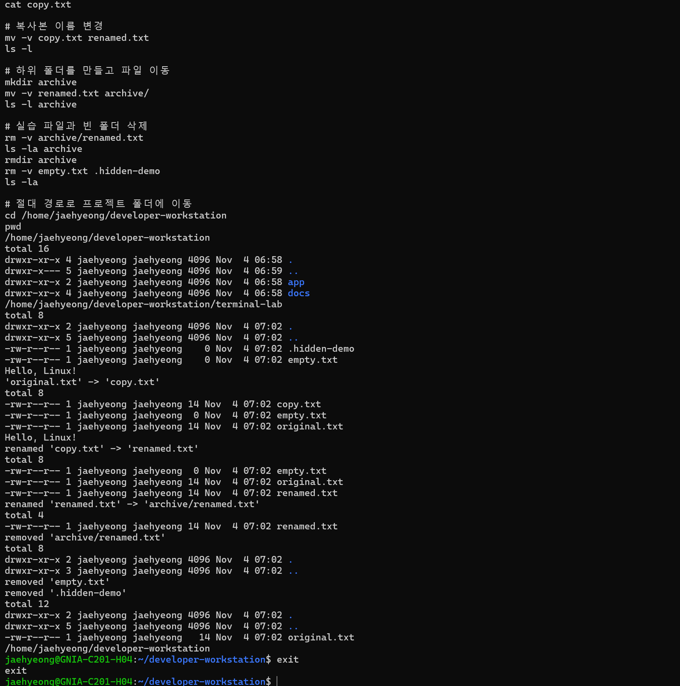

*파일 생성·복사·이름 변경·이동·삭제를 수행한 화면.*

<a id="04-권한"></a>
## 4. 누가 파일을 사용할 수 있는지 정했습니다

권한은 **소유자 / 같은 그룹 / 나머지 사용자**에게 허용할 행동을 나타냅니다. r은 읽기(4), w는 쓰기(2), x는 실행(1)이며, 허용할 숫자를 더합니다.

| 숫자 | 문자 | 의미 |
|---|---|---|
| 7 | rwx | 읽기·쓰기·실행 허용 |
| 6 | rw- | 읽기·쓰기 허용 |
| 5 | r-x | 읽기·실행 허용 |
| 4 | r-- | 읽기 허용 |
| 0 | --- | 해당 권한 없음 |

따라서 파일 644는 소유자가 읽고 쓸 수 있고, 그룹·기타 사용자는 읽기만 가능합니다. 폴더 755는 소유자에게 rwx, 나머지에게 r-x를 줍니다. **폴더의 r은 이름 목록 열람, x는 내부 경로 탐색, w는 항목 생성·삭제와 관련**되며 작업에 따라 권한 조합이 필요합니다.

파일 1개와 폴더 1개의 초기 권한을 확인한 뒤, 소유자만 사용할 수 있게 변경했습니다.

```bash
mkdir -p permission-lab/shared
echo "Permission practice" > permission-lab/sample.txt
chmod 644 permission-lab/sample.txt
chmod 755 permission-lab/shared
ls -l permission-lab/sample.txt
ls -ld permission-lab/shared
chmod 600 permission-lab/sample.txt
chmod 700 permission-lab/shared
stat -c '%a %A %n' permission-lab/sample.txt permission-lab/shared
cat permission-lab/sample.txt
cd permission-lab/shared
pwd
cd ../..
```

```text
# 변경 전 출력 발췌
-rw-r--r-- 1 jaehyeong jaehyeong 20 Nov  4 07:03 permission-lab/sample.txt
drwxr-xr-x 2 jaehyeong jaehyeong 4096 Nov  4 07:03 permission-lab/shared
# 변경 후 출력
600 -rw------- permission-lab/sample.txt
700 drwx------ permission-lab/shared
Permission practice
/home/jaehyeong/developer-workstation/permission-lab/shared
```

**관찰:** 권한 표기가 644→600, 755→700으로 바뀌었고 소유자는 계속 파일을 읽고 폴더에 들어갈 수 있었습니다. 다른 사용자로 접근 거부를 직접 시험한 결과까지 주장하지는 않습니다.

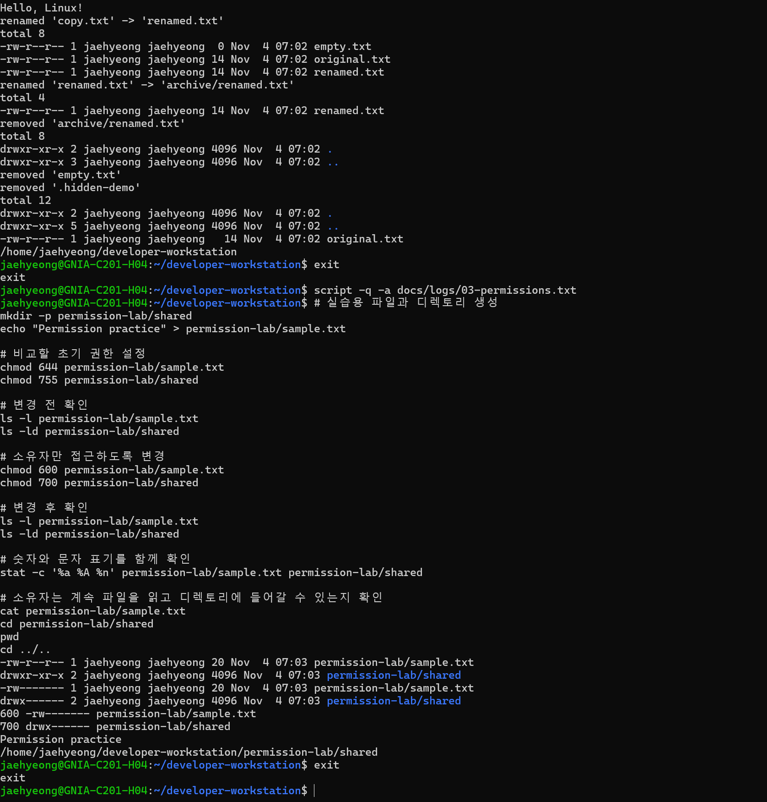

*파일과 폴더의 권한 변경 전후 및 소유자 접근 확인.*

<a id="05-docker"></a>
## 5. Docker로 별도 실행 공간을 만들었습니다

**이미지**는 프로그램과 필요한 파일을 담은 실행 준비물이고, **컨테이너**는 그 이미지로 실제 실행한 공간입니다. 같은 이미지로 여러 컨테이너를 만들 수 있고, 실행이 끝나도 이미지와 종료된 컨테이너가 자동으로 모두 사라지는 것은 아닙니다.

### 설치와 작동 확인

버전 출력은 명령 도구의 설치를, docker info는 실제 실행을 맡는 Docker 서버와의 연결을 확인합니다.

```bash
docker --version
docker info
docker info --format 'Server version: {{.ServerVersion}}'
```

```text
Docker version 29.9.2, build a82e528
Server version: 29.9.2
```

docker info 전체 출력에서는 Operating System: Docker Desktop, OSType: linux, CPU와 메모리 등도 확인했습니다. 처음에는 권한 오류가 있었고, 해결 과정은 10번에 정리했습니다.

### 첫 실행: hello-world

```bash
docker run --name workstation-hello hello-world
docker ps -a
docker logs workstation-hello
docker images
```

| 명령 | 확인한 것 |
|---|---|
| `docker pull` | 이미지를 내려받기 |
| `docker images` | 보관 중인 이미지 목록 |
| `docker ps` | 실행 중인 컨테이너 목록 |
| `docker ps -a` | 종료된 것을 포함한 컨테이너 목록 |
| `docker logs` | 프로그램이 남긴 출력 기록 |
| `docker stats` | CPU·메모리 등의 사용량 |
| `docker stop` | 컨테이너 중지 |
| `docker start` | 중지한 컨테이너 다시 시작 |

```text
Hello from Docker!
This message shows that your installation appears to be working correctly.
# 아래는 실제 목록의 필요한 열만 발췌
CONTAINER ID   IMAGE         STATUS       NAMES
2a668679d344   hello-world   Exited (0)   workstation-hello
IMAGE                ID
hello-world:latest   c567b231f656
```

**관찰:** hello-world는 메시지를 출력하고 정상 종료했습니다. Exited (0)은 이 프로그램의 정상 종료이며, 오류로 꺼졌다는 뜻이 아닙니다.

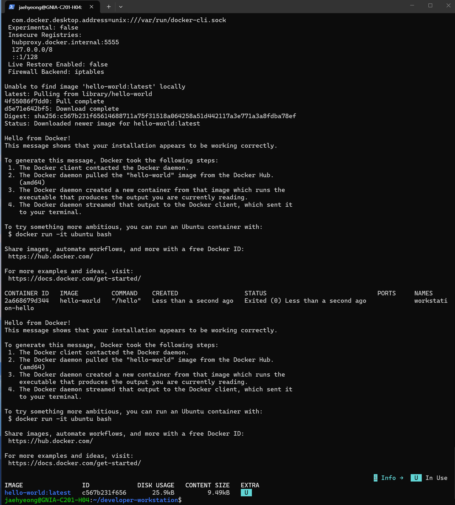

*Docker 실행 성공 메시지와 종료된 컨테이너·이미지 목록.*

### Ubuntu 내부 명령과 리소스 확인

```bash
docker pull ubuntu:24.04
docker run -d --name workstation-ubuntu ubuntu:24.04 sleep infinity
docker ps
docker stats --no-stream workstation-ubuntu
docker exec -it workstation-ubuntu bash
# 아래는 컨테이너 안에서 실행
whoami
cat /etc/os-release
ls /
echo "Hello from inside the container"
exit
```

```text
# 내부 명령의 실제 출력 발췌
root
PRETTY_NAME="Ubuntu 24.04.5 LTS"
bin  boot  dev  etc  home  lib  lib64  media  mnt  opt  proc  root  run  sbin  srv  sys  tmp  usr  var
Hello from inside the container
# stats의 실제 측정값 발췌
NAME                 CPU %   MEM USAGE / LIMIT    PIDS
workstation-ubuntu   0.00%   1.344MiB / 15.25GiB  1
```

리소스 수치는 실행 시점에 따라 달라집니다. 이 실험에서는 컨테이너 내부 사용자·운영체제·파일 목록을 확인하고, CPU와 메모리 사용량도 조회했습니다.

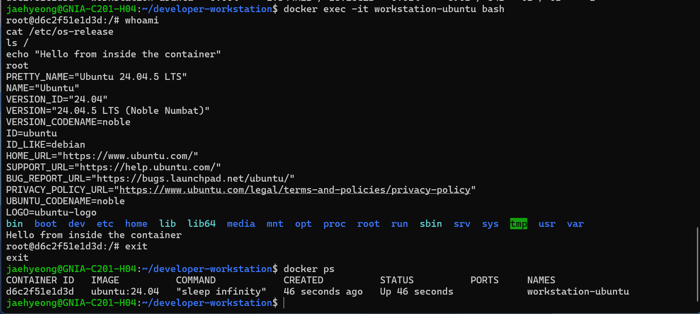

*Ubuntu 컨테이너 내부 명령과 셸 종료 후에도 실행 중인 컨테이너.*

### 컨테이너는 언제 종료되나요?

```bash
docker stop workstation-ubuntu
docker ps -a
docker start workstation-ubuntu
docker ps
docker run -it --name workstation-shell ubuntu:24.04 bash
# 새 컨테이너 안에서 실행
echo "This bash is the main process"
exit
# 다시 호스트에서 실행
docker ps -a
```

컨테이너는 **주 프로세스가 실행되는 동안 유지**됩니다.

| 실제 비교 | 결과 | 이유 |
|---|---|---|
| sleep infinity로 실행하고 exec로 들어간 셸에서 exit | workstation-ubuntu 유지 | 추가 셸만 종료되고 주 프로세스는 계속 실행 |
| bash를 주 프로세스로 실행하고 exit | workstation-shell이 Exited (0) | 주 프로세스 자체가 종료 |
| docker stop 후 start | 중지 후 다시 Up | 같은 컨테이너를 중지·재실행 |

exec는 별도 프로세스를 추가하고, attach는 기존 주 프로세스의 입출력에 연결하는 기능입니다. **실제 수행한 비교는 exec 셸 종료와 bash 주 프로세스 종료**이며 attach를 직접 사용한 실습으로 표시하지 않았습니다. stop 직후의 Ubuntu 컨테이너는 Exited (137)로 기록됐으며, 이 종료값만으로 메모리 부족이라고 단정하지 않았습니다.

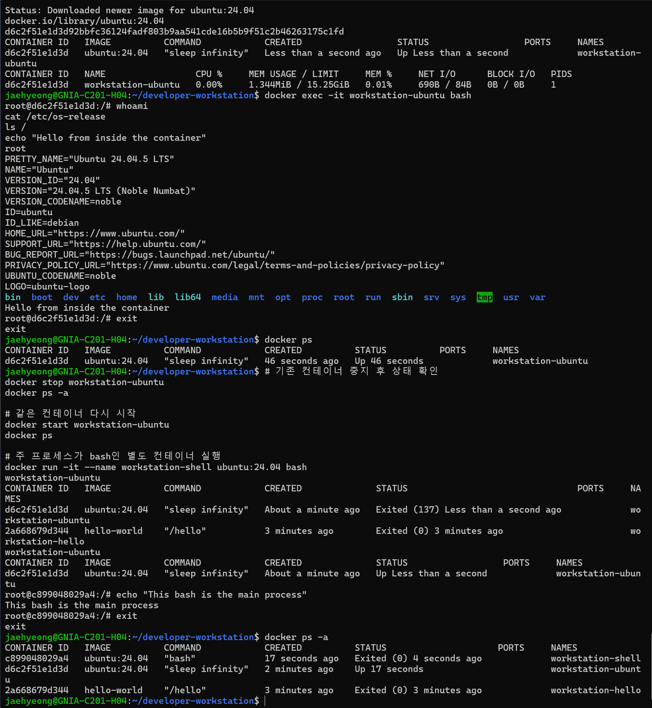

*stop·start 및 주 프로세스 종료에 따른 상태 차이.*

<a id="06-웹-서버"></a>
## 6. 내가 만든 웹페이지를 서버로 보여줬습니다

HTML은 웹페이지의 제목과 본문을 적는 파일이고, 웹 서버는 브라우저 요청에 그 파일을 보내줍니다. 이번에는 **NGINX가 준비된 nginx:stable-alpine을 베이스로 선택**하고 기본 환영 페이지를 직접 만든 소개 페이지로 교체했습니다.

| 커스텀한 부분 | 목적 |
|---|---|
| 한국어 제목·작성자·프로젝트 설명 | 직접 만든 정적 콘텐츠 제공 |
| Version 1·Version 2 표시 | 파일 변경 반영 여부를 눈으로 비교 |
| Dockerfile의 COPY | 페이지를 서버 이미지에 함께 포함 |
| EXPOSE 80 | 서비스 포트를 문서화 |
| .dockerignore | 웹 이미지에 필요한 빌드 재료만 전달 |

직접 작성한 Dockerfile 전체는 다음과 같습니다.

```dockerfile
FROM nginx:stable-alpine
COPY app/ /usr/share/nginx/html/
EXPOSE 80
```

| 줄 | 뜻 |
|---|---|
| `FROM nginx:stable-alpine` | 엔진엑스가 준비된 이미지를 바탕으로 사용해. |
| `COPY app/ /usr/share/nginx/html/` | 내 app 폴더의 내용을 엔진엑스가 페이지를 읽는 위치에 복사해. |
| `EXPOSE 80` | 이 이미지의 서비스가 내부 80번 포트를 사용한다는 정보를 남겨. |

<details>
<summary>현재 HTML 소스 전체 펼치기</summary>

```html
<!doctype html>
<html lang="ko">
<head>
  <meta charset="utf-8">
  <meta name="viewport" content="width=device-width, initial-scale=1">
  <title>개발 워크스테이션</title>
</head>
<body>
  <h1>나의 개발 워크스테이션</h1>
  <p>작성자: jaehyeong</p>
  <p>터미널, Docker, Git으로 재현 가능한 개발 환경 만들기</p>
  <p>Version 2</p>
</body>
</html>
```

</details>

```bash
docker build -t workstation-web:v1 .
docker run -d --name workstation-web -p 127.0.0.1:8080:80 workstation-web:v1
docker ps --filter name=workstation-web
docker port workstation-web
docker logs --tail 20 workstation-web
```

| 부분 | 뜻 |
|---|---|
| `docker run` | 컨테이너를 만들고 실행해. |
| `-d` | 터미널을 계속 사용할 수 있도록 백그라운드에서 실행해. |
| `--name workstation-web` | 컨테이너에 이 이름을 붙여. |
| `-p 127.0.0.1:8080:80` | 컴퓨터 쪽 8080번과 컨테이너 쪽 80번을 연결해. |
| `workstation-web:v1` | 이 이미지를 사용해. |

```text
# 실제 결과의 핵심 부분 발췌
80/tcp -> 127.0.0.1:8080
# 접속 로그에서 필요한 필드 발췌
"GET / HTTP/1.1" 200 382
```

브라우저 주소의 localhost는 자기 컴퓨터를 뜻. localhost:8080을 열었을 때 요청은 다음 순서로 이동.
1. 브라우저가 컴퓨터의 8080번으로 요청.
2. 도커가 그 요청을 컨테이너 내부의 80번으로 전달.
3. 엔진엑스가 HTML을 보냄.
4. 브라우저가 HTML을 해석해서 화면으로 보여.

빌드 성공과 실행 상태는 아래 화면에서 함께 확인할 수 있습니다. favicon.ico의 404는 아이콘 파일이 없어서 발생했으며, 본문 GET /의 200 응답과 구별했습니다.

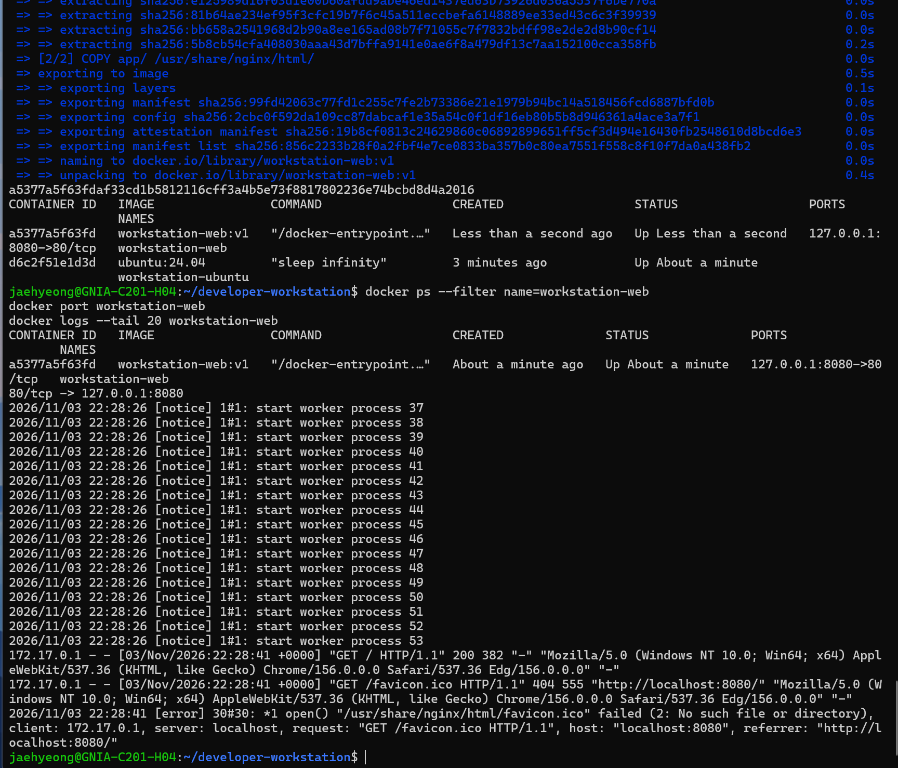

*이미지 빌드·컨테이너 Up·포트 매핑·본문 HTTP 200 기록.*

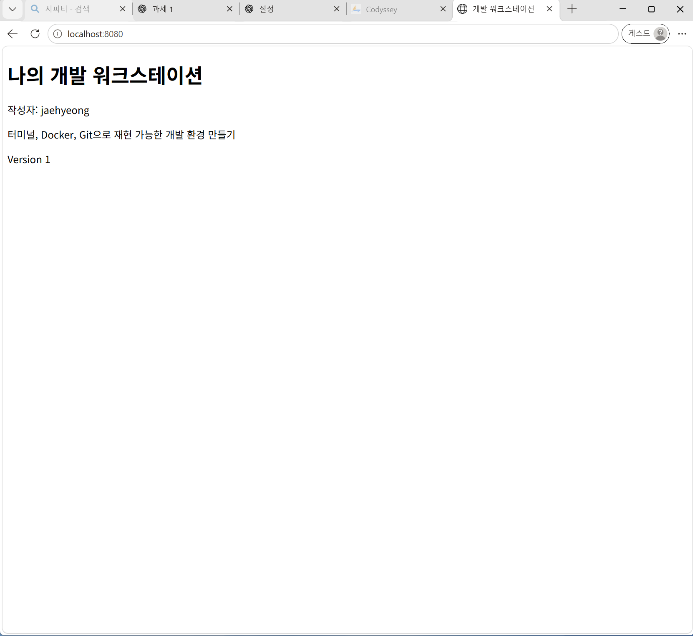

*주소창 localhost:8080과 직접 만든 Version 1 페이지.*

### 포트 연결은 왜 필요한가요?

포트는 프로그램에 요청을 전달하는 **번호가 붙은 입구**입니다. localhost는 요청을 보내는 자기 컴퓨터를 뜻합니다.

기본 bridge 방식의 Linux 컨테이너는 **네트워크 네임스페이스**라는 분리된 네트워크 공간을 사용합니다. 이 기능은 네트워크 장치·IP 주소·라우팅 테이블·포트 등의 자원을 구분합니다. 컨테이너 안의 localhost는 그 컨테이너 자신이며, Windows 브라우저의 localhost와 동일한 공간이 아닙니다.

서로 다른 컨테이너가 각자의 내부 80번 포트를 사용해도 이 분리 덕분에 충돌하지 않습니다. 하지만 내부 80번을 사용한다고 Windows의 localhost:8080에 자동으로 연결되지는 않습니다. 그래서 **-p 옵션으로 호스트의 입구와 컨테이너의 입구를 연결**했습니다. 이번 환경에서는 Docker Desktop이 Windows 쪽 요청을 컨테이너 서비스로 전달합니다.

| 설정 부분 | 뜻 |
|---|---|
| 127.0.0.1 | 호스트에서 로컬 접속용으로 바인딩할 주소 |
| 8080 | 브라우저가 접근하는 호스트 포트 |
| 80 | 컨테이너 내부 NGINX 수신 포트 |
| -p 127.0.0.1:8080:80 | 호스트 8080의 요청을 내부 80으로 전달 |

EXPOSE 80만 적으면 호스트 포트가 게시되지는 않습니다. 이번 실습은 bridge 방식이며 host 네트워크 공유 모드는 사용하지 않았습니다. 같은 호스트 IP·TCP 포트를 두 컨테이너가 동시에 게시하려 하면 충돌할 수 있고, 실제 실험은 10번에 있습니다.

<a id="07-변경-반영"></a>
## 7. 파일을 바꾸면 실행 중인 페이지도 바뀔까요?

두 방식을 비교했습니다. **COPY는 이미지 제작 시점의 파일을 복사**합니다. **바인드 마운트는 실행할 때 내 컴퓨터의 폴더를 연결**합니다.

처음에는 Version 1으로 이미지를 만들고, 바인드 마운트 컨테이너를 추가 실행한 뒤 호스트 HTML을 Version 2로 수정했습니다.

```bash
docker run -d --name workstation-bind   -p 127.0.0.1:8081:80   --mount type=bind,source="$(pwd)/app",target=/usr/share/nginx/html,readonly   workstation-web:v1
docker exec workstation-bind cat /usr/share/nginx/html/index.html
sed -i 's/Version 1/Version 2/' app/index.html
docker exec workstation-bind cat /usr/share/nginx/html/index.html
```

```html
# 파일 내용의 실제 변경 부분 발췌
# 수정 전
<p>Version 1</p>
# 수정 후
<p>Version 2</p>
```

| 실행 방식 | 수정 전 | 호스트 파일 수정 후 |
|---|---|---|
| 기존 COPY 이미지 / 8080 | Version 1 | Version 1 유지 |
| 바인드 마운트 / 8081 | Version 1 | 새로고침하면 Version 2 |

이미 찍은 사진이 실물 변경에 따라 바뀌지 않는 것처럼, 기존 이미지의 복사본은 그대로였습니다. 반면 연결된 호스트 파일을 읽는 컨테이너는 수정 내용을 제공했습니다. readonly는 컨테이너 쪽 쓰기를 제한하며, 호스트에서 편집하는 것을 막지는 않습니다. 마운트 대상 위치의 원래 이미지 파일은 연결된 폴더에 가려집니다.

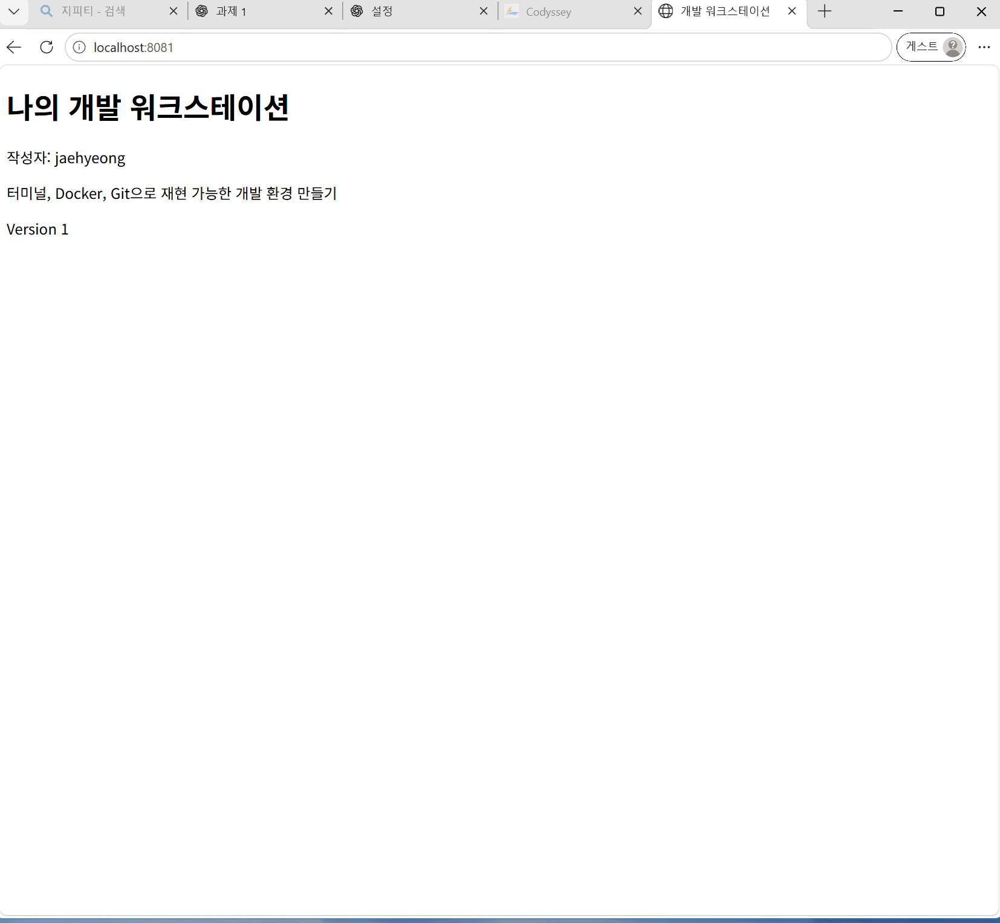

*변경 전: localhost:8081에서 Version 1.*

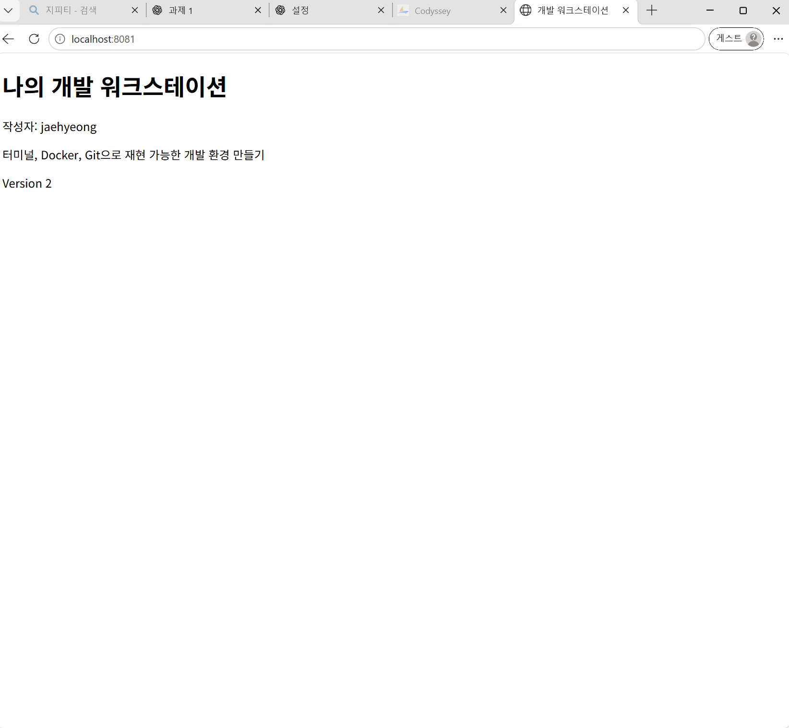

*호스트 파일 변경 후: 같은 localhost:8081에서 Version 2.*

<details>
<summary>바인드 마운트 실행 명령과 파일 비교 사진</summary>

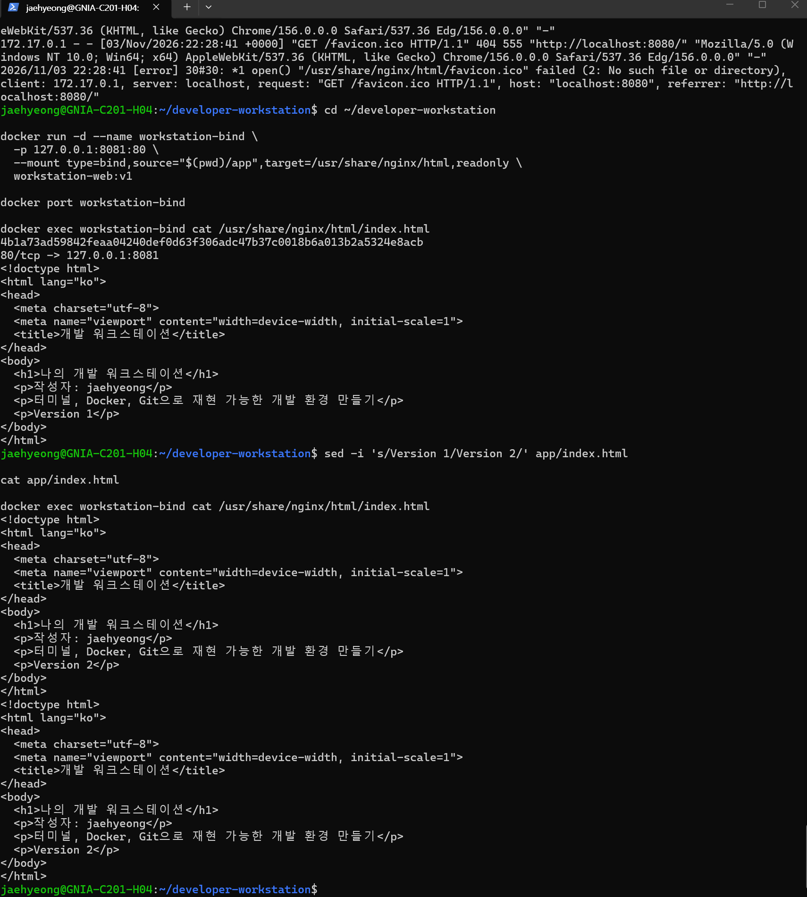

*마운트 명령 및 호스트·컨테이너 파일 비교.*

</details>

현재 저장소의 HTML은 Version 2입니다. 따라서 현재 소스를 새로 빌드하면 Version 2가 나오는 것이 정상입니다. 이 차이를 다시 확인하기 위해 별도 임시 폴더로 재현 실험도 했습니다.

| 추가 재현 | 실제 결과 |
|---|---|
| COPY / localhost:8083 | Version 1 유지 |
| 바인드 마운트 / localhost:8084 | 임시 호스트 파일 수정 후 Version 2 |

<details>
<summary>추가 재현의 주소창 포함 비교 사진</summary>

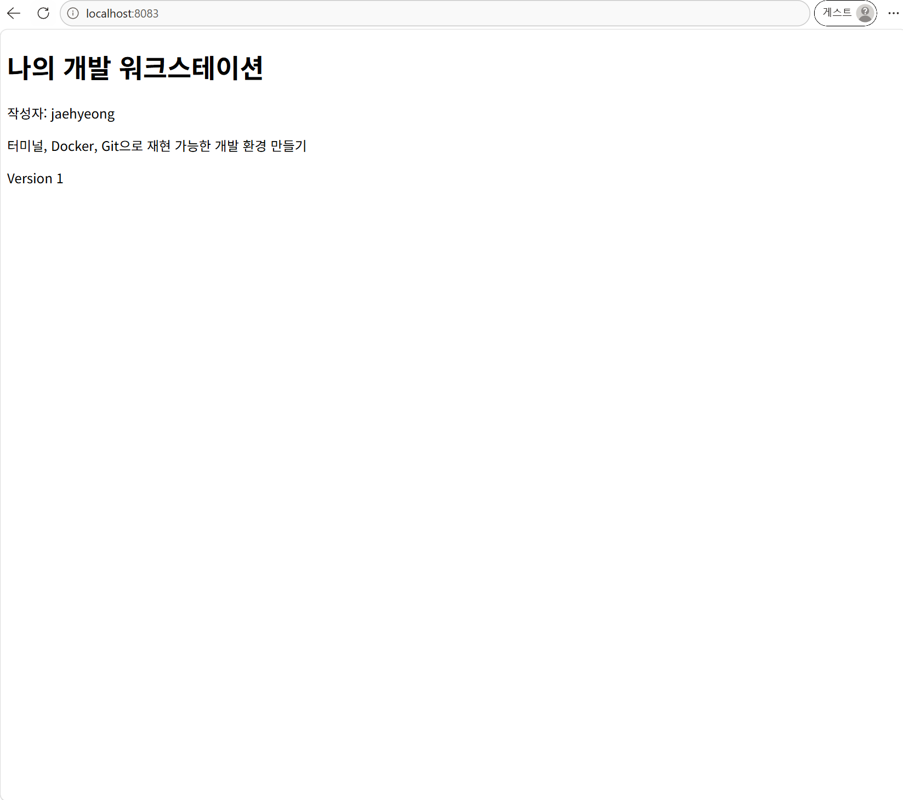

*재현 COPY: 8083 / Version 1.*


*재현 바인드 마운트: 8084 / Version 2.*

</details>

<a id="08-데이터-보관"></a>
## 8. 컨테이너를 지워도 파일을 보관했습니다

컨테이너 자체의 쓰기 영역에만 저장한 파일은 컨테이너를 삭제하면 함께 사라집니다. 보관해야 하는 데이터는 **컨테이너와 별도로 관리하는 볼륨**에 저장할 수 있습니다.

workstation-data 볼륨을 만들고 첫 컨테이너에서 파일을 저장했습니다. 그 컨테이너를 삭제한 뒤, 새 컨테이너에 같은 볼륨을 연결해 기존 파일을 읽었습니다.

```bash
docker volume create workstation-data
docker run --name volume-before   --mount type=volume,source=workstation-data,target=/data ubuntu:24.04   sh -c 'echo "Saved by jaehyeong - persistence test" > /data/proof.txt; cat /data/proof.txt'
docker inspect volume-before --format '{{json .Mounts}}'
docker logs volume-before
docker rm volume-before
docker ps -a --filter name=volume-before
docker run --name volume-after   --mount type=volume,source=workstation-data,target=/data ubuntu:24.04   cat /data/proof.txt
docker volume inspect workstation-data
```


1. workstation-data라는 볼륨을 만듦
2. 첫 번째 컨테이너의 /data 위치에 연결
3. 그 안의 proof.txt에 문장을 저장
4. 첫 번째 컨테이너를 삭제
5. 새로운 컨테이너를 만들고 같은 볼륨을 연결
6. proof.txt를 읽자 같은 문장이 나옴


```text
# 실제 출력의 핵심 부분 발췌
workstation-data
Saved by jaehyeong - persistence test
# Mounts에서 Type=volume, Name=workstation-data, Destination=/data 확인
volume-before
CONTAINER ID   IMAGE   COMMAND   CREATED   STATUS   PORTS   NAMES
Saved by jaehyeong - persistence test
# volume inspect에서 Name=workstation-data, Driver=local 확인
```

**관찰:** 삭제 확인 목록에는 제목만 남았고, 다른 컨테이너가 같은 문장을 다시 출력했습니다. 컨테이너 재시작만 한 것이 아니라 **삭제 후 새 컨테이너에 연결**한 실험입니다. Docker Desktop의 볼륨 경로는 엔진 내부 경로이며 WSL 홈 경로와 다릅니다.

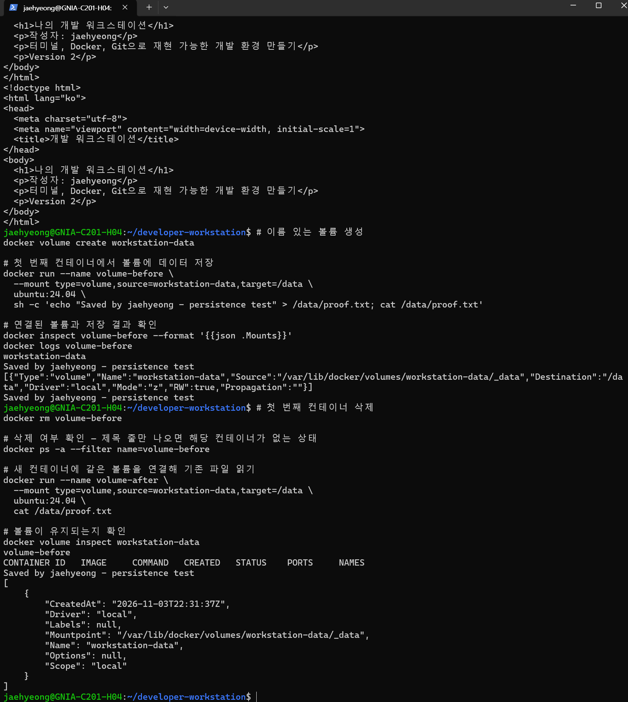

*볼륨 생성·연결·첫 컨테이너 삭제·새 컨테이너에서 파일 읽기.*

| 방식 | 저장 공간 관리 | 이번에 확인한 목적 |
|---|---|---|
| 바인드 마운트 | 내가 지정한 호스트 폴더 | 편집한 소스 즉시 반영 |
| 이름 있는 볼륨 | Docker가 관리 | 컨테이너 교체 후 데이터 보관 |

볼륨도 직접 삭제하면 데이터가 사라지므로, “컨테이너 삭제와 별도로 유지된다”는 뜻입니다.

<a id="09-git"></a>
## 9. 작업 이력을 남기고 GitHub에 공유했습니다

**Git은 내 컴퓨터의 변경 이력 관리**, **GitHub는 원격 저장·협업 서비스**입니다. 커밋은 설명을 붙여 남기는 저장 지점과 비슷합니다. 작성자 이름·이메일 설정은 GitHub 로그인 인증과 별개입니다.

기본 브랜치를 main으로 설정하고 현재 폴더를 저장소로 초기화했습니다. 아래 이메일은 설명용 예시이며 실제 제출 로그의 이메일은 마스킹했습니다.

```bash
git config --global init.defaultBranch main
git init -b main
git config --local user.name "손재형"
# 아래 이메일은 자신의 작성자 이메일로 교체
git config --local user.email "YOUR_EMAIL"
git config --list | sed 's/^user\.email=.*/user.email=[MASKED]/'
git status
```

```text
init.defaultbranch=main
core.repositoryformatversion=0
core.filemode=true
core.bare=false
core.logallrefupdates=true
user.name=손재형
user.email=[MASKED]
```

VS Code에서 WSL 폴더를 열어 같은 프로젝트를 작업했습니다. GitHub 로그인 후 저장소를 게시했고, 이후에는 CLI로 커밋과 push를 수행했습니다.

```bash
git add README.md docs/ scripts/
git commit -m "docs: 실습 문서와 재현 검증 증거 추가"
git push origin main
git status
```

| 명령 | 역할 |
|---|---|
| git add | 다음 커밋에 포함할 변경 선택 |
| git commit | 선택한 변경을 로컬 이력으로 기록 |
| git push | 커밋을 GitHub로 전송 |
| git status | 브랜치와 미기록 변경 확인 |

실제 업로드 후 On branch main, up to date with origin/main, working tree clean을 확인했습니다. clean은 기록하지 않은 파일 변경이 없다는 뜻이며 프로그램에 버그가 없다는 뜻은 아닙니다. 초기에는 HTTPS를 사용했고, 보너스에서 SSH로 변경해 실제 push까지 확인했습니다.

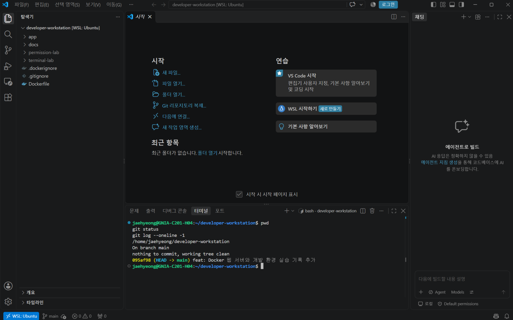

*VS Code의 WSL Ubuntu 프로젝트와 터미널.*

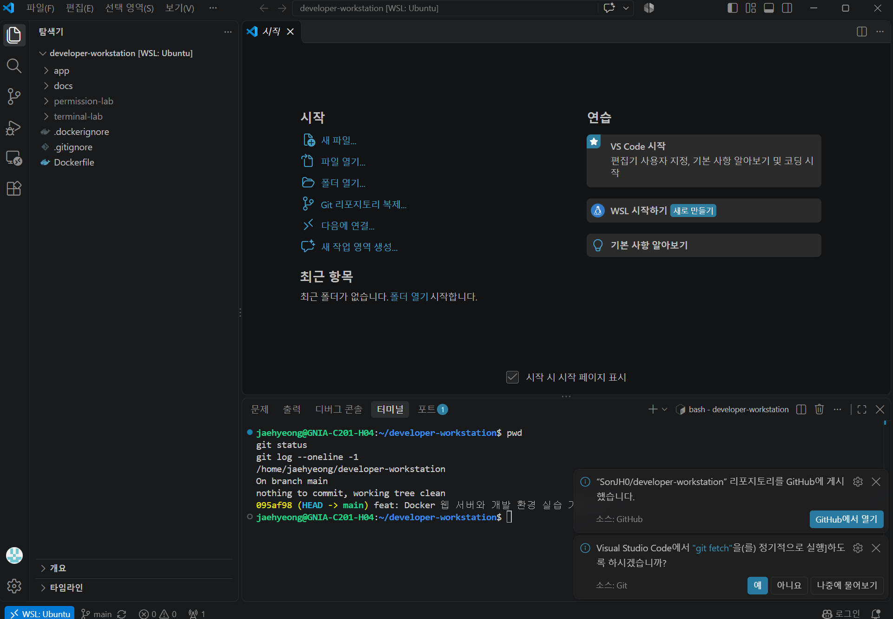

*VS Code에서 SonJH0/developer-workstation 저장소 게시 성공 알림.*

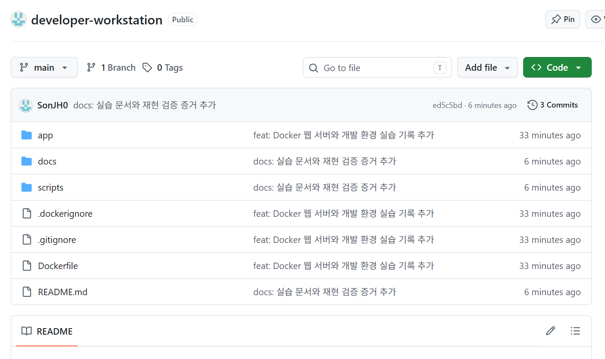

*저장소가 Public으로 전환된 실제 화면.*

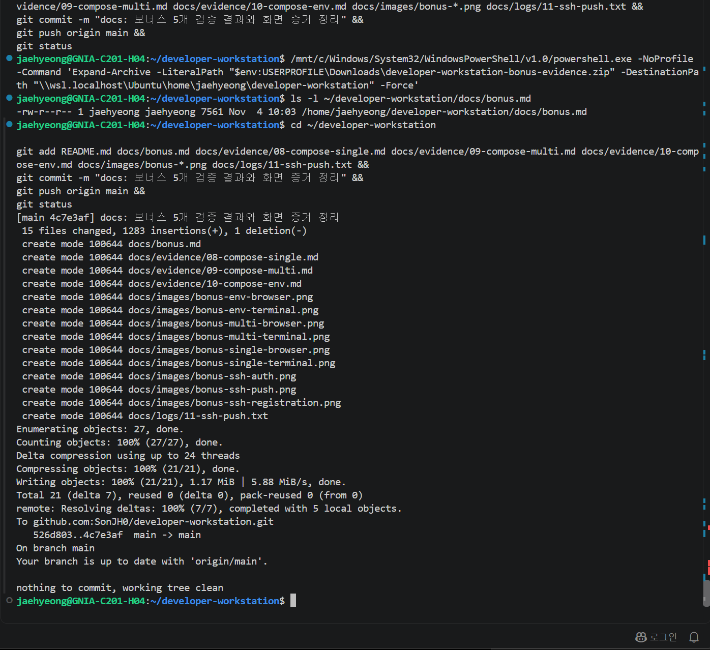

*보너스 증거 커밋 4c7e3af의 push와 working tree clean 확인.*

저장소는 최종적으로 Public으로 전환했습니다. 비밀번호·토큰·개인키·인증 코드는 제출하지 않았고, 개인 이메일이 들어간 원본 05-git.txt 대신 마스킹한 설정 사본을 사용했습니다. 커밋 메타데이터의 작성자 이메일은 로그 마스킹과 별개입니다.

<a id="10-오류-해결"></a>
## 10. 오류가 났을 때 원인을 확인했습니다

### 사례 1. Docker에 접근할 권한이 없었습니다 — 실제 발생

| 단계 | 수행 내용 |
|---|---|
| 문제 | docker info 실행 시 /var/run/docker.sock permission denied |
| 원인 가설 | 계정은 docker 그룹에 등록됐지만 현재 로그인 환경에 그룹 정보가 반영되지 않음 |
| 확인 | id에는 docker가 없고, getent group docker에는 계정이 있음. 소켓은 root:docker / 660. sudo 조회는 성공 |
| 해결 | su - jaehyeong으로 새 로그인 셸을 열어 그룹 정보를 반영 |
| 재검증 | id에 docker 그룹이 생기고 일반 권한으로 Docker 서버 조회·목록 확인 성공 |

```bash
id
getent group docker
ls -l /var/run/docker.sock
sudo docker info --format '{{.ServerVersion}}'
su - jaehyeong
cd ~/developer-workstation
id
docker info --format 'Server version: {{.ServerVersion}}'
docker ps
```

```text
# 실제 결과 발췌
permission denied while trying to connect to the docker API at unix:///var/run/docker.sock
# 새 로그인 후 id의 그룹 목록에 추가된 부분
1001(docker)
Server version: 29.9.2
```

newgrp docker는 당시 미설치로 실패했습니다. 소켓을 모든 사용자에게 여는 chmod 666 대신 로그인 환경을 갱신했습니다. Docker 그룹의 접근 권한은 강하므로 계정 부여 범위에 주의해야 합니다.

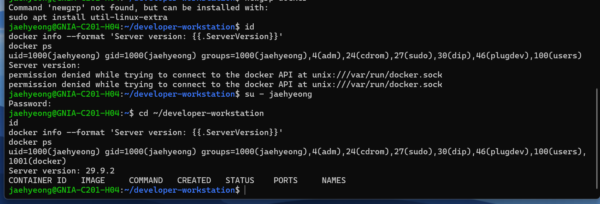

*새 로그인 후 docker 그룹과 일반 사용자 명령 성공 확인.*

### 사례 2. 이미 사용 중인 포트를 다시 쓰려 했습니다 — 의도적 재현

| 단계 | 수행 내용 |
|---|---|
| 문제 | 새 컨테이너를 기존과 같은 127.0.0.1:8080에 연결하자 실행 실패 |
| 원인 가설 | 같은 호스트 IP·TCP 포트를 두 컨테이너가 동시에 게시하려 함 |
| 확인 | 기존 docker port 결과는 8080, 새 실행 오류는 port is already allocated |
| 해결 | 실패한 테스트 컨테이너만 삭제하고 새 컨테이너의 호스트 포트를 8082로 변경 |
| 재검증 | 새 컨테이너가 Up, 매핑 결과가 127.0.0.1:8082로 출력 |

```bash
docker port workstation-web
docker run -d --name workstation-port-test -p 127.0.0.1:8080:80 workstation-web:v1
docker ps -a --filter name=workstation-port-test
docker rm workstation-port-test
docker run -d --name workstation-port-test -p 127.0.0.1:8082:80 workstation-web:v1
docker ps --filter name=workstation-port-test
docker port workstation-port-test
```

```text
# 실제 오류·해결 결과 발췌
Bind for 127.0.0.1:8080 failed: port is already allocated
80/tcp -> 127.0.0.1:8082
```

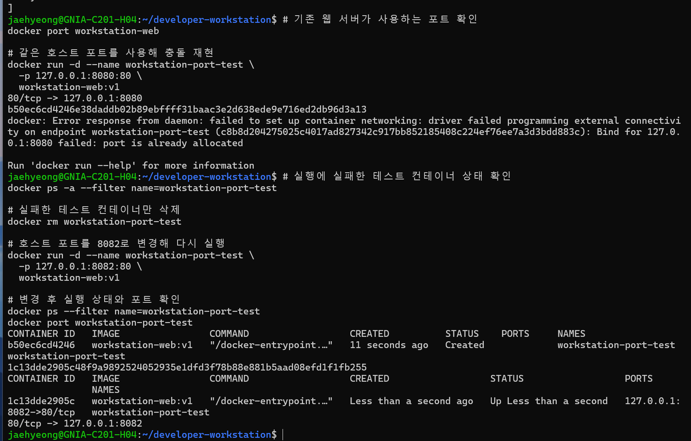

*의도적으로 포트 중복을 재현하고 8082로 변경해 해결.*

<a id="11-보너스"></a>
## 11. 보너스 5개도 실제로 수행했습니다

### 11-1. Compose: 실행 방법을 파일로 남겼습니다

Compose는 이미지·포트·환경 변수 같은 실행 설정을 YAML 파일에 적어두고 실행하는 도구입니다. **긴 실행 명령이 버전 관리할 수 있는 설정 파일**이 됩니다.

단일 서비스는 기존 Dockerfile로 만든 web 하나를 실행했습니다. 아래는 실제 설정 파일 전체입니다.

```yaml
name: workstation-bonus-single

services:
  web:
    build:
      context: ../..
      dockerfile: Dockerfile
    image: workstation-bonus-single:v1
    ports:
      - "127.0.0.1:8085:80"
```

```bash
bash scripts/bonus-single.sh
# 위 스크립트가 수행하는 주요 운영 명령
docker compose -f bonus/compose/compose.single.yaml up -d --build --wait
docker compose -f bonus/compose/compose.single.yaml ps
docker compose -f bonus/compose/compose.single.yaml logs --no-color --tail 20
# 브라우저 확인 후 정리
docker compose -f bonus/compose/compose.single.yaml down
docker compose -f bonus/compose/compose.single.yaml ps -a
```

**실제 결과:** web이 Up, 포트 127.0.0.1:8085→80, 내부 HTTP 요청 200, 브라우저에서 Version 2를 확인했습니다. down 후 ps -a에는 제목만 남았습니다.


*Compose 단일 서비스: localhost:8085 / Version 2.*

<details>
<summary>단일 서비스 명령과 실제 출력 사진</summary>

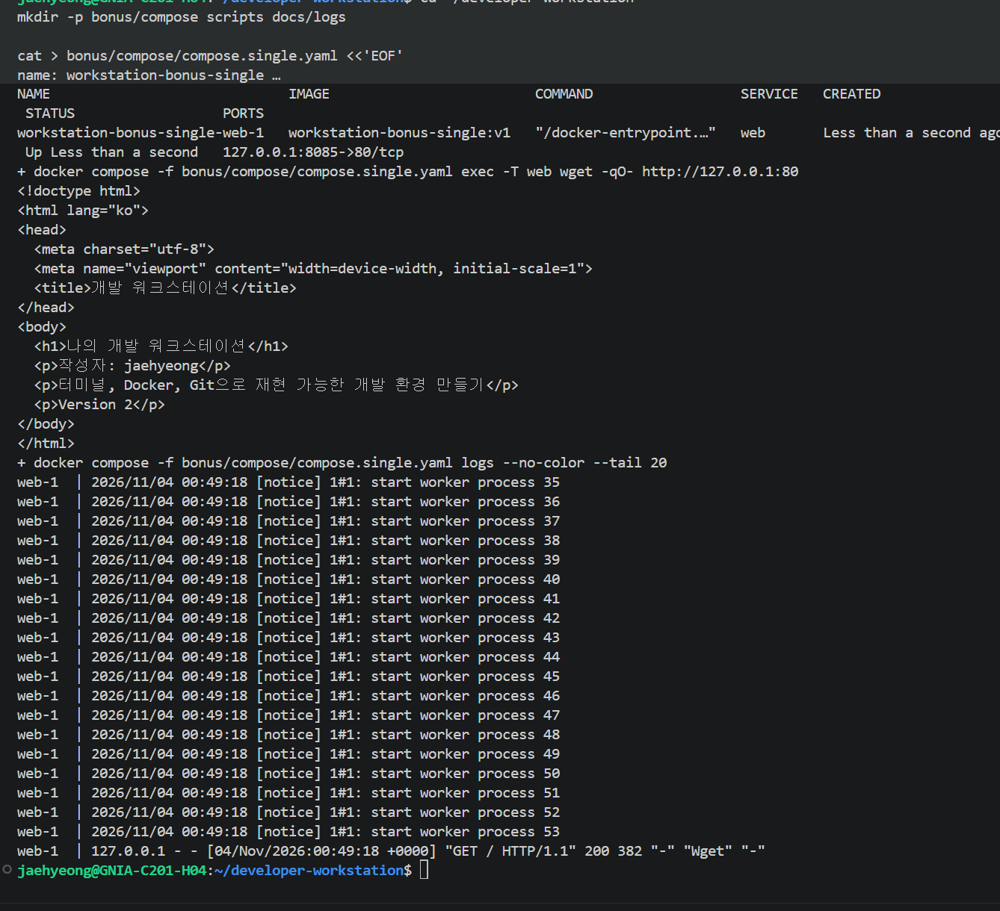

*단일 서비스 상태·HTML 응답·HTTP 200 로그.*

</details>

### 11-2. 두 컨테이너가 이름으로 통신했습니다

web과 helper라는 서비스 2개를 함께 실행했습니다. Compose는 기본 네트워크를 만들며, 그 안에서 서비스 이름으로 상대 주소를 찾을 수 있습니다. 이것을 **서비스 디스커버리**라고 합니다. 고정 IP를 소스에 적지 않고 web, helper라는 이름을 사용했습니다.

<details>
<summary>다중 서비스 설정 파일 전체 펼치기</summary>

```yaml
name: workstation-bonus-multi

services:
  web:
    build:
      context: ../..
      dockerfile: Dockerfile
    image: workstation-bonus-multi:v1
    ports:
      - "127.0.0.1:8086:80"
    healthcheck:
      test: ["CMD", "wget", "-q", "--spider", "http://127.0.0.1:80"]
      interval: 2s
      timeout: 3s
      retries: 15

  helper:
    image: nginx:stable-alpine
    healthcheck:
      test: ["CMD", "wget", "-q", "--spider", "http://127.0.0.1:80"]
      interval: 2s
      timeout: 3s
      retries: 15
```

</details>

```bash
bash scripts/bonus-multi.sh
# 스크립트에서 수행한 양방향 통신 검증
docker compose -f bonus/compose/compose.multi.yaml exec -T web wget -qO- http://helper:80
docker compose -f bonus/compose/compose.multi.yaml exec -T helper wget -qO- http://web:80
# 브라우저 확인 후 정리
docker compose -f bonus/compose/compose.multi.yaml down
docker compose -f bonus/compose/compose.multi.yaml ps -a
```

| 요청 방향 | 실제 응답 |
|---|---|
| web → helper:80 | NGINX 기본 환영 페이지 HTML |
| helper → web:80 | 프로젝트의 Version 2 HTML |
| Windows 브라우저 → localhost:8086 | 프로젝트의 Version 2 화면 |

helper의 포트를 호스트에 게시하지 않아도 같은 네트워크의 web에서 내부 80 포트로 접근했습니다. 양쪽 서버 로그에 HTTP 200이 기록됐습니다. healthcheck는 각 서비스가 응답 가능한지 확인하며 --wait는 이 준비 상태를 기다립니다.

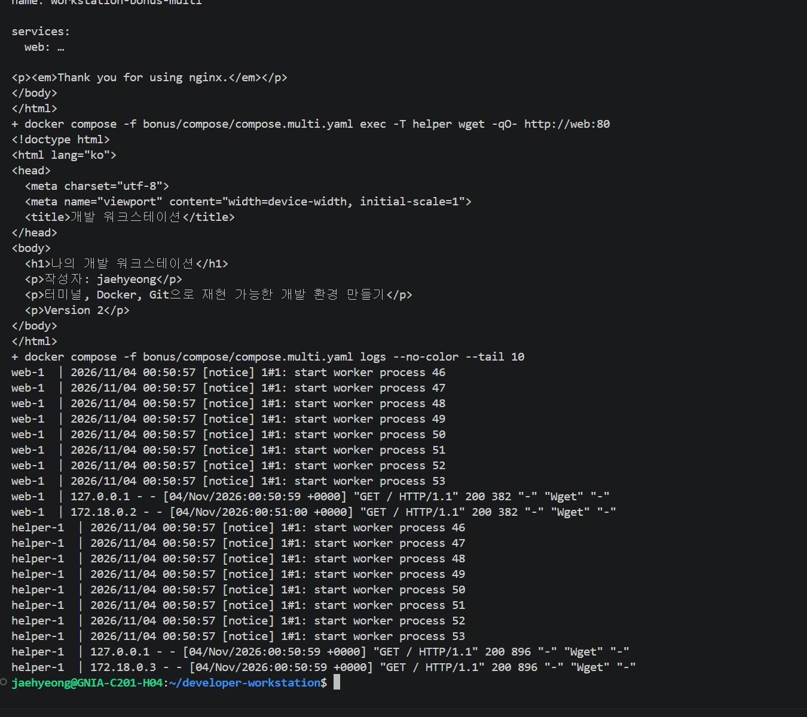

*컨테이너 이름으로 양방향 요청, HTML 응답 및 양쪽 HTTP 200 기록.*


*다중 서비스의 web 접속: localhost:8086.*

### 11-3. 운영 명령으로 시작부터 종료까지 확인했습니다

| 명령 | 확인한 내용 |
|---|---|
| up -d --build --wait | 이미지를 준비하고 서비스가 응답 가능한 상태까지 실행 |
| ps | 서비스 상태와 게시된 포트 확인 |
| logs | 서버 시작 기록과 HTTP 요청 결과 확인 |
| down | 해당 프로젝트의 컨테이너와 기본 네트워크 정리 |
| ps -a | 종료 후 해당 프로젝트의 컨테이너가 없는지 확인 |

단일·다중·환경 변수 실습의 로그에는 시작과 종료 명령을 함께 기록했습니다. 각 정리 기록은 COMMAND_EXIT_CODE="0"으로 끝났으며, 종료 후 목록에는 제목만 표시됐습니다. 사용한 명령은 위·아래 코드블록과 이 문서 마지막 전체 로그에서 확인할 수 있습니다.

### 11-4. 코드 대신 환경 변수로 서버 포트를 바꿨습니다

환경 변수는 실행할 때 전달하는 설정값입니다. **같은 이미지를 사용하면서 NGINX_PORT 값만 바꿔 컨테이너 내부 서버 포트를 변경**했습니다.

NGINX 공식 이미지의 시작 기능이 템플릿 속 변수를 치환해 실제 설정 파일을 생성합니다. 단순히 변수를 선언한 것이 아니라 listen 항목에 연결했습니다.

```nginx
server {
    listen ${NGINX_PORT};
    server_name localhost;

    location / {
        root /usr/share/nginx/html;
        index index.html;
    }
}
```

<details>
<summary>환경 변수를 주입하는 Compose 설정 전체 펼치기</summary>

```yaml
name: workstation-bonus-env

services:
  web:
    build:
      context: ../..
      dockerfile: Dockerfile
    image: workstation-bonus-env:v1
    environment:
      NGINX_PORT: "${NGINX_PORT:-80}"
    ports:
      - "127.0.0.1:8087:${NGINX_PORT:-80}"
    volumes:
      - ./templates/default.conf.template:/etc/nginx/templates/default.conf.template:ro
    healthcheck:
      test: ["CMD-SHELL", "wget -q --spider http://127.0.0.1:$$NGINX_PORT"]
      interval: 2s
      timeout: 3s
      retries: 15
```

</details>

```bash
bash scripts/bonus-env.sh
# 스크립트는 NGINX_PORT를 80, 8088로 바꾸어 컨테이너를 각각 재생성
# 각 실행에서 실제 값·설정·HTTP 응답·포트 매핑을 확인
NGINX_PORT=8088 docker compose -f bonus/compose/compose.env.yaml exec -T web printenv NGINX_PORT
NGINX_PORT=8088 docker compose -f bonus/compose/compose.env.yaml exec -T web cat /etc/nginx/conf.d/default.conf
NGINX_PORT=8088 docker compose -f bonus/compose/compose.env.yaml exec -T web wget -qO- http://127.0.0.1:8088
NGINX_PORT=8088 docker compose -f bonus/compose/compose.env.yaml port web 8088
```

| 환경 변수 | 실제 생성된 설정 | 연결 | 확인 |
|---|---|---|---|
| NGINX_PORT=80 | listen 80; | 호스트8087 → 내부80 | HTML 응답 성공 |
| NGINX_PORT=8088 | listen 8088; | 호스트8087 → 내부8088 | HTML 응답 성공 |

이미지는 한 번 빌드한 뒤 재사용했고 HTML을 수정하지 않았습니다. 내부 수신 포트와 매핑 대상이 함께 바뀌었으며, 브라우저 주소는 localhost:8087로 유지했습니다. 이것으로 설정과 코드를 분리하는 방식을 확인했습니다.

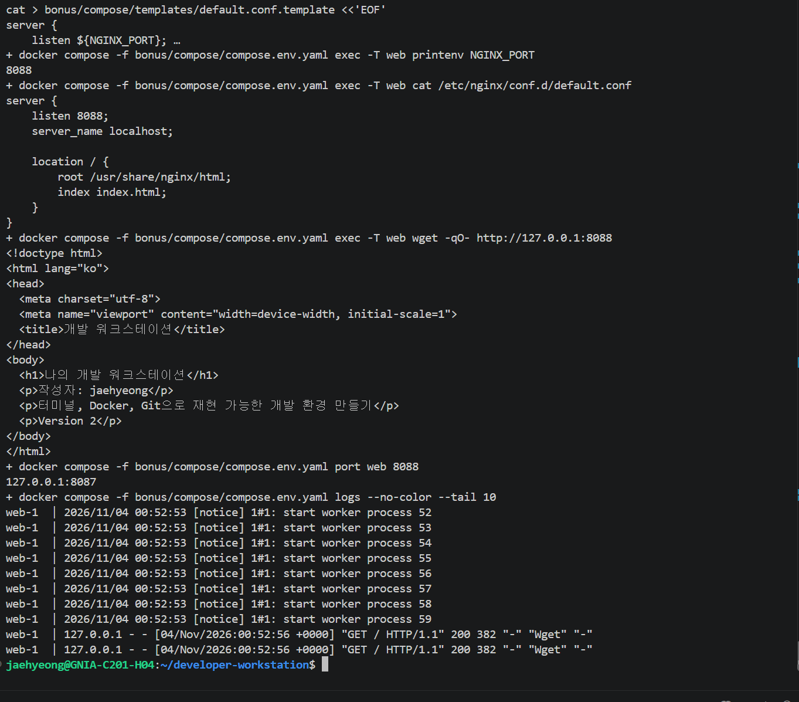

*환경 변수 8088, listen 8088, 내부 HTTP 응답과 호스트8087 매핑.*


*포트 변경 후에도 localhost:8087에서 Version 2 접속.*

```bash
# 브라우저 확인 후 정리
NGINX_PORT=8088 docker compose -f bonus/compose/compose.env.yaml down
NGINX_PORT=8088 docker compose -f bonus/compose/compose.env.yaml ps -a
```

### 11-5. SSH로 GitHub에 실제 업로드했습니다

SSH는 키 쌍으로 본인임을 증명하는 인증 방식입니다. **개인키는 내 컴퓨터에 보관하고 공개키만 GitHub에 등록**했습니다. 키는 암호로 보호했고, 키 암호와 개인키는 제출하지 않았습니다.

아래는 수행한 절차입니다. 다른 사용자는 자신의 키와 계정을 사용해야 합니다. 같은 파일명으로 기존 키가 있다면 덮어쓰지 않습니다.

```bash
# 작성자 PC에서 선택한 키 경로. 자신의 계정에서는 별도 키 사용
ssh-keygen -t ed25519 -C "developer-workstation" -f ~/.ssh/id_ed25519_workstation
# 생성 시 키 보호 암호를 직접 입력. 공개키(.pub)만 GitHub에 등록
eval "$(ssh-agent -s)"
ssh-add ~/.ssh/id_ed25519_workstation
ssh -T -o IdentitiesOnly=yes -i ~/.ssh/id_ed25519_workstation git@github.com
# 이 저장소에 사용할 키와 원격 주소 설정
git config --local core.sshCommand 'ssh -i ~/.ssh/id_ed25519_workstation -o IdentitiesOnly=yes'
git remote set-url origin git@github.com:SonJH0/developer-workstation.git
git remote -v
git push origin main
```

```text
# 실제 인증 결과
Hi SonJH0! You've successfully authenticated, but GitHub does not provide shell access.
# 실제 SSH 원격 주소
origin  git@github.com:SonJH0/developer-workstation.git (fetch)
origin  git@github.com:SonJH0/developer-workstation.git (push)
# 보너스 실행 파일을 실제 전송한 결과
To github.com:SonJH0/developer-workstation.git
   c8c8a4d..526d803  main -> main
```

최초 접속 때 GitHub 서버의 ED25519 지문을 공식 문서와 대조한 뒤 승인했습니다. ssh -T는 인증에 성공해도 대화형 셸을 제공하지 않기 때문에 종료 코드 1을 반환할 수 있습니다. **인증 메시지와 실제 git push 성공을 따로 확인**했습니다. 새 터미널에서는 필요하면 agent를 시작하고 키를 다시 추가합니다. 다른 평가자가 push를 시험하려면 자신의 쓰기 권한이 있는 저장소나 fork를 대상으로 합니다.

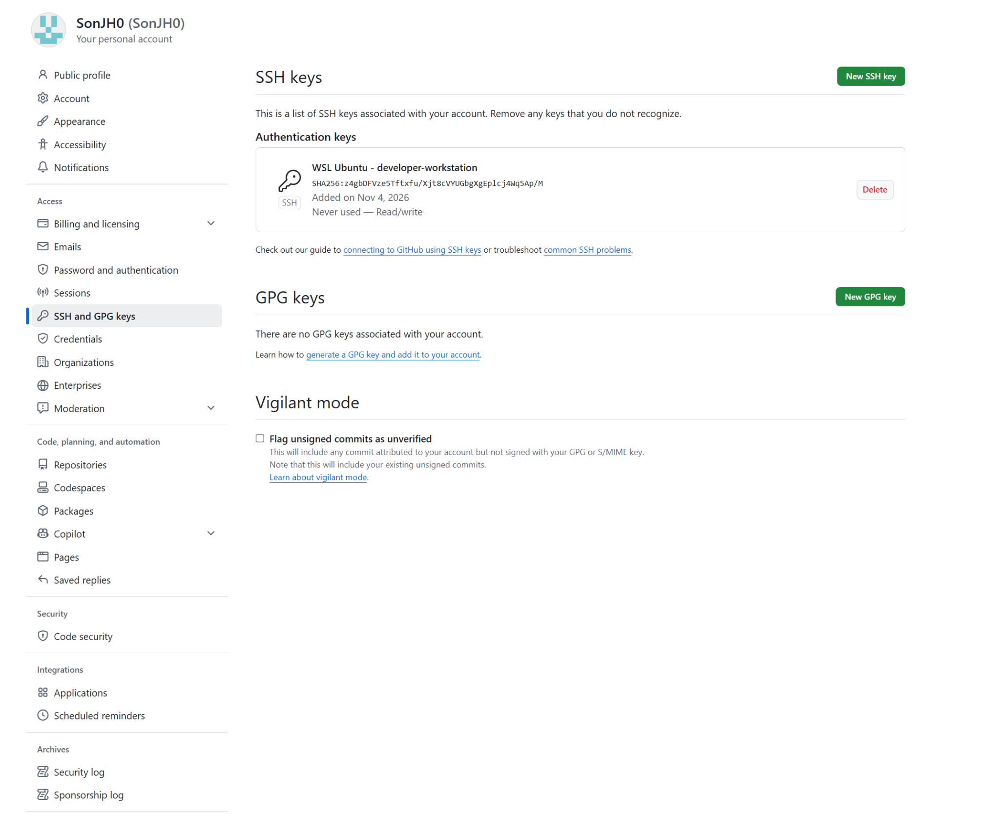

*GitHub에 공개키 등록 완료. 개인키가 아닌 공개키의 지문이 표시됨.*

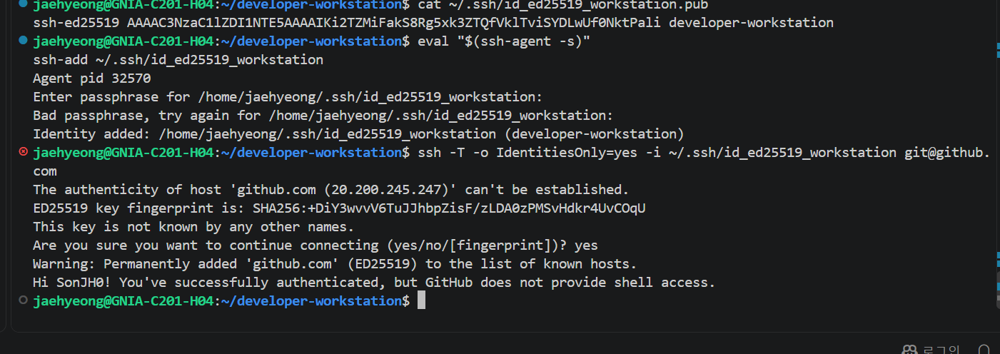

*SonJH0 계정으로 SSH 인증 성공.*

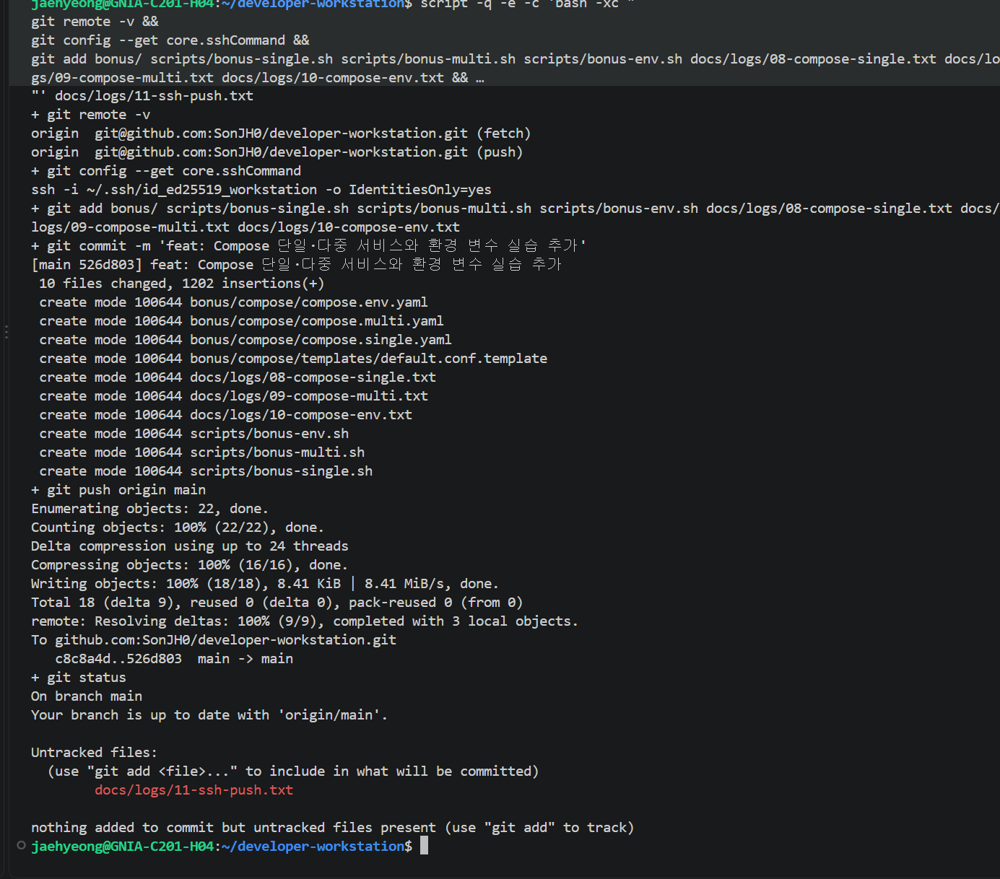

*SSH 주소로 보너스 커밋을 실제 push한 기록.*


<a id="13-평가-확인표"></a>
## 13. 평가 기준별 확인표

모든 항목은 실제 수행 결과와 이 README의 위치를 연결했습니다. 아래 링크는 다른 문서가 아닌 **이 페이지 안의 해당 부분**으로 이동합니다.

| 필수·선택 항목 | 상태 | 이 README의 증거 위치 |
|---|---|---|
| 프로젝트 개요·실행 환경 | 완료 | 처음 소개, [1번](#01-준비) |
| 폴더 구성 기준·역할·포함 파일 | 완료 | [2번](#02-폴더) |
| 위치·숨김 목록·이동·생성·복사·이름 변경·삭제·내용·빈 파일 | 완료 | [3번 명령·출력·사진](#03-터미널), 아래 02 전체 로그 |
| 절대·상대 경로 설명 | 완료 | [3번](#03-터미널) |
| 파일 1개·폴더 1개 권한 변경 전후 | 완료 | [4번 명령·출력·사진](#04-권한) |
| r/w/x·644·755 해석 | 완료 | [4번](#04-권한) |
| Docker 설치·버전·데몬 점검 | 완료 | [5번](#05-docker), 아래 04 전체 로그 |
| pull·images·run·stop·start·ps·ps -a·logs·stats | 완료 | [5번](#05-docker), 아래 04 전체 로그 |
| hello-world·Ubuntu 내부 명령 | 완료 | [5번](#05-docker) |
| 주 프로세스와 exec 셸 종료 비교 | 완료 | [5번](#05-docker) |
| 직접 작성한 Dockerfile·베이스·커스텀 목적·빌드 성공 | 완료 | [6번 소스·명령·사진](#06-웹-서버) |
| 포트 매핑·주소창 포함 접속 화면 | 완료 | [6번](#06-웹-서버) |
| 네트워크 격리·포트 매핑 필요성 | 완료 | [6번](#06-웹-서버) |
| 바인드 마운트 명령·호스트 변경 전후 | 완료 | [7번](#07-변경-반영) |
| 볼륨 생성·연결·삭제 전후 유지 | 완료 | [8번](#08-데이터-보관) |
| Git 사용자·기본 브랜치·설정 목록 | 완료 | [9번](#09-git) |
| VS Code 로그인·GitHub 저장소 연결 | 완료 | [9번 게시 화면](#09-git) |
| 트러블슈팅 2건 이상 | 완료 | [10번](#10-오류-해결) |
| 보너스: Compose 단일 서비스 | 완료 | [11번](#11-보너스) |
| 보너스: 멀티 컨테이너·통신 | 완료 | [11번](#11-보너스) |
| 보너스: up/down/ps/logs | 완료 | [11번](#11-보너스), 아래 08·09·10 전체 로그 |
| 보너스: 환경 변수로 실제 서버 포트 변경 | 완료 | [11번](#11-보너스) |
| 보너스: SSH 키 등록·인증·실제 push | 완료 | [11번](#11-보너스), 아래 11 전체 로그 |
| README만으로 재현·개인 경로 대안 | 작성·동일 PC 검증 | [12번](#12-재현) |
| 민감정보 보호 | 원본 설정 로그 제외·이메일 마스킹 | [9번](#09-git), SSH 개인키·암호는 수록하지 않음 |


<a id="14-전체-기록"></a>
## 14. 추가 사진과 전체 실행 기록

발표 중에는 위의 핵심 결과와 사진을 사용하면 됩니다. 원래 기록을 더 확인하려면 **이 페이지에서 아래 항목을 펼치세요.** 기록 당시의 컨테이너 ID·시간·사용량은 스냅샷이므로 재실행 시 달라집니다. 과거 상태를 기록한 로그는 최종 상태와 다를 수 있습니다.

전체 로그에는 입력이 반복되거나 진행 상태가 여러 번 출력된 부분이 있습니다. 이는 실행 당시 기록을 보존한 것이며 본문의 핵심 결과 발췌와 구별합니다. 색상·화면 제어문자는 읽기 편하게 제거했습니다. 최초 환경 기록의 종료값 127은 당시 Docker가 준비되기 전의 결과이고, 이후 Docker 정상 실행을 별도로 확인했습니다.

<details>
<summary>추가 설치·상태·재현 사진 6장 펼치기</summary>

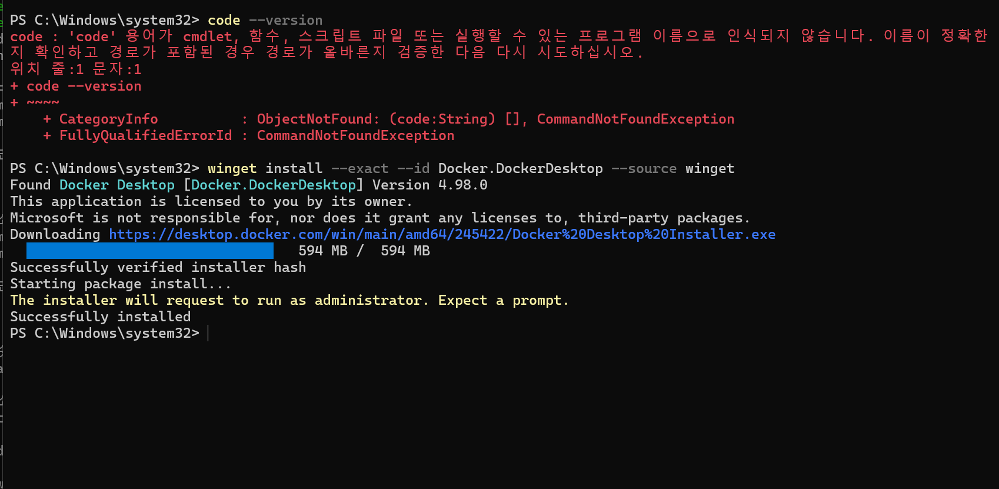

*Docker Desktop 설치 성공*


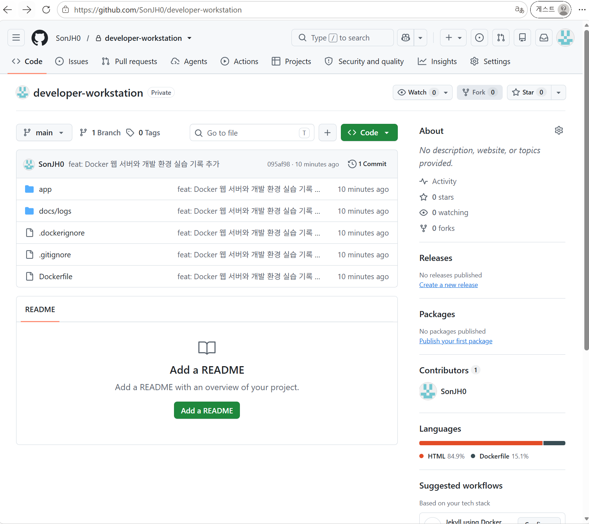

*초기 GitHub 저장소 게시 화면: 당시에는 Private였으며 이후 Public 전환*


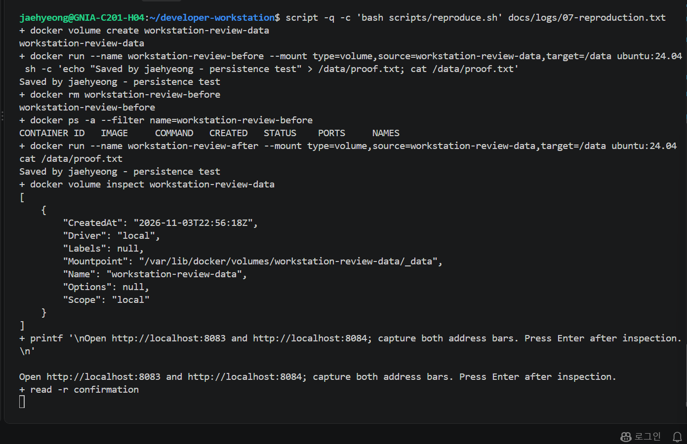

*별도 재현 볼륨 조회 및 브라우저 확인 대기*


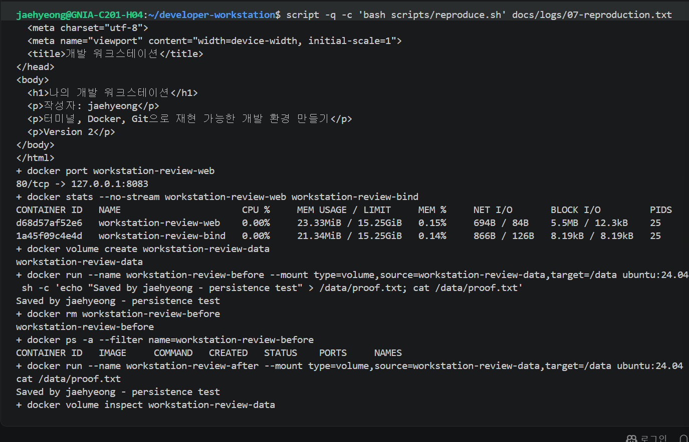

*별도 재현에서도 첫 컨테이너 삭제 후 같은 데이터 확인*


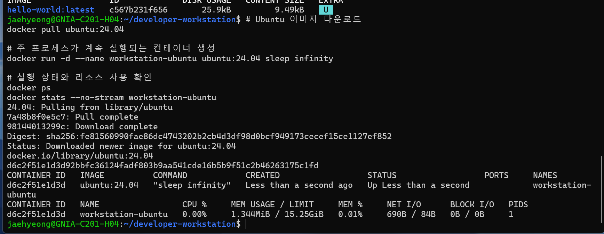

*Ubuntu 실행 상태와 리소스 측정*


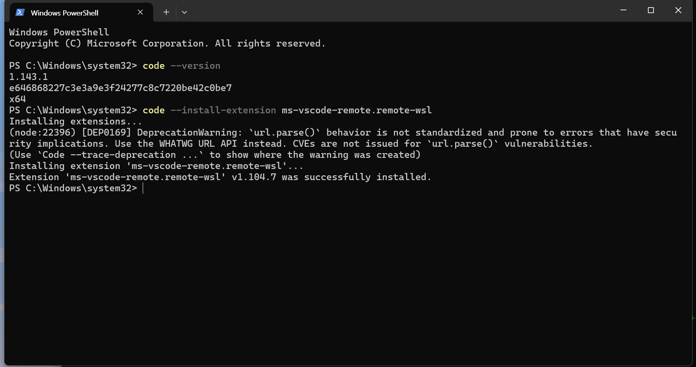

*VS Code 버전과 WSL 확장 설치 성공*

</details>

<details>
<summary>01-environment 전체 명령·출력 펼치기</summary>

```text
Script started on 2026-11-04 06:58:14+09:00 [TERM="xterm-256color" TTY="/dev/pts/0" COLUMNS="120" LINES="30"]
jaehyeong@GNIA-C201-H04:~/developer-workstation$ whoami

pwd

cat /etc/os-release

echo "$SHELL"

bash --version

uname -r

git --version

docker --version
jaehyeong@GNIA-C201-H04:~/developer-workstation$ whoami

pwd

cat /etc/os-release

echo "$SHELL"

bash --version

uname -r

git --version

docker --version

jaehyeong
/home/jaehyeong/developer-workstation
PRETTY_NAME="Ubuntu 26.04.1 LTS"
NAME="Ubuntu"
VERSION_ID="26.04"
VERSION="26.04.1 LTS (Resolute Raccoon)"
VERSION_CODENAME=resolute
ID=ubuntu
ID_LIKE=debian
HOME_URL="https://www.ubuntu.com/"
SUPPORT_URL="https://help.ubuntu.com/"
BUG_REPORT_URL="https://bugs.launchpad.net/ubuntu/"
PRIVACY_POLICY_URL="https://www.ubuntu.com/legal/terms-and-policies/privacy-policy"
UBUNTU_CODENAME=resolute
LOGO=ubuntu-logo
/bin/bash
GNU bash, version 5.3.9(1)-release (x86_64-pc-linux-gnu)
Copyright (C) 2025 Free Software Foundation, Inc.
License GPLv3+: GNU GPL version 3 or later <http://gnu.org/licenses/gpl.html>

This is free software; you are free to change and redistribute it.
There is NO WARRANTY, to the extent permitted by law.
6.18.54.1-microsoft-standard-WSL2
git version 2.53.0
docker: command not found
jaehyeong@GNIA-C201-H04:~/developer-workstation$ 

jaehyeong@GNIA-C201-H04:~/developer-workstation$ 

jaehyeong@GNIA-C201-H04:~/developer-workstation$ 

jaehyeong@GNIA-C201-H04:~/developer-workstation$ 

jaehyeong@GNIA-C201-H04:~/developer-workstation$ 

jaehyeong@GNIA-C201-H04:~/developer-workstation$ 

jaehyeong@GNIA-C201-H04:~/developer-workstation$ 

jaehyeong@GNIA-C201-H04:~/developer-workstation$ 

jaehyeong@GNIA-C201-H04:~/developer-workstation$ 

jaehyeong@GNIA-C201-H04:~/developer-workstation$ 

jaehyeong@GNIA-C201-H04:~/developer-workstation$ 

jaehyeong@GNIA-C201-H04:~/developer-workstation$ 

jaehyeong@GNIA-C201-H04:~/developer-workstation$ 

jaehyeong@GNIA-C201-H04:~/developer-workstation$ 

jaehyeong@GNIA-C201-H04:~/developer-workstation$ 

jaehyeong@GNIA-C201-H04:~/developer-workstation$ 

jaehyeong@GNIA-C201-H04:~/developer-workstation$ 

jaehyeong@GNIA-C201-H04:~/developer-workstation$ 

jaehyeong@GNIA-C201-H04:~/developer-workstation$ 

jaehyeong@GNIA-C201-H04:~/developer-workstation$ 

jaehyeong@GNIA-C201-H04:~/developer-workstation$ 

jaehyeong@GNIA-C201-H04:~/developer-workstation$ 

jaehyeong@GNIA-C201-H04:~/developer-workstation$ 

jaehyeong@GNIA-C201-H04:~/developer-workstation$ 

jaehyeong@GNIA-C201-H04:~/developer-workstation$ 

jaehyeong@GNIA-C201-H04:~/developer-workstation$ 

jaehyeong@GNIA-C201-H04:~/developer-workstation$ 

jaehyeong@GNIA-C201-H04:~/developer-workstation$ 

jaehyeong@GNIA-C201-H04:~/developer-workstation$ 

jaehyeong@GNIA-C201-H04:~/developer-workstation$ 

jaehyeong@GNIA-C201-H04:~/developer-workstation$ 

jaehyeong@GNIA-C201-H04:~/developer-workstation$ 

jaehyeong@GNIA-C201-H04:~/developer-workstation$ exit

ls -lh docs/logs/01-environment.txt

tail -n 15 docs/logs/01-environment.txt
jaehyeong@GNIA-C201-H04:~/developer-workstation$ exit

ls -lh docs/logs/01-environment.txt

tail -n 15 docs/logs/01-environment.txt

exit

Script done on 2026-11-04 06:59:47+09:00 [COMMAND_EXIT_CODE="127"]
```

</details>

<details>
<summary>02-terminal 전체 명령·출력 펼치기</summary>

```text
Script started on 2026-11-04 07:01:53+09:00 [TERM="xterm-256color" TTY="/dev/pts/0" COLUMNS="120" LINES="62"]
jaehyeong@GNIA-C201-H04:~/developer-workstation$ # 현재 위치와 숨김 파일 포함 목록 확인

pwd

ls -la


# 실습 폴더 생성 후 상대 경로로 이동

mkdir terminal-lab

cd terminal-lab

pwd


# 빈 파일과 숨김 파일 생성

touch empty.txt .hidden-demo

ls -la


# 파일에 내용 작성하고 확인

echo "Hello, Linux!" > original.txt

cat original.txt


# 파일 복사 후 원본과 복사본 확인

cp -v original.txt copy.txt

ls -l

cat copy.txt


# 복사본 이름 변경

mv -v copy.txt renamed.txt

ls -l


# 하위 폴더를 만들고 파일 이동

mkdir archive

mv -v renamed.txt archive/

ls -l archive


# 실습 파일과 빈 폴더 삭제

rm -v archive/renamed.txt

ls -la archive

rmdir archive

rm -v empty.txt .hidden-demo

ls -la


# 절대 경로로 프로젝트 폴더에 이동

cd /home/jaehyeong/developer-workstation

pwd
jaehyeong@GNIA-C201-H04:~/developer-workstation$ # 현재 위치와 숨김 파일 포함 목록 확인

pwd

ls -la


# 실습 폴더 생성 후 상대 경로로 이동

mkdir terminal-lab

cd terminal-lab

pwd


# 빈 파일과 숨김 파일 생성

touch empty.txt .hidden-demo

ls -la


# 파일에 내용 작성하고 확인

echo "Hello, Linux!" > original.txt

cat original.txt


# 파일 복사 후 원본과 복사본 확인

cp -v original.txt copy.txt

ls -l

cat copy.txt


# 복사본 이름 변경

mv -v copy.txt renamed.txt

ls -l


# 하위 폴더를 만들고 파일 이동

mkdir archive

mv -v renamed.txt archive/

ls -l archive


# 실습 파일과 빈 폴더 삭제

rm -v archive/renamed.txt

ls -la archive

rmdir archive

rm -v empty.txt .hidden-demo

ls -la


# 절대 경로로 프로젝트 폴더에 이동

cd /home/jaehyeong/developer-workstation

pwd

/home/jaehyeong/developer-workstation
total 16
drwxr-xr-x 4 jaehyeong jaehyeong 4096 Nov  4 06:58 .
drwxr-x--- 5 jaehyeong jaehyeong 4096 Nov  4 06:59 ..
drwxr-xr-x 2 jaehyeong jaehyeong 4096 Nov  4 06:58 app
drwxr-xr-x 4 jaehyeong jaehyeong 4096 Nov  4 06:58 docs
/home/jaehyeong/developer-workstation/terminal-lab
total 8
drwxr-xr-x 2 jaehyeong jaehyeong 4096 Nov  4 07:02 .
drwxr-xr-x 5 jaehyeong jaehyeong 4096 Nov  4 07:02 ..
-rw-r--r-- 1 jaehyeong jaehyeong    0 Nov  4 07:02 .hidden-demo
-rw-r--r-- 1 jaehyeong jaehyeong    0 Nov  4 07:02 empty.txt
Hello, Linux!
'original.txt' -> 'copy.txt'
total 8
-rw-r--r-- 1 jaehyeong jaehyeong 14 Nov  4 07:02 copy.txt
-rw-r--r-- 1 jaehyeong jaehyeong  0 Nov  4 07:02 empty.txt
-rw-r--r-- 1 jaehyeong jaehyeong 14 Nov  4 07:02 original.txt
Hello, Linux!
renamed 'copy.txt' -> 'renamed.txt'
total 8
-rw-r--r-- 1 jaehyeong jaehyeong  0 Nov  4 07:02 empty.txt
-rw-r--r-- 1 jaehyeong jaehyeong 14 Nov  4 07:02 original.txt
-rw-r--r-- 1 jaehyeong jaehyeong 14 Nov  4 07:02 renamed.txt
renamed 'renamed.txt' -> 'archive/renamed.txt'
total 4
-rw-r--r-- 1 jaehyeong jaehyeong 14 Nov  4 07:02 renamed.txt
removed 'archive/renamed.txt'
total 8
drwxr-xr-x 2 jaehyeong jaehyeong 4096 Nov  4 07:02 .
drwxr-xr-x 3 jaehyeong jaehyeong 4096 Nov  4 07:02 ..
removed 'empty.txt'
removed '.hidden-demo'
total 12
drwxr-xr-x 2 jaehyeong jaehyeong 4096 Nov  4 07:02 .
drwxr-xr-x 5 jaehyeong jaehyeong 4096 Nov  4 07:02 ..
-rw-r--r-- 1 jaehyeong jaehyeong   14 Nov  4 07:02 original.txt
/home/jaehyeong/developer-workstation
jaehyeong@GNIA-C201-H04:~/developer-workstation$ exitexit

exit

Script done on 2026-11-04 07:02:12+09:00 [COMMAND_EXIT_CODE="0"]
```

</details>

<details>
<summary>03-permissions 전체 명령·출력 펼치기</summary>

```text
Script started on 2026-11-04 07:03:34+09:00 [TERM="xterm-256color" TTY="/dev/pts/0" COLUMNS="120" LINES="62"]
jaehyeong@GNIA-C201-H04:~/developer-workstation$ # 실습용 파일과 디렉토리 생성

mkdir -p permission-lab/shared

echo "Permission practice" > permission-lab/sample.txt


# 비교할 초기 권한 설정

chmod 644 permission-lab/sample.txt

chmod 755 permission-lab/shared


# 변경 전 확인

ls -l permission-lab/sample.txt

ls -ld permission-lab/shared


# 소유자만 접근하도록 변경

chmod 600 permission-lab/sample.txt

chmod 700 permission-lab/shared


# 변경 후 확인

ls -l permission-lab/sample.txt

ls -ld permission-lab/shared


# 숫자와 문자 표기를 함께 확인

stat -c '%a %A %n' permission-lab/sample.txt permission-lab/shared


# 소유자는 계속 파일을 읽고 디렉토리에 들어갈 수 있는지 확인

cat permission-lab/sample.txt

cd permission-lab/shared

pwd

cd ../..
jaehyeong@GNIA-C201-H04:~/developer-workstation$ # 실습용 파일과 디렉토리 생성

mkdir -p permission-lab/shared

echo "Permission practice" > permission-lab/sample.txt


# 비교할 초기 권한 설정

chmod 644 permission-lab/sample.txt

chmod 755 permission-lab/shared


# 변경 전 확인

ls -l permission-lab/sample.txt

ls -ld permission-lab/shared


# 소유자만 접근하도록 변경

chmod 600 permission-lab/sample.txt

chmod 700 permission-lab/shared


# 변경 후 확인

ls -l permission-lab/sample.txt

ls -ld permission-lab/shared


# 숫자와 문자 표기를 함께 확인

stat -c '%a %A %n' permission-lab/sample.txt permission-lab/shared


# 소유자는 계속 파일을 읽고 디렉토리에 들어갈 수 있는지 확인

cat permission-lab/sample.txt

cd permission-lab/shared

pwd

cd ../..

-rw-r--r-- 1 jaehyeong jaehyeong 20 Nov  4 07:03 permission-lab/sample.txt
drwxr-xr-x 2 jaehyeong jaehyeong 4096 Nov  4 07:03 permission-lab/shared
-rw------- 1 jaehyeong jaehyeong 20 Nov  4 07:03 permission-lab/sample.txt
drwx------ 2 jaehyeong jaehyeong 4096 Nov  4 07:03 permission-lab/shared
600 -rw------- permission-lab/sample.txt
700 drwx------ permission-lab/shared
Permission practice
/home/jaehyeong/developer-workstation/permission-lab/shared
jaehyeong@GNIA-C201-H04:~/developer-workstation$ exitexit

exit

Script done on 2026-11-04 07:03:48+09:00 [COMMAND_EXIT_CODE="0"]
```

</details>

<details>
<summary>04-docker-permission 전체 명령·출력 펼치기</summary>

```text
Script started on 2026-11-04 07:20:17+09:00 [TERM="xterm-256color" TTY="/dev/pts/0" COLUMNS="120" LINES="62"]
jaehyeong@GNIA-C201-H04:~/developer-workstation$ whoami

id

ls -l /var/run/docker.sock

getent group docker

docker info
jaehyeong@GNIA-C201-H04:~/developer-workstation$ whoami

id

ls -l /var/run/docker.sock

getent group docker

docker info

jaehyeong
uid=1000(jaehyeong) gid=1000(jaehyeong) groups=1000(jaehyeong),4(adm),24(cdrom),27(sudo),30(dip),46(plugdev),100(users)
srw-rw---- 1 root docker 0 Nov  4 07:18 /var/run/docker.sock
docker:x:1001:jaehyeong
Client:
 Version:    29.9.2
 Context:    default
 Debug Mode: false
 Plugins:
  agent: Docker AI Agent Runner (Docker Inc.)
    Version:  v1.152.0
    Path:     /usr/local/lib/docker/cli-plugins/docker-agent
  ai: Docker AI Agent - Ask Gordon (Docker Inc.)
    Version:  v1.33.0
    Path:     /usr/local/lib/docker/cli-plugins/docker-ai
  buildx: Docker Buildx (Docker Inc.)
    Version:  v0.38.1
    Path:     /usr/local/lib/docker/cli-plugins/docker-buildx
  compose: Docker Compose (Docker Inc.)
    Version:  v5.6.1
    Path:     /usr/local/lib/docker/cli-plugins/docker-compose
  debug: Get a shell into any image or container (Docker Inc.)
    Version:  0.49.0
    Path:     /usr/local/lib/docker/cli-plugins/docker-debug
  desktop: Docker Desktop commands (Docker Inc.)
    Version:  4.98.0
    Path:     /usr/local/lib/docker/cli-plugins/docker-desktop
  dhi: CLI for managing Docker Hardened Images (Docker Inc.)
    Version:  v0.0.9
    Path:     /usr/local/lib/docker/cli-plugins/docker-dhi
  extension: Manages Docker extensions (Docker Inc.)
    Version:  v0.2.32
    Path:     /usr/local/lib/docker/cli-plugins/docker-extension
  init: Creates Docker-related starter files for your project (Docker Inc.)
    Version:  v1.4.1
    Path:     /usr/local/lib/docker/cli-plugins/docker-init
  mcp: Docker MCP Plugin (Docker Inc.)
    Version:  v0.44.2
    Path:     /usr/local/lib/docker/cli-plugins/docker-mcp
  model: Docker Model Runner (Docker Inc.)
    Version:  v1.2.9
    Path:     /usr/local/lib/docker/cli-plugins/docker-model
  offload: Docker Offload (Docker Inc.)
    Version:  v0.7.35
    Path:     /usr/local/lib/docker/cli-plugins/docker-offload
  pass: Docker Pass Secrets Manager Plugin (beta) (Docker Inc.)
    Version:  v0.3.2
    Path:     /usr/local/lib/docker/cli-plugins/docker-pass
  sandbox: "docker sandbox" is deprecated, use Docker Sandboxes instead (Docker Inc.)
    Version:  v0.13.0
    Path:     /usr/local/lib/docker/cli-plugins/docker-sandbox
  scout: Docker Scout (Docker Inc.)
    Version:  v1.27.0
    Path:     /usr/local/lib/docker/cli-plugins/docker-scout

Server:
permission denied while trying to connect to the docker API at unix:///var/run/docker.sock
jaehyeong@GNIA-C201-H04:~/developer-workstation$ 

jaehyeong@GNIA-C201-H04:~/developer-workstation$ 

jaehyeong@GNIA-C201-H04:~/developer-workstation$ 

jaehyeong@GNIA-C201-H04:~/developer-workstation$ 

jaehyeong@GNIA-C201-H04:~/developer-workstation$ sudo docker info --format '{{.ServerVersion}}'sudo docker info --format '{{.ServerVersion}}'

[sudo: authenticate] Password: **********          
29.9.2
jaehyeong@GNIA-C201-H04:~/developer-workstation$ newgrp dockernewgrp docker

Command 'newgrp' not found, but can be installed with:
sudo apt install util-linux-extra
jaehyeong@GNIA-C201-H04:~/developer-workstation$ id

docker info --format 'Server version: {{.ServerVersion}}'

docker ps
jaehyeong@GNIA-C201-H04:~/developer-workstation$ id

docker info --format 'Server version: {{.ServerVersion}}'

docker ps

uid=1000(jaehyeong) gid=1000(jaehyeong) groups=1000(jaehyeong),4(adm),24(cdrom),27(sudo),30(dip),46(plugdev),100(users)
Server version: 
permission denied while trying to connect to the docker API at unix:///var/run/docker.sock
permission denied while trying to connect to the docker API at unix:///var/run/docker.sock
jaehyeong@GNIA-C201-H04:~/developer-workstation$ su - jaehyeongsu - jaehyeong

Password: 
jaehyeong@GNIA-C201-H04:~$ cd ~/developer-workstation

id

docker info --format 'Server version: {{.ServerVersion}}'

docker ps
jaehyeong@GNIA-C201-H04:~$ cd ~/developer-workstation

id

docker info --format 'Server version: {{.ServerVersion}}'

docker ps

uid=1000(jaehyeong) gid=1000(jaehyeong) groups=1000(jaehyeong),4(adm),24(cdrom),27(sudo),30(dip),46(plugdev),100(users),1001(docker)
Server version: 29.9.2
CONTAINER ID   IMAGE     COMMAND   CREATED   STATUS    PORTS     NAMES
jaehyeong@GNIA-C201-H04:~/developer-workstation$ # Docker 버전과 엔진 상태 기록

docker --version

docker info


# 테스트 이미지로 컨테이너 생성 및 실행

docker run --name workstation-hello hello-world


# 종료된 컨테이너까지 포함해 확인

docker ps -a


# 컨테이너가 출력한 메시지 다시 확인

docker logs workstation-hello


# 다운로드된 이미지 확인

docker images
jaehyeong@GNIA-C201-H04:~/developer-workstation$ # Docker 버전과 엔진 상태 기록

docker --version

docker info


# 테스트 이미지로 컨테이너 생성 및 실행

docker run --name workstation-hello hello-world


# 종료된 컨테이너까지 포함해 확인

docker ps -a


# 컨테이너가 출력한 메시지 다시 확인

docker logs workstation-hello


# 다운로드된 이미지 확인

docker images

Docker version 29.9.2, build a82e528
Client:
 Version:    29.9.2
 Context:    default
 Debug Mode: false
 Plugins:
  agent: Docker AI Agent Runner (Docker Inc.)
    Version:  v1.152.0
    Path:     /usr/local/lib/docker/cli-plugins/docker-agent
  ai: Docker AI Agent - Ask Gordon (Docker Inc.)
    Version:  v1.33.0
    Path:     /usr/local/lib/docker/cli-plugins/docker-ai
  buildx: Docker Buildx (Docker Inc.)
    Version:  v0.38.1
    Path:     /usr/local/lib/docker/cli-plugins/docker-buildx
  compose: Docker Compose (Docker Inc.)
    Version:  v5.6.1
    Path:     /usr/local/lib/docker/cli-plugins/docker-compose
  debug: Get a shell into any image or container (Docker Inc.)
    Version:  0.49.0
    Path:     /usr/local/lib/docker/cli-plugins/docker-debug
  desktop: Docker Desktop commands (Docker Inc.)
    Version:  4.98.0
    Path:     /usr/local/lib/docker/cli-plugins/docker-desktop
  dhi: CLI for managing Docker Hardened Images (Docker Inc.)
    Version:  v0.0.9
    Path:     /usr/local/lib/docker/cli-plugins/docker-dhi
  extension: Manages Docker extensions (Docker Inc.)
    Version:  v0.2.32
    Path:     /usr/local/lib/docker/cli-plugins/docker-extension
  init: Creates Docker-related starter files for your project (Docker Inc.)
    Version:  v1.4.1
    Path:     /usr/local/lib/docker/cli-plugins/docker-init
  mcp: Docker MCP Plugin (Docker Inc.)
    Version:  v0.44.2
    Path:     /usr/local/lib/docker/cli-plugins/docker-mcp
  model: Docker Model Runner (Docker Inc.)
    Version:  v1.2.9
    Path:     /usr/local/lib/docker/cli-plugins/docker-model
  offload: Docker Offload (Docker Inc.)
    Version:  v0.7.35
    Path:     /usr/local/lib/docker/cli-plugins/docker-offload
  pass: Docker Pass Secrets Manager Plugin (beta) (Docker Inc.)
    Version:  v0.3.2
    Path:     /usr/local/lib/docker/cli-plugins/docker-pass
  sandbox: "docker sandbox" is deprecated, use Docker Sandboxes instead (Docker Inc.)
    Version:  v0.13.0
    Path:     /usr/local/lib/docker/cli-plugins/docker-sandbox
  scout: Docker Scout (Docker Inc.)
    Version:  v1.27.0
    Path:     /usr/local/lib/docker/cli-plugins/docker-scout

Server:
 Containers: 0
  Running: 0
  Paused: 0
  Stopped: 0
 Images: 0
 Server Version: 29.9.2
 Storage Driver: overlayfs
  driver-type: io.containerd.snapshotter.v1
 Logging Driver: local
 Cgroup Driver: cgroupfs
 Cgroup Version: 2
 Plugins:
  Volume: local
  Network: bridge host ipvlan macvlan null overlay
  Log: awslogs fluentd gcplogs gelf journald json-file local splunk syslog
 CDI spec directories:
  /etc/cdi
  /var/run/cdi
 Discovered Devices:
  cdi: docker.com/gpu=webgpu
 Swarm: inactive
 Runtimes: runc io.containerd.runc.v2 nvidia
 Default Runtime: runc
 Init Binary: docker-init
 containerd version: b7a25261e029d68978bbf290df0a62fc819b3c51
 runc version: v1.5.2-0-g29dd3dc2
 init version: de40ad0
 Security Options:
  seccomp
   Profile: builtin
  cgroupns
 Kernel Version: 6.18.54.1-microsoft-standard-WSL2
 Operating System: Docker Desktop
 OSType: linux
 Architecture: x86_64
 CPUs: 24
 Total Memory: 15.25GiB
 Name: docker-desktop
 ID: 7dc9eaf5-14a2-4317-93af-f20021c274d3
 Docker Root Dir: /var/lib/docker
 Debug Mode: false
 HTTP Proxy: http.docker.internal:3128
 HTTPS Proxy: http.docker.internal:3128
 No Proxy: hubproxy.docker.internal
 Labels:
  com.docker.desktop.address=unix:///var/run/docker-cli.sock
 Experimental: false
 Insecure Registries:
  hubproxy.docker.internal:5555
  127.0.0.0/8
  ::1/128
 Live Restore Enabled: false
 Firewall Backend: iptables

Unable to find image 'hello-world:latest' locally
latest: Pulling from library/hello-world


4f55086f7dd0: Pulling fs layer 

4f55086f7dd0: Download complete 

4f55086f7dd0: Pull complete 


d5e71e642bf5: Download complete 
Digest: sha256:c567b231f65614688711a75f31518a064258a51d442117a3e771a3a8fdba78ef
Status: Downloaded newer image for hello-world:latest

Hello from Docker!
This message shows that your installation appears to be working correctly.

To generate this message, Docker took the following steps:
 1. The Docker client contacted the Docker daemon.
 2. The Docker daemon pulled the "hello-world" image from the Docker Hub.
    (amd64)
 3. The Docker daemon created a new container from that image which runs the
    executable that produces the output you are currently reading.
 4. The Docker daemon streamed that output to the Docker client, which sent it
    to your terminal.

To try something more ambitious, you can run an Ubuntu container with:
 $ docker run -it ubuntu bash

Share images, automate workflows, and more with a free Docker ID:
 https://hub.docker.com/

For more examples and ideas, visit:
 https://docs.docker.com/get-started/

CONTAINER ID   IMAGE         COMMAND    CREATED                  STATUS                              PORTS     NAMES
2a668679d344   hello-world   "/hello"   Less than a second ago   Exited (0) Less than a second ago             workstation-hello

Hello from Docker!
This message shows that your installation appears to be working correctly.

To generate this message, Docker took the following steps:
 1. The Docker client contacted the Docker daemon.
 2. The Docker daemon pulled the "hello-world" image from the Docker Hub.
    (amd64)
 3. The Docker daemon created a new container from that image which runs the
    executable that produces the output you are currently reading.
 4. The Docker daemon streamed that output to the Docker client, which sent it
    to your terminal.

To try something more ambitious, you can run an Ubuntu container with:
 $ docker run -it ubuntu bash

Share images, automate workflows, and more with a free Docker ID:
 https://hub.docker.com/

For more examples and ideas, visit:
 https://docs.docker.com/get-started/

                                                                                                    i Info →   U  In Use
IMAGE                ID             DISK USAGE   CONTENT SIZE   EXTRA
hello-world:latest   c567b231f656       25.9kB         9.49kB    U   
jaehyeong@GNIA-C201-H04:~/developer-workstation$ # Ubuntu 이미지 다운로드

docker pull ubuntu:24.04


# 주 프로세스가 계속 실행되는 컨테이너 생성

docker run -d --name workstation-ubuntu ubuntu:24.04 sleep infinity


# 실행 상태와 리소스 사용 확인

docker ps

docker stats --no-stream workstation-ubuntu
jaehyeong@GNIA-C201-H04:~/developer-workstation$ # Ubuntu 이미지 다운로드

docker pull ubuntu:24.04


# 주 프로세스가 계속 실행되는 컨테이너 생성

docker run -d --name workstation-ubuntu ubuntu:24.04 sleep infinity


# 실행 상태와 리소스 사용 확인

docker ps

docker stats --no-stream workstation-ubuntu

24.04: Pulling from library/ubuntu


7a48b8f0e5c7: Pulling fs layer 

7a48b8f0e5c7: Downloading [=>                                                 ]  1.049MB/29.77MB

7a48b8f0e5c7: Downloading [=====>                                             ]  3.146MB/29.77MB

7a48b8f0e5c7: Downloading [========>                                          ]  5.243MB/29.77MB

7a48b8f0e5c7: Downloading [==========>                                        ]  6.291MB/29.77MB

7a48b8f0e5c7: Downloading [==============>                                    ]  8.389MB/29.77MB


98144013299c: Downloading [==================================================>]  1.938MB/1.938MB

7a48b8f0e5c7: Downloading [===============>                                   ]  9.437MB/29.77MB

98144013299c: Download complete 

7a48b8f0e5c7: Downloading [===================>                               ]  11.53MB/29.77MB

7a48b8f0e5c7: Downloading [======================>                            ]  13.63MB/29.77MB

7a48b8f0e5c7: Downloading [========================>                          ]  14.68MB/29.77MB

7a48b8f0e5c7: Downloading [============================>                      ]  16.78MB/29.77MB

7a48b8f0e5c7: Downloading [===============================>                   ]  18.87MB/29.77MB

7a48b8f0e5c7: Downloading [===================================>               ]  20.97MB/29.77MB

7a48b8f0e5c7: Downloading [====================================>              ]  22.02MB/29.77MB

7a48b8f0e5c7: Downloading [========================================>          ]  24.12MB/29.77MB

7a48b8f0e5c7: Downloading [==========================================>        ]  25.17MB/29.77MB

7a48b8f0e5c7: Downloading [=============================================>     ]  27.26MB/29.77MB

7a48b8f0e5c7: Downloading [==================================================>]  29.77MB/29.77MB

7a48b8f0e5c7: Download complete 

7a48b8f0e5c7: Extracting 1 s

7a48b8f0e5c7: Extracting 1 s

7a48b8f0e5c7: Extracting 1 s

7a48b8f0e5c7: Pull complete 
Digest: sha256:fe81560990fae86dc4743202b2cb4d3df98d0bcf949173cecef15ce1127ef852
Status: Downloaded newer image for ubuntu:24.04
docker.io/library/ubuntu:24.04
d6c2f51e1d3d92bbfc36124fadf803b9aa541cde16b5b9f51c2b46263175c1fd
CONTAINER ID   IMAGE          COMMAND            CREATED                  STATUS                  PORTS     NAMES
d6c2f51e1d3d   ubuntu:24.04   "sleep infinity"   Less than a second ago   Up Less than a second             workstation-ubuntu
CONTAINER ID   NAME                 CPU %     MEM USAGE / LIMIT     MEM %     NET I/O      BLOCK I/O   PIDS
d6c2f51e1d3d   workstation-ubuntu   0.00%     1.344MiB / 15.25GiB   0.01%     690B / 84B   0B / 0B     1
jaehyeong@GNIA-C201-H04:~/developer-workstation$ docker exec -it workstation-ubuntu bashdocker exec -it workstation-ubuntu bash

root@d6c2f51e1d3d:/# whoami

cat /etc/os-release

ls /

echo "Hello from inside the container"whoami

cat /etc/os-release

ls /

echo "Hello from inside the container"

root
PRETTY_NAME="Ubuntu 24.04.5 LTS"
NAME="Ubuntu"
VERSION_ID="24.04"
VERSION="24.04.5 LTS (Noble Numbat)"
VERSION_CODENAME=noble
ID=ubuntu
ID_LIKE=debian
HOME_URL="https://www.ubuntu.com/"
SUPPORT_URL="https://help.ubuntu.com/"
BUG_REPORT_URL="https://bugs.launchpad.net/ubuntu/"
PRIVACY_POLICY_URL="https://www.ubuntu.com/legal/terms-and-policies/privacy-policy"
UBUNTU_CODENAME=noble
LOGO=ubuntu-logo
bin  boot  dev  etc  home  lib  lib64  media  mnt  opt  proc  root  run  sbin  srv  sys  tmp  usr  var
Hello from inside the container
root@d6c2f51e1d3d:/# exitexit

exit
jaehyeong@GNIA-C201-H04:~/developer-workstation$ docker psdocker ps

CONTAINER ID   IMAGE          COMMAND            CREATED          STATUS          PORTS     NAMES
d6c2f51e1d3d   ubuntu:24.04   "sleep infinity"   46 seconds ago   Up 46 seconds             workstation-ubuntu
jaehyeong@GNIA-C201-H04:~/developer-workstation$ # 기존 컨테이너 중지 후 상태 확인

docker stop workstation-ubuntu

docker ps -a


# 같은 컨테이너 다시 시작

docker start workstation-ubuntu

docker ps


# 주 프로세스가 bash인 별도 컨테이너 실행

docker run -it --name workstation-shell ubuntu:24.04 bash# 기존 컨테이너 중지 후 상태 확인

docker stop workstation-ubuntu

docker ps -a


# 같은 컨테이너 다시 시작

docker start workstation-ubuntu

docker ps


# 주 프로세스가 bash인 별도 컨테이너 실행

docker run -it --name workstation-shell ubuntu:24.04 bash

workstation-ubuntu
CONTAINER ID   IMAGE          COMMAND            CREATED              STATUS                                PORTS     NAMES
d6c2f51e1d3d   ubuntu:24.04   "sleep infinity"   About a minute ago   Exited (137) Less than a second ago             workstation-ubuntu
2a668679d344   hello-world    "/hello"           3 minutes ago        Exited (0) 3 minutes ago                        workstation-hello
workstation-ubuntu
CONTAINER ID   IMAGE          COMMAND            CREATED              STATUS                  PORTS     NAMES
d6c2f51e1d3d   ubuntu:24.04   "sleep infinity"   About a minute ago   Up Less than a second             workstation-ubuntu
root@c899048029a4:/# echo "This bash is the main process"echo "This bash is the main process"

This bash is the main process
root@c899048029a4:/# exitexit

exit
jaehyeong@GNIA-C201-H04:~/developer-workstation$ docker ps -adocker ps -a

CONTAINER ID   IMAGE          COMMAND            CREATED          STATUS                     PORTS     NAMES
c899048029a4   ubuntu:24.04   "bash"             17 seconds ago   Exited (0) 4 seconds ago             workstation-shell
d6c2f51e1d3d   ubuntu:24.04   "sleep infinity"   2 minutes ago    Up 17 seconds                        workstation-ubuntu
2a668679d344   hello-world    "/hello"           3 minutes ago    Exited (0) 3 minutes ago             workstation-hello
jaehyeong@GNIA-C201-H04:~/developer-workstation$ cd ~/developer-workstation


cat > app/index.html <<'EOF'

<!doctype html>

<html lang="ko">

<head>

  <meta charset="utf-8">

  <meta name="viewport" content="width=device-width, initial-scale=1">

  <title>개발 워크스테이션</title>

</head>

<body>

  <h1>나의 개발 워크스테이션</h1>

  <p>작성자: jaehyeong</p>

  <p>터미널, Docker, Git으로 재현 가능한 개발 환경 만들기</p>

  <p>Version 1</p>

</body>

</html>

EOF


cat > Dockerfile <<'EOF'

FROM nginx:stable-alpine

COPY app/ /usr/share/nginx/html/

EXPOSE 80

EOF


cat > .dockerignore <<'EOF'

*

!app/

!app/**

!Dockerfile

EOF


cat Dockerfile

cat app/index.html
jaehyeong@GNIA-C201-H04:~/developer-workstation$ cd ~/developer-workstation


cat > app/index.html <<'EOF'

<!doctype html>

<html lang="ko">

<head>

  <meta charset="utf-8">

  <meta name="viewport" content="width=device-width, initial-scale=1">

  <title>개발 워크스테이션</title>

</head>

<body>

  <h1>나의 개발 워크스테이션</h1>

  <p>작성자: jaehyeong</p>

  <p>터미널, Docker, Git으로 재현 가능한 개발 환경 만들기</p>

  <p>Version 1</p>

</body>

</html>

EOF


cat > Dockerfile <<'EOF'

FROM nginx:stable-alpine

COPY app/ /usr/share/nginx/html/

EXPOSE 80

EOF


cat > .dockerignore <<'EOF'

*

!app/

!app/**

!Dockerfile

EOF


cat Dockerfile

cat app/index.html

FROM nginx:stable-alpine
COPY app/ /usr/share/nginx/html/
EXPOSE 80
<!doctype html>
<html lang="ko">
<head>
  <meta charset="utf-8">
  <meta name="viewport" content="width=device-width, initial-scale=1">
  <title>개발 워크스테이션</title>
</head>
<body>
  <h1>나의 개발 워크스테이션</h1>
  <p>작성자: jaehyeong</p>
  <p>터미널, Docker, Git으로 재현 가능한 개발 환경 만들기</p>
  <p>Version 1</p>
</body>
</html>
jaehyeong@GNIA-C201-H04:~/developer-workstation$ docker build -t workstation-web:v1 .


docker run -d --name workstation-web -p 127.0.0.1:8080:80 workstation-web:v1


docker ps
jaehyeong@GNIA-C201-H04:~/developer-workstation$ docker build -t workstation-web:v1 .


docker run -d --name workstation-web -p 127.0.0.1:8080:80 workstation-web:v1


docker ps

[+] Building 0.0s (0/1)                                                                                  docker:default
 => [internal] load build definition from Dockerfile                                                               0.0s
[+] Building 0.2s (1/2)                                                                                  docker:default
 => [internal] load build definition from Dockerfile                                                               0.0s
 => => transferring dockerfile: 105B                                                                               0.0s
 => [internal] load metadata for docker.io/library/nginx:stable-alpine                                             0.2s
[+] Building 0.3s (1/2)                                                                                  docker:default
 => [internal] load build definition from Dockerfile                                                               0.0s
 => => transferring dockerfile: 105B                                                                               0.0s
 => [internal] load metadata for docker.io/library/nginx:stable-alpine                                             0.3s
[+] Building 0.5s (1/2)                                                                                  docker:default
 => [internal] load build definition from Dockerfile                                                               0.0s
 => => transferring dockerfile: 105B                                                                               0.0s
 => [internal] load metadata for docker.io/library/nginx:stable-alpine                                             0.5s
[+] Building 0.6s (1/2)                                                                                  docker:default
 => [internal] load build definition from Dockerfile                                                               0.0s
 => => transferring dockerfile: 105B                                                                               0.0s
 => [internal] load metadata for docker.io/library/nginx:stable-alpine                                             0.6s
[+] Building 0.8s (1/2)                                                                                  docker:default
 => [internal] load build definition from Dockerfile                                                               0.0s
 => => transferring dockerfile: 105B                                                                               0.0s
 => [internal] load metadata for docker.io/library/nginx:stable-alpine                                             0.8s
[+] Building 0.9s (1/2)                                                                                  docker:default
 => [internal] load build definition from Dockerfile                                                               0.0s
 => => transferring dockerfile: 105B                                                                               0.0s
 => [internal] load metadata for docker.io/library/nginx:stable-alpine                                             0.9s
[+] Building 1.1s (1/2)                                                                                  docker:default
 => [internal] load build definition from Dockerfile                                                               0.0s
 => => transferring dockerfile: 105B                                                                               0.0s
 => [internal] load metadata for docker.io/library/nginx:stable-alpine                                             1.1s
[+] Building 1.2s (1/2)                                                                                  docker:default
 => [internal] load build definition from Dockerfile                                                               0.0s
 => => transferring dockerfile: 105B                                                                               0.0s
 => [internal] load metadata for docker.io/library/nginx:stable-alpine                                             1.2s
[+] Building 1.4s (1/2)                                                                                  docker:default
 => [internal] load build definition from Dockerfile                                                               0.0s
 => => transferring dockerfile: 105B                                                                               0.0s
 => [internal] load metadata for docker.io/library/nginx:stable-alpine                                             1.4s
[+] Building 1.5s (1/2)                                                                                  docker:default
 => [internal] load build definition from Dockerfile                                                               0.0s
 => => transferring dockerfile: 105B                                                                               0.0s
 => [internal] load metadata for docker.io/library/nginx:stable-alpine                                             1.5s
[+] Building 1.7s (1/2)                                                                                  docker:default
 => [internal] load build definition from Dockerfile                                                               0.0s
 => => transferring dockerfile: 105B                                                                               0.0s
 => [internal] load metadata for docker.io/library/nginx:stable-alpine                                             1.7s
[+] Building 1.8s (1/2)                                                                                  docker:default
 => [internal] load build definition from Dockerfile                                                               0.0s
 => => transferring dockerfile: 105B                                                                               0.0s
 => [internal] load metadata for docker.io/library/nginx:stable-alpine                                             1.8s
[+] Building 2.0s (1/2)                                                                                  docker:default
 => [internal] load build definition from Dockerfile                                                               0.0s
 => => transferring dockerfile: 105B                                                                               0.0s
 => [internal] load metadata for docker.io/library/nginx:stable-alpine                                             2.0s
[+] Building 2.1s (1/2)                                                                                  docker:default
 => [internal] load build definition from Dockerfile                                                               0.0s
 => => transferring dockerfile: 105B                                                                               0.0s
 => [internal] load metadata for docker.io/library/nginx:stable-alpine                                             2.1s
[+] Building 2.2s (2/2)                                                                                  docker:default
 => [internal] load build definition from Dockerfile                                                               0.0s
 => => transferring dockerfile: 105B                                                                               0.0s
 => [internal] load metadata for docker.io/library/nginx:stable-alpine                                             2.2s
[+] Building 2.4s (5/6)                                                                                  docker:default
 => [internal] load build definition from Dockerfile                                                               0.0s
 => => transferring dockerfile: 105B                                                                               0.0s
 => [internal] load metadata for docker.io/library/nginx:stable-alpine                                             2.2s
 => [internal] load .dockerignore                                                                                  0.0s
 => => transferring context: 68B                                                                                   0.0s
 => [internal] load build context                                                                                  0.1s
 => => transferring context: 452B                                                                                  0.0s
 => [1/2] FROM docker.io/library/nginx:stable-alpine@sha256:0e52bd054126cdc040b1276c0af347aeb02a41b9cfe305d609476  0.2s
 => => resolve docker.io/library/nginx:stable-alpine@sha256:0e52bd054126cdc040b1276c0af347aeb02a41b9cfe305d609476  0.0s
[+] Building 2.6s (4/6)                                                                                  docker:default
 => [internal] load build definition from Dockerfile                                                               0.0s
 => => transferring dockerfile: 105B                                                                               0.0s
 => [internal] load metadata for docker.io/library/nginx:stable-alpine                                             2.2s
 => [internal] load .dockerignore                                                                                  0.0s
 => => transferring context: 68B                                                                                   0.0s
 => [internal] load build context                                                                                  0.1s
 => => transferring context: 452B                                                                                  0.0s
 => [1/2] FROM docker.io/library/nginx:stable-alpine@sha256:0e52bd054126cdc040b1276c0af347aeb02a41b9cfe305d609476  0.3s
 => => resolve docker.io/library/nginx:stable-alpine@sha256:0e52bd054126cdc040b1276c0af347aeb02a41b9cfe305d609476  0.0s
[+] Building 2.6s (4/6)                                                                                  docker:default
 => [internal] load build definition from Dockerfile                                                               0.0s
 => => transferring dockerfile: 105B                                                                               0.0s
 => [internal] load metadata for docker.io/library/nginx:stable-alpine                                             2.2s
 => [internal] load .dockerignore                                                                                  0.0s
 => => transferring context: 68B                                                                                   0.0s
 => [internal] load build context                                                                                  0.1s
 => => transferring context: 452B                                                                                  0.0s
 => [1/2] FROM docker.io/library/nginx:stable-alpine@sha256:0e52bd054126cdc040b1276c0af347aeb02a41b9cfe305d609476  0.3s
 => => resolve docker.io/library/nginx:stable-alpine@sha256:0e52bd054126cdc040b1276c0af347aeb02a41b9cfe305d609476  0.0s
 => => sha256:5b8cb54cfa408030aaa43d7bffa9141e0ae6f8a479df13c7aa152100cca358fb 0B / 20.31MB                        0.2s
[+] Building 2.8s (4/6)                                                                                  docker:default
 => [internal] load build definition from Dockerfile                                                               0.0s
 => => transferring dockerfile: 105B                                                                               0.0s
 => [internal] load metadata for docker.io/library/nginx:stable-alpine                                             2.2s
 => [internal] load .dockerignore                                                                                  0.0s
 => => transferring context: 68B                                                                                   0.0s
 => [internal] load build context                                                                                  0.1s
 => => transferring context: 452B                                                                                  0.0s
 => [1/2] FROM docker.io/library/nginx:stable-alpine@sha256:0e52bd054126cdc040b1276c0af347aeb02a41b9cfe305d609476  0.5s
 => => resolve docker.io/library/nginx:stable-alpine@sha256:0e52bd054126cdc040b1276c0af347aeb02a41b9cfe305d609476  0.0s
 => => sha256:5b8cb54cfa408030aaa43d7bffa9141e0ae6f8a479df13c7aa152100cca358fb 0B / 20.31MB                        0.3s
 => => sha256:bb658a2541968d2b90a8ee165ad08b7f71055c7f7832bdff98e2de2d8b90cf14 0B / 1.40kB                         0.3s
 => => sha256:81b64ae234ef95f3cfc19b7f6c45a511eccbefa6148889ee33ed43c6c3f39939 0B / 1.21kB                         0.3s
 => => sha256:e125989d16f03d1e00b60afdd9abe46ed1437ed63b73926d036a5537f6be770a 0B / 403B                           0.3s
[+] Building 2.9s (4/6)                                                                                  docker:default
 => [internal] load build definition from Dockerfile                                                               0.0s
 => => transferring dockerfile: 105B                                                                               0.0s
 => [internal] load metadata for docker.io/library/nginx:stable-alpine                                             2.2s
 => [internal] load .dockerignore                                                                                  0.0s
 => => transferring context: 68B                                                                                   0.0s
 => [internal] load build context                                                                                  0.1s
 => => transferring context: 452B                                                                                  0.0s
 => [1/2] FROM docker.io/library/nginx:stable-alpine@sha256:0e52bd054126cdc040b1276c0af347aeb02a41b9cfe305d609476  0.6s
 => => resolve docker.io/library/nginx:stable-alpine@sha256:0e52bd054126cdc040b1276c0af347aeb02a41b9cfe305d609476  0.0s
 => => sha256:5b8cb54cfa408030aaa43d7bffa9141e0ae6f8a479df13c7aa152100cca358fb 3.15MB / 20.31MB                    0.5s
 => => sha256:bb658a2541968d2b90a8ee165ad08b7f71055c7f7832bdff98e2de2d8b90cf14 0B / 1.40kB                         0.4s
 => => sha256:81b64ae234ef95f3cfc19b7f6c45a511eccbefa6148889ee33ed43c6c3f39939 0B / 1.21kB                         0.4s
 => => sha256:e125989d16f03d1e00b60afdd9abe46ed1437ed63b73926d036a5537f6be770a 0B / 403B                           0.4s
[+] Building 3.1s (4/6)                                                                                  docker:default
 => [internal] load build definition from Dockerfile                                                               0.0s
 => => transferring dockerfile: 105B                                                                               0.0s
 => [internal] load metadata for docker.io/library/nginx:stable-alpine                                             2.2s
 => [internal] load .dockerignore                                                                                  0.0s
 => => transferring context: 68B                                                                                   0.0s
 => [internal] load build context                                                                                  0.1s
 => => transferring context: 452B                                                                                  0.0s
 => [1/2] FROM docker.io/library/nginx:stable-alpine@sha256:0e52bd054126cdc040b1276c0af347aeb02a41b9cfe305d609476  0.8s
 => => resolve docker.io/library/nginx:stable-alpine@sha256:0e52bd054126cdc040b1276c0af347aeb02a41b9cfe305d609476  0.0s
 => => sha256:5b8cb54cfa408030aaa43d7bffa9141e0ae6f8a479df13c7aa152100cca358fb 6.29MB / 20.31MB                    0.6s
 => => sha256:bb658a2541968d2b90a8ee165ad08b7f71055c7f7832bdff98e2de2d8b90cf14 1.40kB / 1.40kB                     0.5s
 => => sha256:81b64ae234ef95f3cfc19b7f6c45a511eccbefa6148889ee33ed43c6c3f39939 0B / 1.21kB                         0.6s
 => => sha256:e125989d16f03d1e00b60afdd9abe46ed1437ed63b73926d036a5537f6be770a 0B / 403B                           0.6s
[+] Building 3.2s (4/6)                                                                                  docker:default
 => [internal] load build definition from Dockerfile                                                               0.0s
 => => transferring dockerfile: 105B                                                                               0.0s
 => [internal] load metadata for docker.io/library/nginx:stable-alpine                                             2.2s
 => [internal] load .dockerignore                                                                                  0.0s
 => => transferring context: 68B                                                                                   0.0s
 => [internal] load build context                                                                                  0.1s
 => => transferring context: 452B                                                                                  0.0s
 => [1/2] FROM docker.io/library/nginx:stable-alpine@sha256:0e52bd054126cdc040b1276c0af347aeb02a41b9cfe305d609476  0.9s
 => => resolve docker.io/library/nginx:stable-alpine@sha256:0e52bd054126cdc040b1276c0af347aeb02a41b9cfe305d609476  0.0s
 => => sha256:5b8cb54cfa408030aaa43d7bffa9141e0ae6f8a479df13c7aa152100cca358fb 6.29MB / 20.31MB                    0.7s
 => => sha256:bb658a2541968d2b90a8ee165ad08b7f71055c7f7832bdff98e2de2d8b90cf14 1.40kB / 1.40kB                     0.5s
 => => sha256:81b64ae234ef95f3cfc19b7f6c45a511eccbefa6148889ee33ed43c6c3f39939 1.21kB / 1.21kB                     0.6s
 => => sha256:e125989d16f03d1e00b60afdd9abe46ed1437ed63b73926d036a5537f6be770a 403B / 403B                         0.6s
 => => sha256:885725a63a7cf1d4d5aac105944b35ece2b69a8c2cc6f7040f04727b7b8a63d2 964B / 964B                         0.2s
[+] Building 3.3s (4/6)                                                                                  docker:default
 => [internal] load build definition from Dockerfile                                                               0.0s
 => => transferring dockerfile: 105B                                                                               0.0s
 => [internal] load metadata for docker.io/library/nginx:stable-alpine                                             2.2s
 => [internal] load .dockerignore                                                                                  0.0s
 => => transferring context: 68B                                                                                   0.0s
 => [internal] load build context                                                                                  0.1s
 => => transferring context: 452B                                                                                  0.0s
 => [1/2] FROM docker.io/library/nginx:stable-alpine@sha256:0e52bd054126cdc040b1276c0af347aeb02a41b9cfe305d609476  1.1s
 => => resolve docker.io/library/nginx:stable-alpine@sha256:0e52bd054126cdc040b1276c0af347aeb02a41b9cfe305d609476  0.0s
 => => sha256:5b8cb54cfa408030aaa43d7bffa9141e0ae6f8a479df13c7aa152100cca358fb 8.39MB / 20.31MB                    0.9s
 => => sha256:bb658a2541968d2b90a8ee165ad08b7f71055c7f7832bdff98e2de2d8b90cf14 1.40kB / 1.40kB                     0.5s
 => => sha256:81b64ae234ef95f3cfc19b7f6c45a511eccbefa6148889ee33ed43c6c3f39939 1.21kB / 1.21kB                     0.6s
 => => sha256:e125989d16f03d1e00b60afdd9abe46ed1437ed63b73926d036a5537f6be770a 403B / 403B                         0.6s
 => => sha256:885725a63a7cf1d4d5aac105944b35ece2b69a8c2cc6f7040f04727b7b8a63d2 964B / 964B                         0.2s
 => => sha256:f19a2d3b695178ba0e57d473535f74f5d934f45e191de8334e730f83d2c62704 627B / 627B                         0.2s
 => => sha256:9f0afb44f10e826253b342c0265e188067c2f0a30c782a52e329928a763adc60 0B / 1.88MB                         0.2s
[+] Building 3.5s (4/6)                                                                                  docker:default
 => [internal] load build definition from Dockerfile                                                               0.0s
 => => transferring dockerfile: 105B                                                                               0.0s
 => [internal] load metadata for docker.io/library/nginx:stable-alpine                                             2.2s
 => [internal] load .dockerignore                                                                                  0.0s
 => => transferring context: 68B                                                                                   0.0s
 => [internal] load build context                                                                                  0.1s
 => => transferring context: 452B                                                                                  0.0s
 => [1/2] FROM docker.io/library/nginx:stable-alpine@sha256:0e52bd054126cdc040b1276c0af347aeb02a41b9cfe305d609476  1.2s
 => => resolve docker.io/library/nginx:stable-alpine@sha256:0e52bd054126cdc040b1276c0af347aeb02a41b9cfe305d609476  0.0s
 => => sha256:5b8cb54cfa408030aaa43d7bffa9141e0ae6f8a479df13c7aa152100cca358fb 11.53MB / 20.31MB                   1.0s
 => => sha256:bb658a2541968d2b90a8ee165ad08b7f71055c7f7832bdff98e2de2d8b90cf14 1.40kB / 1.40kB                     0.5s
 => => sha256:81b64ae234ef95f3cfc19b7f6c45a511eccbefa6148889ee33ed43c6c3f39939 1.21kB / 1.21kB                     0.6s
 => => sha256:e125989d16f03d1e00b60afdd9abe46ed1437ed63b73926d036a5537f6be770a 403B / 403B                         0.6s
 => => sha256:885725a63a7cf1d4d5aac105944b35ece2b69a8c2cc6f7040f04727b7b8a63d2 964B / 964B                         0.2s
 => => sha256:f19a2d3b695178ba0e57d473535f74f5d934f45e191de8334e730f83d2c62704 627B / 627B                         0.2s
 => => sha256:9f0afb44f10e826253b342c0265e188067c2f0a30c782a52e329928a763adc60 0B / 1.88MB                         0.4s
 => => sha256:7b229517ed222597277036d94892173207d01a731ab3a88eeb1de2e963a2c788 0B / 3.85MB                         0.3s
[+] Building 3.7s (4/6)                                                                                  docker:default
 => [internal] load build definition from Dockerfile                                                               0.0s
 => => transferring dockerfile: 105B                                                                               0.0s
 => [internal] load metadata for docker.io/library/nginx:stable-alpine                                             2.2s
 => [internal] load .dockerignore                                                                                  0.0s
 => => transferring context: 68B                                                                                   0.0s
 => [internal] load build context                                                                                  0.1s
 => => transferring context: 452B                                                                                  0.0s
 => [1/2] FROM docker.io/library/nginx:stable-alpine@sha256:0e52bd054126cdc040b1276c0af347aeb02a41b9cfe305d609476  1.4s
 => => resolve docker.io/library/nginx:stable-alpine@sha256:0e52bd054126cdc040b1276c0af347aeb02a41b9cfe305d609476  0.0s
 => => sha256:5b8cb54cfa408030aaa43d7bffa9141e0ae6f8a479df13c7aa152100cca358fb 13.63MB / 20.31MB                   1.2s
 => => sha256:bb658a2541968d2b90a8ee165ad08b7f71055c7f7832bdff98e2de2d8b90cf14 1.40kB / 1.40kB                     0.5s
 => => sha256:81b64ae234ef95f3cfc19b7f6c45a511eccbefa6148889ee33ed43c6c3f39939 1.21kB / 1.21kB                     0.6s
 => => sha256:e125989d16f03d1e00b60afdd9abe46ed1437ed63b73926d036a5537f6be770a 403B / 403B                         0.6s
 => => sha256:885725a63a7cf1d4d5aac105944b35ece2b69a8c2cc6f7040f04727b7b8a63d2 964B / 964B                         0.2s
 => => sha256:f19a2d3b695178ba0e57d473535f74f5d934f45e191de8334e730f83d2c62704 627B / 627B                         0.2s
 => => sha256:9f0afb44f10e826253b342c0265e188067c2f0a30c782a52e329928a763adc60 1.88MB / 1.88MB                     0.4s
 => => sha256:7b229517ed222597277036d94892173207d01a731ab3a88eeb1de2e963a2c788 2.10MB / 3.85MB                     0.5s
[+] Building 3.8s (4/6)                                                                                  docker:default
 => [internal] load build definition from Dockerfile                                                               0.0s
 => => transferring dockerfile: 105B                                                                               0.0s
 => [internal] load metadata for docker.io/library/nginx:stable-alpine                                             2.2s
 => [internal] load .dockerignore                                                                                  0.0s
 => => transferring context: 68B                                                                                   0.0s
 => [internal] load build context                                                                                  0.1s
 => => transferring context: 452B                                                                                  0.0s
 => [1/2] FROM docker.io/library/nginx:stable-alpine@sha256:0e52bd054126cdc040b1276c0af347aeb02a41b9cfe305d609476  1.5s
 => => resolve docker.io/library/nginx:stable-alpine@sha256:0e52bd054126cdc040b1276c0af347aeb02a41b9cfe305d609476  0.0s
 => => sha256:5b8cb54cfa408030aaa43d7bffa9141e0ae6f8a479df13c7aa152100cca358fb 15.73MB / 20.31MB                   1.3s
 => => sha256:bb658a2541968d2b90a8ee165ad08b7f71055c7f7832bdff98e2de2d8b90cf14 1.40kB / 1.40kB                     0.5s
 => => sha256:81b64ae234ef95f3cfc19b7f6c45a511eccbefa6148889ee33ed43c6c3f39939 1.21kB / 1.21kB                     0.6s
 => => sha256:e125989d16f03d1e00b60afdd9abe46ed1437ed63b73926d036a5537f6be770a 403B / 403B                         0.6s
 => => sha256:885725a63a7cf1d4d5aac105944b35ece2b69a8c2cc6f7040f04727b7b8a63d2 964B / 964B                         0.2s
 => => sha256:f19a2d3b695178ba0e57d473535f74f5d934f45e191de8334e730f83d2c62704 627B / 627B                         0.2s
 => => sha256:9f0afb44f10e826253b342c0265e188067c2f0a30c782a52e329928a763adc60 1.88MB / 1.88MB                     0.4s
 => => sha256:7b229517ed222597277036d94892173207d01a731ab3a88eeb1de2e963a2c788 3.85MB / 3.85MB                     0.5s
 => => extracting sha256:7b229517ed222597277036d94892173207d01a731ab3a88eeb1de2e963a2c788                          0.1s
[+] Building 3.9s (4/6)                                                                                  docker:default
 => [internal] load build definition from Dockerfile                                                               0.0s
 => => transferring dockerfile: 105B                                                                               0.0s
 => [internal] load metadata for docker.io/library/nginx:stable-alpine                                             2.2s
 => [internal] load .dockerignore                                                                                  0.0s
 => => transferring context: 68B                                                                                   0.0s
 => [internal] load build context                                                                                  0.1s
 => => transferring context: 452B                                                                                  0.0s
 => [1/2] FROM docker.io/library/nginx:stable-alpine@sha256:0e52bd054126cdc040b1276c0af347aeb02a41b9cfe305d609476  1.6s
 => => resolve docker.io/library/nginx:stable-alpine@sha256:0e52bd054126cdc040b1276c0af347aeb02a41b9cfe305d609476  0.0s
 => => sha256:5b8cb54cfa408030aaa43d7bffa9141e0ae6f8a479df13c7aa152100cca358fb 20.31MB / 20.31MB                   1.4s
 => => sha256:bb658a2541968d2b90a8ee165ad08b7f71055c7f7832bdff98e2de2d8b90cf14 1.40kB / 1.40kB                     0.5s
 => => sha256:81b64ae234ef95f3cfc19b7f6c45a511eccbefa6148889ee33ed43c6c3f39939 1.21kB / 1.21kB                     0.6s
 => => sha256:e125989d16f03d1e00b60afdd9abe46ed1437ed63b73926d036a5537f6be770a 403B / 403B                         0.6s
 => => sha256:885725a63a7cf1d4d5aac105944b35ece2b69a8c2cc6f7040f04727b7b8a63d2 964B / 964B                         0.2s
 => => sha256:f19a2d3b695178ba0e57d473535f74f5d934f45e191de8334e730f83d2c62704 627B / 627B                         0.2s
 => => sha256:9f0afb44f10e826253b342c0265e188067c2f0a30c782a52e329928a763adc60 1.88MB / 1.88MB                     0.4s
 => => sha256:7b229517ed222597277036d94892173207d01a731ab3a88eeb1de2e963a2c788 3.85MB / 3.85MB                     0.5s
 => => extracting sha256:7b229517ed222597277036d94892173207d01a731ab3a88eeb1de2e963a2c788                          0.1s
 => => extracting sha256:9f0afb44f10e826253b342c0265e188067c2f0a30c782a52e329928a763adc60                          0.1s
 => => extracting sha256:f19a2d3b695178ba0e57d473535f74f5d934f45e191de8334e730f83d2c62704                          0.0s
 => => extracting sha256:885725a63a7cf1d4d5aac105944b35ece2b69a8c2cc6f7040f04727b7b8a63d2                          0.0s
 => => extracting sha256:e125989d16f03d1e00b60afdd9abe46ed1437ed63b73926d036a5537f6be770a                          0.0s
[+] Building 4.1s (4/6)                                                                                  docker:default
 => [internal] load build definition from Dockerfile                                                               0.0s
 => => transferring dockerfile: 105B                                                                               0.0s
 => [internal] load metadata for docker.io/library/nginx:stable-alpine                                             2.2s
 => [internal] load .dockerignore                                                                                  0.0s
 => => transferring context: 68B                                                                                   0.0s
 => [internal] load build context                                                                                  0.1s
 => => transferring context: 452B                                                                                  0.0s
 => [1/2] FROM docker.io/library/nginx:stable-alpine@sha256:0e52bd054126cdc040b1276c0af347aeb02a41b9cfe305d609476  1.8s
 => => resolve docker.io/library/nginx:stable-alpine@sha256:0e52bd054126cdc040b1276c0af347aeb02a41b9cfe305d609476  0.0s
 => => sha256:5b8cb54cfa408030aaa43d7bffa9141e0ae6f8a479df13c7aa152100cca358fb 20.31MB / 20.31MB                   1.4s
 => => sha256:bb658a2541968d2b90a8ee165ad08b7f71055c7f7832bdff98e2de2d8b90cf14 1.40kB / 1.40kB                     0.5s
 => => sha256:81b64ae234ef95f3cfc19b7f6c45a511eccbefa6148889ee33ed43c6c3f39939 1.21kB / 1.21kB                     0.6s
 => => sha256:e125989d16f03d1e00b60afdd9abe46ed1437ed63b73926d036a5537f6be770a 403B / 403B                         0.6s
 => => sha256:885725a63a7cf1d4d5aac105944b35ece2b69a8c2cc6f7040f04727b7b8a63d2 964B / 964B                         0.2s
 => => sha256:f19a2d3b695178ba0e57d473535f74f5d934f45e191de8334e730f83d2c62704 627B / 627B                         0.2s
 => => sha256:9f0afb44f10e826253b342c0265e188067c2f0a30c782a52e329928a763adc60 1.88MB / 1.88MB                     0.4s
 => => sha256:7b229517ed222597277036d94892173207d01a731ab3a88eeb1de2e963a2c788 3.85MB / 3.85MB                     0.5s
 => => extracting sha256:7b229517ed222597277036d94892173207d01a731ab3a88eeb1de2e963a2c788                          0.1s
 => => extracting sha256:9f0afb44f10e826253b342c0265e188067c2f0a30c782a52e329928a763adc60                          0.1s
 => => extracting sha256:f19a2d3b695178ba0e57d473535f74f5d934f45e191de8334e730f83d2c62704                          0.0s
 => => extracting sha256:885725a63a7cf1d4d5aac105944b35ece2b69a8c2cc6f7040f04727b7b8a63d2                          0.0s
 => => extracting sha256:e125989d16f03d1e00b60afdd9abe46ed1437ed63b73926d036a5537f6be770a                          0.0s
 => => extracting sha256:81b64ae234ef95f3cfc19b7f6c45a511eccbefa6148889ee33ed43c6c3f39939                          0.0s
 => => extracting sha256:bb658a2541968d2b90a8ee165ad08b7f71055c7f7832bdff98e2de2d8b90cf14                          0.0s
 => => extracting sha256:5b8cb54cfa408030aaa43d7bffa9141e0ae6f8a479df13c7aa152100cca358fb                          0.2s
[+] Building 4.1s (5/6)                                                                                  docker:default
 => [internal] load build definition from Dockerfile                                                               0.0s
 => => transferring dockerfile: 105B                                                                               0.0s
 => [internal] load metadata for docker.io/library/nginx:stable-alpine                                             2.2s
 => [internal] load .dockerignore                                                                                  0.0s
 => => transferring context: 68B                                                                                   0.0s
 => [internal] load build context                                                                                  0.1s
 => => transferring context: 452B                                                                                  0.0s
 => [1/2] FROM docker.io/library/nginx:stable-alpine@sha256:0e52bd054126cdc040b1276c0af347aeb02a41b9cfe305d609476  1.8s
 => => resolve docker.io/library/nginx:stable-alpine@sha256:0e52bd054126cdc040b1276c0af347aeb02a41b9cfe305d609476  0.0s
 => => sha256:5b8cb54cfa408030aaa43d7bffa9141e0ae6f8a479df13c7aa152100cca358fb 20.31MB / 20.31MB                   1.4s
 => => sha256:bb658a2541968d2b90a8ee165ad08b7f71055c7f7832bdff98e2de2d8b90cf14 1.40kB / 1.40kB                     0.5s
 => => sha256:81b64ae234ef95f3cfc19b7f6c45a511eccbefa6148889ee33ed43c6c3f39939 1.21kB / 1.21kB                     0.6s
 => => sha256:e125989d16f03d1e00b60afdd9abe46ed1437ed63b73926d036a5537f6be770a 403B / 403B                         0.6s
 => => sha256:885725a63a7cf1d4d5aac105944b35ece2b69a8c2cc6f7040f04727b7b8a63d2 964B / 964B                         0.2s
 => => sha256:f19a2d3b695178ba0e57d473535f74f5d934f45e191de8334e730f83d2c62704 627B / 627B                         0.2s
 => => sha256:9f0afb44f10e826253b342c0265e188067c2f0a30c782a52e329928a763adc60 1.88MB / 1.88MB                     0.4s
 => => sha256:7b229517ed222597277036d94892173207d01a731ab3a88eeb1de2e963a2c788 3.85MB / 3.85MB                     0.5s
 => => extracting sha256:7b229517ed222597277036d94892173207d01a731ab3a88eeb1de2e963a2c788                          0.1s
 => => extracting sha256:9f0afb44f10e826253b342c0265e188067c2f0a30c782a52e329928a763adc60                          0.1s
 => => extracting sha256:f19a2d3b695178ba0e57d473535f74f5d934f45e191de8334e730f83d2c62704                          0.0s
 => => extracting sha256:885725a63a7cf1d4d5aac105944b35ece2b69a8c2cc6f7040f04727b7b8a63d2                          0.0s
 => => extracting sha256:e125989d16f03d1e00b60afdd9abe46ed1437ed63b73926d036a5537f6be770a                          0.0s
 => => extracting sha256:81b64ae234ef95f3cfc19b7f6c45a511eccbefa6148889ee33ed43c6c3f39939                          0.0s
 => => extracting sha256:bb658a2541968d2b90a8ee165ad08b7f71055c7f7832bdff98e2de2d8b90cf14                          0.0s
 => => extracting sha256:5b8cb54cfa408030aaa43d7bffa9141e0ae6f8a479df13c7aa152100cca358fb                          0.2s
[+] Building 4.3s (6/7)                                                                                  docker:default
 => [internal] load build definition from Dockerfile                                                               0.0s
 => => transferring dockerfile: 105B                                                                               0.0s
 => [internal] load metadata for docker.io/library/nginx:stable-alpine                                             2.2s
 => [internal] load .dockerignore                                                                                  0.0s
 => => transferring context: 68B                                                                                   0.0s
 => [internal] load build context                                                                                  0.1s
 => => transferring context: 452B                                                                                  0.0s
 => [1/2] FROM docker.io/library/nginx:stable-alpine@sha256:0e52bd054126cdc040b1276c0af347aeb02a41b9cfe305d609476  1.8s
 => => resolve docker.io/library/nginx:stable-alpine@sha256:0e52bd054126cdc040b1276c0af347aeb02a41b9cfe305d609476  0.0s
 => => sha256:5b8cb54cfa408030aaa43d7bffa9141e0ae6f8a479df13c7aa152100cca358fb 20.31MB / 20.31MB                   1.4s
 => => sha256:bb658a2541968d2b90a8ee165ad08b7f71055c7f7832bdff98e2de2d8b90cf14 1.40kB / 1.40kB                     0.5s
 => => sha256:81b64ae234ef95f3cfc19b7f6c45a511eccbefa6148889ee33ed43c6c3f39939 1.21kB / 1.21kB                     0.6s
 => => sha256:e125989d16f03d1e00b60afdd9abe46ed1437ed63b73926d036a5537f6be770a 403B / 403B                         0.6s
 => => sha256:885725a63a7cf1d4d5aac105944b35ece2b69a8c2cc6f7040f04727b7b8a63d2 964B / 964B                         0.2s
 => => sha256:f19a2d3b695178ba0e57d473535f74f5d934f45e191de8334e730f83d2c62704 627B / 627B                         0.2s
 => => sha256:9f0afb44f10e826253b342c0265e188067c2f0a30c782a52e329928a763adc60 1.88MB / 1.88MB                     0.4s
 => => sha256:7b229517ed222597277036d94892173207d01a731ab3a88eeb1de2e963a2c788 3.85MB / 3.85MB                     0.5s
 => => extracting sha256:7b229517ed222597277036d94892173207d01a731ab3a88eeb1de2e963a2c788                          0.1s
 => => extracting sha256:9f0afb44f10e826253b342c0265e188067c2f0a30c782a52e329928a763adc60                          0.1s
 => => extracting sha256:f19a2d3b695178ba0e57d473535f74f5d934f45e191de8334e730f83d2c62704                          0.0s
 => => extracting sha256:885725a63a7cf1d4d5aac105944b35ece2b69a8c2cc6f7040f04727b7b8a63d2                          0.0s
 => => extracting sha256:e125989d16f03d1e00b60afdd9abe46ed1437ed63b73926d036a5537f6be770a                          0.0s
 => => extracting sha256:81b64ae234ef95f3cfc19b7f6c45a511eccbefa6148889ee33ed43c6c3f39939                          0.0s
 => => extracting sha256:bb658a2541968d2b90a8ee165ad08b7f71055c7f7832bdff98e2de2d8b90cf14                          0.0s
 => => extracting sha256:5b8cb54cfa408030aaa43d7bffa9141e0ae6f8a479df13c7aa152100cca358fb                          0.2s
 => [2/2] COPY app/ /usr/share/nginx/html/                                                                         0.0s
 => exporting to image                                                                                             0.1s
 => => exporting layers                                                                                            0.1s
[+] Building 4.5s (6/7)                                                                                  docker:default
 => [internal] load build definition from Dockerfile                                                               0.0s
 => => transferring dockerfile: 105B                                                                               0.0s
 => [internal] load metadata for docker.io/library/nginx:stable-alpine                                             2.2s
 => [internal] load .dockerignore                                                                                  0.0s
 => => transferring context: 68B                                                                                   0.0s
 => [internal] load build context                                                                                  0.1s
 => => transferring context: 452B                                                                                  0.0s
 => [1/2] FROM docker.io/library/nginx:stable-alpine@sha256:0e52bd054126cdc040b1276c0af347aeb02a41b9cfe305d609476  1.8s
 => => resolve docker.io/library/nginx:stable-alpine@sha256:0e52bd054126cdc040b1276c0af347aeb02a41b9cfe305d609476  0.0s
 => => sha256:5b8cb54cfa408030aaa43d7bffa9141e0ae6f8a479df13c7aa152100cca358fb 20.31MB / 20.31MB                   1.4s
 => => sha256:bb658a2541968d2b90a8ee165ad08b7f71055c7f7832bdff98e2de2d8b90cf14 1.40kB / 1.40kB                     0.5s
 => => sha256:81b64ae234ef95f3cfc19b7f6c45a511eccbefa6148889ee33ed43c6c3f39939 1.21kB / 1.21kB                     0.6s
 => => sha256:e125989d16f03d1e00b60afdd9abe46ed1437ed63b73926d036a5537f6be770a 403B / 403B                         0.6s
 => => sha256:885725a63a7cf1d4d5aac105944b35ece2b69a8c2cc6f7040f04727b7b8a63d2 964B / 964B                         0.2s
 => => sha256:f19a2d3b695178ba0e57d473535f74f5d934f45e191de8334e730f83d2c62704 627B / 627B                         0.2s
 => => sha256:9f0afb44f10e826253b342c0265e188067c2f0a30c782a52e329928a763adc60 1.88MB / 1.88MB                     0.4s
 => => sha256:7b229517ed222597277036d94892173207d01a731ab3a88eeb1de2e963a2c788 3.85MB / 3.85MB                     0.5s
 => => extracting sha256:7b229517ed222597277036d94892173207d01a731ab3a88eeb1de2e963a2c788                          0.1s
 => => extracting sha256:9f0afb44f10e826253b342c0265e188067c2f0a30c782a52e329928a763adc60                          0.1s
 => => extracting sha256:f19a2d3b695178ba0e57d473535f74f5d934f45e191de8334e730f83d2c62704                          0.0s
 => => extracting sha256:885725a63a7cf1d4d5aac105944b35ece2b69a8c2cc6f7040f04727b7b8a63d2                          0.0s
 => => extracting sha256:e125989d16f03d1e00b60afdd9abe46ed1437ed63b73926d036a5537f6be770a                          0.0s
 => => extracting sha256:81b64ae234ef95f3cfc19b7f6c45a511eccbefa6148889ee33ed43c6c3f39939                          0.0s
 => => extracting sha256:bb658a2541968d2b90a8ee165ad08b7f71055c7f7832bdff98e2de2d8b90cf14                          0.0s
 => => extracting sha256:5b8cb54cfa408030aaa43d7bffa9141e0ae6f8a479df13c7aa152100cca358fb                          0.2s
 => [2/2] COPY app/ /usr/share/nginx/html/                                                                         0.0s
 => exporting to image                                                                                             0.3s
 => => exporting layers                                                                                            0.1s
 => => exporting manifest sha256:99fd42063c77fd1c255c7fe2b73386e21e1979b94bc14a518456fcd6887bfd0b                  0.0s
 => => exporting config sha256:2cbc0f592da109cc87dabcaf1e35a54c0f1df16eb80b5b8d946361a4ace3a7f1                    0.0s
 => => exporting attestation manifest sha256:19b8cf0813c24629860c06892899651ff5cf3d494e16430fb2548610d8bcd6e3      0.0s
 => => exporting manifest list sha256:856c2233b28f0a2fbf4e7ce0833ba357b0c80ea7551f558c8f10f7da0a438fb2             0.0s
 => => naming to docker.io/library/workstation-web:v1                                                              0.0s
 => => unpacking to docker.io/library/workstation-web:v1                                                           0.2s
[+] Building 4.6s (6/7)                                                                                  docker:default
 => [internal] load build definition from Dockerfile                                                               0.0s
 => => transferring dockerfile: 105B                                                                               0.0s
 => [internal] load metadata for docker.io/library/nginx:stable-alpine                                             2.2s
 => [internal] load .dockerignore                                                                                  0.0s
 => => transferring context: 68B                                                                                   0.0s
 => [internal] load build context                                                                                  0.1s
 => => transferring context: 452B                                                                                  0.0s
 => [1/2] FROM docker.io/library/nginx:stable-alpine@sha256:0e52bd054126cdc040b1276c0af347aeb02a41b9cfe305d609476  1.8s
 => => resolve docker.io/library/nginx:stable-alpine@sha256:0e52bd054126cdc040b1276c0af347aeb02a41b9cfe305d609476  0.0s
 => => sha256:5b8cb54cfa408030aaa43d7bffa9141e0ae6f8a479df13c7aa152100cca358fb 20.31MB / 20.31MB                   1.4s
 => => sha256:bb658a2541968d2b90a8ee165ad08b7f71055c7f7832bdff98e2de2d8b90cf14 1.40kB / 1.40kB                     0.5s
 => => sha256:81b64ae234ef95f3cfc19b7f6c45a511eccbefa6148889ee33ed43c6c3f39939 1.21kB / 1.21kB                     0.6s
 => => sha256:e125989d16f03d1e00b60afdd9abe46ed1437ed63b73926d036a5537f6be770a 403B / 403B                         0.6s
 => => sha256:885725a63a7cf1d4d5aac105944b35ece2b69a8c2cc6f7040f04727b7b8a63d2 964B / 964B                         0.2s
 => => sha256:f19a2d3b695178ba0e57d473535f74f5d934f45e191de8334e730f83d2c62704 627B / 627B                         0.2s
 => => sha256:9f0afb44f10e826253b342c0265e188067c2f0a30c782a52e329928a763adc60 1.88MB / 1.88MB                     0.4s
 => => sha256:7b229517ed222597277036d94892173207d01a731ab3a88eeb1de2e963a2c788 3.85MB / 3.85MB                     0.5s
 => => extracting sha256:7b229517ed222597277036d94892173207d01a731ab3a88eeb1de2e963a2c788                          0.1s
 => => extracting sha256:9f0afb44f10e826253b342c0265e188067c2f0a30c782a52e329928a763adc60                          0.1s
 => => extracting sha256:f19a2d3b695178ba0e57d473535f74f5d934f45e191de8334e730f83d2c62704                          0.0s
 => => extracting sha256:885725a63a7cf1d4d5aac105944b35ece2b69a8c2cc6f7040f04727b7b8a63d2                          0.0s
 => => extracting sha256:e125989d16f03d1e00b60afdd9abe46ed1437ed63b73926d036a5537f6be770a                          0.0s
 => => extracting sha256:81b64ae234ef95f3cfc19b7f6c45a511eccbefa6148889ee33ed43c6c3f39939                          0.0s
 => => extracting sha256:bb658a2541968d2b90a8ee165ad08b7f71055c7f7832bdff98e2de2d8b90cf14                          0.0s
 => => extracting sha256:5b8cb54cfa408030aaa43d7bffa9141e0ae6f8a479df13c7aa152100cca358fb                          0.2s
 => [2/2] COPY app/ /usr/share/nginx/html/                                                                         0.0s
 => exporting to image                                                                                             0.5s
 => => exporting layers                                                                                            0.1s
 => => exporting manifest sha256:99fd42063c77fd1c255c7fe2b73386e21e1979b94bc14a518456fcd6887bfd0b                  0.0s
 => => exporting config sha256:2cbc0f592da109cc87dabcaf1e35a54c0f1df16eb80b5b8d946361a4ace3a7f1                    0.0s
 => => exporting attestation manifest sha256:19b8cf0813c24629860c06892899651ff5cf3d494e16430fb2548610d8bcd6e3      0.0s
 => => exporting manifest list sha256:856c2233b28f0a2fbf4e7ce0833ba357b0c80ea7551f558c8f10f7da0a438fb2             0.0s
 => => naming to docker.io/library/workstation-web:v1                                                              0.0s
 => => unpacking to docker.io/library/workstation-web:v1                                                           0.3s
[+] Building 4.7s (6/7)                                                                                  docker:default
 => [internal] load build definition from Dockerfile                                                               0.0s
 => => transferring dockerfile: 105B                                                                               0.0s
 => [internal] load metadata for docker.io/library/nginx:stable-alpine                                             2.2s
 => [internal] load .dockerignore                                                                                  0.0s
 => => transferring context: 68B                                                                                   0.0s
 => [internal] load build context                                                                                  0.1s
 => => transferring context: 452B                                                                                  0.0s
 => [1/2] FROM docker.io/library/nginx:stable-alpine@sha256:0e52bd054126cdc040b1276c0af347aeb02a41b9cfe305d609476  1.8s
 => => resolve docker.io/library/nginx:stable-alpine@sha256:0e52bd054126cdc040b1276c0af347aeb02a41b9cfe305d609476  0.0s
 => => sha256:5b8cb54cfa408030aaa43d7bffa9141e0ae6f8a479df13c7aa152100cca358fb 20.31MB / 20.31MB                   1.4s
 => => sha256:bb658a2541968d2b90a8ee165ad08b7f71055c7f7832bdff98e2de2d8b90cf14 1.40kB / 1.40kB                     0.5s
 => => sha256:81b64ae234ef95f3cfc19b7f6c45a511eccbefa6148889ee33ed43c6c3f39939 1.21kB / 1.21kB                     0.6s
 => => sha256:e125989d16f03d1e00b60afdd9abe46ed1437ed63b73926d036a5537f6be770a 403B / 403B                         0.6s
 => => sha256:885725a63a7cf1d4d5aac105944b35ece2b69a8c2cc6f7040f04727b7b8a63d2 964B / 964B                         0.2s
 => => sha256:f19a2d3b695178ba0e57d473535f74f5d934f45e191de8334e730f83d2c62704 627B / 627B                         0.2s
 => => sha256:9f0afb44f10e826253b342c0265e188067c2f0a30c782a52e329928a763adc60 1.88MB / 1.88MB                     0.4s
 => => sha256:7b229517ed222597277036d94892173207d01a731ab3a88eeb1de2e963a2c788 3.85MB / 3.85MB                     0.5s
 => => extracting sha256:7b229517ed222597277036d94892173207d01a731ab3a88eeb1de2e963a2c788                          0.1s
 => => extracting sha256:9f0afb44f10e826253b342c0265e188067c2f0a30c782a52e329928a763adc60                          0.1s
 => => extracting sha256:f19a2d3b695178ba0e57d473535f74f5d934f45e191de8334e730f83d2c62704                          0.0s
 => => extracting sha256:885725a63a7cf1d4d5aac105944b35ece2b69a8c2cc6f7040f04727b7b8a63d2                          0.0s
 => => extracting sha256:e125989d16f03d1e00b60afdd9abe46ed1437ed63b73926d036a5537f6be770a                          0.0s
 => => extracting sha256:81b64ae234ef95f3cfc19b7f6c45a511eccbefa6148889ee33ed43c6c3f39939                          0.0s
 => => extracting sha256:bb658a2541968d2b90a8ee165ad08b7f71055c7f7832bdff98e2de2d8b90cf14                          0.0s
 => => extracting sha256:5b8cb54cfa408030aaa43d7bffa9141e0ae6f8a479df13c7aa152100cca358fb                          0.2s
 => [2/2] COPY app/ /usr/share/nginx/html/                                                                         0.0s
 => exporting to image                                                                                             0.5s
 => => exporting layers                                                                                            0.1s
 => => exporting manifest sha256:99fd42063c77fd1c255c7fe2b73386e21e1979b94bc14a518456fcd6887bfd0b                  0.0s
 => => exporting config sha256:2cbc0f592da109cc87dabcaf1e35a54c0f1df16eb80b5b8d946361a4ace3a7f1                    0.0s
 => => exporting attestation manifest sha256:19b8cf0813c24629860c06892899651ff5cf3d494e16430fb2548610d8bcd6e3      0.0s
 => => exporting manifest list sha256:856c2233b28f0a2fbf4e7ce0833ba357b0c80ea7551f558c8f10f7da0a438fb2             0.0s
 => => naming to docker.io/library/workstation-web:v1                                                              0.0s
 => => unpacking to docker.io/library/workstation-web:v1                                                           0.4s
[+] Building 4.8s (7/7) FINISHED                                                                         docker:default
 => [internal] load build definition from Dockerfile                                                               0.0s
 => => transferring dockerfile: 105B                                                                               0.0s
 => [internal] load metadata for docker.io/library/nginx:stable-alpine                                             2.2s
 => [internal] load .dockerignore                                                                                  0.0s
 => => transferring context: 68B                                                                                   0.0s
 => [internal] load build context                                                                                  0.1s
 => => transferring context: 452B                                                                                  0.0s
 => [1/2] FROM docker.io/library/nginx:stable-alpine@sha256:0e52bd054126cdc040b1276c0af347aeb02a41b9cfe305d609476  1.8s
 => => resolve docker.io/library/nginx:stable-alpine@sha256:0e52bd054126cdc040b1276c0af347aeb02a41b9cfe305d609476  0.0s
 => => sha256:5b8cb54cfa408030aaa43d7bffa9141e0ae6f8a479df13c7aa152100cca358fb 20.31MB / 20.31MB                   1.4s
 => => sha256:bb658a2541968d2b90a8ee165ad08b7f71055c7f7832bdff98e2de2d8b90cf14 1.40kB / 1.40kB                     0.5s
 => => sha256:81b64ae234ef95f3cfc19b7f6c45a511eccbefa6148889ee33ed43c6c3f39939 1.21kB / 1.21kB                     0.6s
 => => sha256:e125989d16f03d1e00b60afdd9abe46ed1437ed63b73926d036a5537f6be770a 403B / 403B                         0.6s
 => => sha256:885725a63a7cf1d4d5aac105944b35ece2b69a8c2cc6f7040f04727b7b8a63d2 964B / 964B                         0.2s
 => => sha256:f19a2d3b695178ba0e57d473535f74f5d934f45e191de8334e730f83d2c62704 627B / 627B                         0.2s
 => => sha256:9f0afb44f10e826253b342c0265e188067c2f0a30c782a52e329928a763adc60 1.88MB / 1.88MB                     0.4s
 => => sha256:7b229517ed222597277036d94892173207d01a731ab3a88eeb1de2e963a2c788 3.85MB / 3.85MB                     0.5s
 => => extracting sha256:7b229517ed222597277036d94892173207d01a731ab3a88eeb1de2e963a2c788                          0.1s
 => => extracting sha256:9f0afb44f10e826253b342c0265e188067c2f0a30c782a52e329928a763adc60                          0.1s
 => => extracting sha256:f19a2d3b695178ba0e57d473535f74f5d934f45e191de8334e730f83d2c62704                          0.0s
 => => extracting sha256:885725a63a7cf1d4d5aac105944b35ece2b69a8c2cc6f7040f04727b7b8a63d2                          0.0s
 => => extracting sha256:e125989d16f03d1e00b60afdd9abe46ed1437ed63b73926d036a5537f6be770a                          0.0s
 => => extracting sha256:81b64ae234ef95f3cfc19b7f6c45a511eccbefa6148889ee33ed43c6c3f39939                          0.0s
 => => extracting sha256:bb658a2541968d2b90a8ee165ad08b7f71055c7f7832bdff98e2de2d8b90cf14                          0.0s
 => => extracting sha256:5b8cb54cfa408030aaa43d7bffa9141e0ae6f8a479df13c7aa152100cca358fb                          0.2s
 => [2/2] COPY app/ /usr/share/nginx/html/                                                                         0.0s
 => exporting to image                                                                                             0.5s
 => => exporting layers                                                                                            0.1s
 => => exporting manifest sha256:99fd42063c77fd1c255c7fe2b73386e21e1979b94bc14a518456fcd6887bfd0b                  0.0s
 => => exporting config sha256:2cbc0f592da109cc87dabcaf1e35a54c0f1df16eb80b5b8d946361a4ace3a7f1                    0.0s
 => => exporting attestation manifest sha256:19b8cf0813c24629860c06892899651ff5cf3d494e16430fb2548610d8bcd6e3      0.0s
 => => exporting manifest list sha256:856c2233b28f0a2fbf4e7ce0833ba357b0c80ea7551f558c8f10f7da0a438fb2             0.0s
 => => naming to docker.io/library/workstation-web:v1                                                              0.0s
 => => unpacking to docker.io/library/workstation-web:v1                                                           0.4s
a5377a5f63fdaf33cd1b5812116cff3a4b5e73f8817802236e74bcbd8d4a2016
CONTAINER ID   IMAGE                COMMAND                  CREATED                  STATUS                  PORTS                    NAMES
a5377a5f63fd   workstation-web:v1   "/docker-entrypoint.…"   Less than a second ago   Up Less than a second   127.0.0.1:8080->80/tcp   workstation-web
d6c2f51e1d3d   ubuntu:24.04         "sleep infinity"         3 minutes ago            Up About a minute                                workstation-ubuntu
jaehyeong@GNIA-C201-H04:~/developer-workstation$ docker ps --filter name=workstation-web

docker port workstation-web

docker logs --tail 20 workstation-web
jaehyeong@GNIA-C201-H04:~/developer-workstation$ docker ps --filter name=workstation-web

docker port workstation-web

docker logs --tail 20 workstation-web

CONTAINER ID   IMAGE                COMMAND                  CREATED              STATUS              PORTS                    NAMES
a5377a5f63fd   workstation-web:v1   "/docker-entrypoint.…"   About a minute ago   Up About a minute   127.0.0.1:8080->80/tcp   workstation-web
80/tcp -> 127.0.0.1:8080
2026/11/03 22:28:26 [notice] 1#1: start worker process 37
2026/11/03 22:28:26 [notice] 1#1: start worker process 38
2026/11/03 22:28:26 [notice] 1#1: start worker process 39
2026/11/03 22:28:26 [notice] 1#1: start worker process 40
2026/11/03 22:28:26 [notice] 1#1: start worker process 41
2026/11/03 22:28:26 [notice] 1#1: start worker process 42
2026/11/03 22:28:26 [notice] 1#1: start worker process 43
2026/11/03 22:28:26 [notice] 1#1: start worker process 44
2026/11/03 22:28:26 [notice] 1#1: start worker process 45
2026/11/03 22:28:26 [notice] 1#1: start worker process 46
2026/11/03 22:28:26 [notice] 1#1: start worker process 47
2026/11/03 22:28:26 [notice] 1#1: start worker process 48
2026/11/03 22:28:26 [notice] 1#1: start worker process 49
2026/11/03 22:28:26 [notice] 1#1: start worker process 50
2026/11/03 22:28:26 [notice] 1#1: start worker process 51
2026/11/03 22:28:26 [notice] 1#1: start worker process 52
2026/11/03 22:28:26 [notice] 1#1: start worker process 53
172.17.0.1 - - [03/Nov/2026:22:28:41 +0000] "GET / HTTP/1.1" 200 382 "-" "Mozilla/5.0 (Windows NT 10.0; Win64; x64) AppleWebKit/537.36 (KHTML, like Gecko) Chrome/156.0.0.0 Safari/537.36 Edg/156.0.0.0" "-"
172.17.0.1 - - [03/Nov/2026:22:28:41 +0000] "GET /favicon.ico HTTP/1.1" 404 555 "http://localhost:8080/" "Mozilla/5.0 (Windows NT 10.0; Win64; x64) AppleWebKit/537.36 (KHTML, like Gecko) Chrome/156.0.0.0 Safari/537.36 Edg/156.0.0.0" "-"
2026/11/03 22:28:41 [error] 30#30: *1 open() "/usr/share/nginx/html/favicon.ico" failed (2: No such file or directory), client: 172.17.0.1, server: localhost, request: "GET /favicon.ico HTTP/1.1", host: "localhost:8080", referrer: "http://localhost:8080/"
jaehyeong@GNIA-C201-H04:~/developer-workstation$ cd ~/developer-workstation


docker run -d --name workstation-bind \

  -p 127.0.0.1:8081:80 \

  --mount type=bind,source="$(pwd)/app",target=/usr/share/nginx/html,readonly \

  workstation-web:v1


docker port workstation-bind


docker exec workstation-bind cat /usr/share/nginx/html/index.htmlcd ~/developer-workstation


docker run -d --name workstation-bind \

  -p 127.0.0.1:8081:80 \

  --mount type=bind,source="$(pwd)/app",target=/usr/share/nginx/html,readonly \

  workstation-web:v1


docker port workstation-bind


docker exec workstation-bind cat /usr/share/nginx/html/index.html

4b1a73ad59842feaa04240def0d63f306adc47b37c0018b6a013b2a5324e8acb
80/tcp -> 127.0.0.1:8081
<!doctype html>
<html lang="ko">
<head>
  <meta charset="utf-8">
  <meta name="viewport" content="width=device-width, initial-scale=1">
  <title>개발 워크스테이션</title>
</head>
<body>
  <h1>나의 개발 워크스테이션</h1>
  <p>작성자: jaehyeong</p>
  <p>터미널, Docker, Git으로 재현 가능한 개발 환경 만들기</p>
  <p>Version 1</p>
</body>
</html>
jaehyeong@GNIA-C201-H04:~/developer-workstation$ sed -i 's/Version 1/Version 2/' app/index.html


cat app/index.html


docker exec workstation-bind cat /usr/share/nginx/html/index.htmlsed -i 's/Version 1/Version 2/' app/index.html


cat app/index.html


docker exec workstation-bind cat /usr/share/nginx/html/index.html

<!doctype html>
<html lang="ko">
<head>
  <meta charset="utf-8">
  <meta name="viewport" content="width=device-width, initial-scale=1">
  <title>개발 워크스테이션</title>
</head>
<body>
  <h1>나의 개발 워크스테이션</h1>
  <p>작성자: jaehyeong</p>
  <p>터미널, Docker, Git으로 재현 가능한 개발 환경 만들기</p>
  <p>Version 2</p>
</body>
</html>
<!doctype html>
<html lang="ko">
<head>
  <meta charset="utf-8">
  <meta name="viewport" content="width=device-width, initial-scale=1">
  <title>개발 워크스테이션</title>
</head>
<body>
  <h1>나의 개발 워크스테이션</h1>
  <p>작성자: jaehyeong</p>
  <p>터미널, Docker, Git으로 재현 가능한 개발 환경 만들기</p>
  <p>Version 2</p>
</body>
</html>
jaehyeong@GNIA-C201-H04:~/developer-workstation$ # 이름 있는 볼륨 생성

docker volume create workstation-data


# 첫 번째 컨테이너에서 볼륨에 데이터 저장

docker run --name volume-before \

  --mount type=volume,source=workstation-data,target=/data \

  ubuntu:24.04 \

  sh -c 'echo "Saved by jaehyeong - persistence test" > /data/proof.txt; cat /data/proof.txt'


# 연결된 볼륨과 저장 결과 확인

docker inspect volume-before --format '{{json .Mounts}}'

docker logs volume-before
jaehyeong@GNIA-C201-H04:~/developer-workstation$ # 이름 있는 볼륨 생성

docker volume create workstation-data


# 첫 번째 컨테이너에서 볼륨에 데이터 저장

docker run --name volume-before \

  --mount type=volume,source=workstation-data,target=/data \

  ubuntu:24.04 \

  sh -c 'echo "Saved by jaehyeong - persistence test" > /data/proof.txt; cat /data/proof.txt'


# 연결된 볼륨과 저장 결과 확인

docker inspect volume-before --format '{{json .Mounts}}'

docker logs volume-before

workstation-data
Saved by jaehyeong - persistence test
[{"Type":"volume","Name":"workstation-data","Source":"/var/lib/docker/volumes/workstation-data/_data","Destination":"/data","Driver":"local","Mode":"z","RW":true,"Propagation":""}]
Saved by jaehyeong - persistence test
jaehyeong@GNIA-C201-H04:~/developer-workstation$ # 첫 번째 컨테이너 삭제

docker rm volume-before


# 삭제 여부 확인 — 제목 줄만 나오면 해당 컨테이너가 없는 상태

docker ps -a --filter name=volume-before


# 새 컨테이너에 같은 볼륨을 연결해 기존 파일 읽기

docker run --name volume-after \

  --mount type=volume,source=workstation-data,target=/data \

  ubuntu:24.04 \

  cat /data/proof.txt


# 볼륨이 유지되는지 확인

docker volume inspect workstation-data
jaehyeong@GNIA-C201-H04:~/developer-workstation$ # 첫 번째 컨테이너 삭제

docker rm volume-before


# 삭제 여부 확인 — 제목 줄만 나오면 해당 컨테이너가 없는 상태

docker ps -a --filter name=volume-before


# 새 컨테이너에 같은 볼륨을 연결해 기존 파일 읽기

docker run --name volume-after \

  --mount type=volume,source=workstation-data,target=/data \

  ubuntu:24.04 \

  cat /data/proof.txt


# 볼륨이 유지되는지 확인

docker volume inspect workstation-data

volume-before
CONTAINER ID   IMAGE     COMMAND   CREATED   STATUS    PORTS     NAMES
Saved by jaehyeong - persistence test
[
    {
        "CreatedAt": "2026-11-03T22:31:37Z",
        "Driver": "local",
        "Labels": null,
        "Mountpoint": "/var/lib/docker/volumes/workstation-data/_data",
        "Name": "workstation-data",
        "Options": null,
        "Scope": "local"
    }
]
jaehyeong@GNIA-C201-H04:~/developer-workstation$ # 기존 웹 서버가 사용하는 포트 확인

docker port workstation-web


# 같은 호스트 포트를 사용해 충돌 재현

docker run -d --name workstation-port-test \

  -p 127.0.0.1:8080:80 \

  workstation-web:v1
jaehyeong@GNIA-C201-H04:~/developer-workstation$ # 기존 웹 서버가 사용하는 포트 확인

docker port workstation-web


# 같은 호스트 포트를 사용해 충돌 재현

docker run -d --name workstation-port-test \

  -p 127.0.0.1:8080:80 \

  workstation-web:v1

80/tcp -> 127.0.0.1:8080
b50ec6cd4246e38daddb02b89ebffff31baac3e2d638ede9e716ed2db96d3a13
docker: Error response from daemon: failed to set up container networking: driver failed programming external connectivity on endpoint workstation-port-test (c8b8d204275025c4017ad827342c917bb852185408c224ef76ee7a3d3bdd883c): Bind for 127.0.0.1:8080 failed: port is already allocated

Run 'docker run --help' for more information
jaehyeong@GNIA-C201-H04:~/developer-workstation$ # 실행에 실패한 테스트 컨테이너 상태 확인

docker ps -a --filter name=workstation-port-test


# 실패한 테스트 컨테이너만 삭제

docker rm workstation-port-test


# 호스트 포트를 8082로 변경해 다시 실행

docker run -d --name workstation-port-test \

  -p 127.0.0.1:8082:80 \

  workstation-web:v1


# 변경 후 실행 상태와 포트 확인

docker ps --filter name=workstation-port-test

docker port workstation-port-test
jaehyeong@GNIA-C201-H04:~/developer-workstation$ # 실행에 실패한 테스트 컨테이너 상태 확인

docker ps -a --filter name=workstation-port-test


# 실패한 테스트 컨테이너만 삭제

docker rm workstation-port-test


# 호스트 포트를 8082로 변경해 다시 실행

docker run -d --name workstation-port-test \

  -p 127.0.0.1:8082:80 \

  workstation-web:v1


# 변경 후 실행 상태와 포트 확인

docker ps --filter name=workstation-port-test

docker port workstation-port-test

CONTAINER ID   IMAGE                COMMAND                  CREATED          STATUS    PORTS     NAMES
b50ec6cd4246   workstation-web:v1   "/docker-entrypoint.…"   11 seconds ago   Created             workstation-port-test
workstation-port-test
1c13dde2905c48f9a9892524052935e1dfd3f78b88e881b5aad08efd1f1fb255
CONTAINER ID   IMAGE                COMMAND                  CREATED                  STATUS                  PORTS                    NAMES
1c13dde2905c   workstation-web:v1   "/docker-entrypoint.…"   Less than a second ago   Up Less than a second   127.0.0.1:8082->80/tcp   workstation-port-test
80/tcp -> 127.0.0.1:8082
jaehyeong@GNIA-C201-H04:~/developer-workstation$ exitexit

logout
jaehyeong@GNIA-C201-H04:~/developer-workstation$ exitexit

exit

Script done on 2026-11-04 07:33:40+09:00 [COMMAND_EXIT_CODE="0"]
```

</details>

<details>
<summary>05-git-config-masked 전체 명령·출력 펼치기</summary>

```text
init.defaultbranch=main
core.repositoryformatversion=0
core.filemode=true
core.bare=false
core.logallrefupdates=true
user.name=손재형
user.email=[MASKED]
```

</details>

<details>
<summary>06-github-connection 전체 명령·출력 펼치기</summary>

```text
$ git remote -v
origin	https://github.com/SonJH0/developer-workstation.git (fetch)
origin	https://github.com/SonJH0/developer-workstation.git (push)
$ git status
On branch main
Your branch is up to date with 'origin/main'.

nothing to commit, working tree clean
$ git log --oneline -1
095af98 feat: Docker 웹 서버와 개발 환경 실습 기록 추가
```

</details>

<details>
<summary>07-reproduction 전체 명령·출력 펼치기</summary>

```text
Script started on 2026-11-04 07:56:13+09:00 [COMMAND="bash scripts/reproduce.sh" TERM="xterm-256color" TTY="/dev/pts/8" COLUMNS="122" LINES="31"]
++ dirname scripts/reproduce.sh
+ cd scripts/..
+ docker --version
Docker version 29.9.2, build a82e528
+ docker info --format 'Server version: {{.ServerVersion}}'
Server version: 29.9.2
++ mktemp -d
+ repro_dir=/tmp/tmp.cFYQBhdWCB
+ trap 'rm -rf "$repro_dir"' EXIT
+ mkdir -p /tmp/tmp.cFYQBhdWCB/app
+ cp Dockerfile .dockerignore /tmp/tmp.cFYQBhdWCB/
+ sed 's/Version 2/Version 1/' app/index.html
+ docker build -t workstation-review:v1 /tmp/tmp.cFYQBhdWCB
[+] Building 0.0s (0/1)                                                                                    docker:default
[+] Building 0.2s (1/2)                                                                                    docker:default
 => [internal] load build definition from Dockerfile                                                                 0.0s
 => => transferring dockerfile: 105B                                                                                 0.0s
 => [internal] load metadata for docker.io/library/nginx:stable-alpine                                               0.2s
[+] Building 0.3s (1/2)                                                                                    docker:default
 => [internal] load build definition from Dockerfile                                                                 0.0s
 => => transferring dockerfile: 105B                                                                                 0.0s
 => [internal] load metadata for docker.io/library/nginx:stable-alpine                                               0.3s
[+] Building 0.5s (1/2)                                                                                    docker:default
 => [internal] load build definition from Dockerfile                                                                 0.0s
 => => transferring dockerfile: 105B                                                                                 0.0s
 => [internal] load metadata for docker.io/library/nginx:stable-alpine                                               0.5s
[+] Building 0.6s (1/2)                                                                                    docker:default
 => [internal] load build definition from Dockerfile                                                                 0.0s
 => => transferring dockerfile: 105B                                                                                 0.0s
 => [internal] load metadata for docker.io/library/nginx:stable-alpine                                               0.6s
[+] Building 0.8s (1/2)                                                                                    docker:default
 => [internal] load build definition from Dockerfile                                                                 0.0s
 => => transferring dockerfile: 105B                                                                                 0.0s
 => [internal] load metadata for docker.io/library/nginx:stable-alpine                                               0.8s
[+] Building 0.9s (1/2)                                                                                    docker:default
 => [internal] load build definition from Dockerfile                                                                 0.0s
 => => transferring dockerfile: 105B                                                                                 0.0s
 => [internal] load metadata for docker.io/library/nginx:stable-alpine                                               0.9s
[+] Building 1.1s (1/2)                                                                                    docker:default
 => [internal] load build definition from Dockerfile                                                                 0.0s
 => => transferring dockerfile: 105B                                                                                 0.0s
 => [internal] load metadata for docker.io/library/nginx:stable-alpine                                               1.1s
[+] Building 1.2s (1/2)                                                                                    docker:default
 => [internal] load build definition from Dockerfile                                                                 0.0s
 => => transferring dockerfile: 105B                                                                                 0.0s
 => [internal] load metadata for docker.io/library/nginx:stable-alpine                                               1.2s
[+] Building 1.3s (2/2)                                                                                    docker:default
 => [internal] load build definition from Dockerfile                                                                 0.0s
 => => transferring dockerfile: 105B                                                                                 0.0s
 => [internal] load metadata for docker.io/library/nginx:stable-alpine                                               1.3s
[+] Building 1.4s (6/6)                                                                                    docker:default
 => [internal] load build definition from Dockerfile                                                                 0.0s
 => => transferring dockerfile: 105B                                                                                 0.0s
 => [internal] load metadata for docker.io/library/nginx:stable-alpine                                               1.3s
 => [internal] load .dockerignore                                                                                    0.0s
 => => transferring context: 68B                                                                                     0.0s
 => [internal] load build context                                                                                    0.0s
 => => transferring context: 452B                                                                                    0.0s
 => CACHED [1/2] FROM docker.io/library/nginx:stable-alpine@sha256:0e52bd054126cdc040b1276c0af347aeb02a41b9cfe305d6  0.0s
 => => resolve docker.io/library/nginx:stable-alpine@sha256:0e52bd054126cdc040b1276c0af347aeb02a41b9cfe305d6094767a  0.0s
 => [2/2] COPY app/ /usr/share/nginx/html/                                                                           0.0s
[+] Building 1.5s (6/7)                                                                                    docker:default
 => [internal] load build definition from Dockerfile                                                                 0.0s
 => => transferring dockerfile: 105B                                                                                 0.0s
 => [internal] load metadata for docker.io/library/nginx:stable-alpine                                               1.3s
 => [internal] load .dockerignore                                                                                    0.0s
 => => transferring context: 68B                                                                                     0.0s
 => [internal] load build context                                                                                    0.0s
 => => transferring context: 452B                                                                                    0.0s
 => CACHED [1/2] FROM docker.io/library/nginx:stable-alpine@sha256:0e52bd054126cdc040b1276c0af347aeb02a41b9cfe305d6  0.0s
 => => resolve docker.io/library/nginx:stable-alpine@sha256:0e52bd054126cdc040b1276c0af347aeb02a41b9cfe305d6094767a  0.0s
 => [2/2] COPY app/ /usr/share/nginx/html/                                                                           0.0s
 => exporting to image                                                                                               0.1s
 => => exporting layers                                                                                              0.1s
 => => exporting manifest sha256:859b7803aabd39030a0eb12d63215ade5b437e56f031332157e568f5a46a3999                    0.0s
 => => exporting config sha256:07d7d6c0be8efbe131d517610756094883b420e5dc31c5b8eec9a95b07fc713d                      0.0s
[+] Building 1.7s (7/7) FINISHED                                                                           docker:default
 => [internal] load build definition from Dockerfile                                                                 0.0s
 => => transferring dockerfile: 105B                                                                                 0.0s
 => [internal] load metadata for docker.io/library/nginx:stable-alpine                                               1.3s
 => [internal] load .dockerignore                                                                                    0.0s
 => => transferring context: 68B                                                                                     0.0s
 => [internal] load build context                                                                                    0.0s
 => => transferring context: 452B                                                                                    0.0s
 => CACHED [1/2] FROM docker.io/library/nginx:stable-alpine@sha256:0e52bd054126cdc040b1276c0af347aeb02a41b9cfe305d6  0.0s
 => => resolve docker.io/library/nginx:stable-alpine@sha256:0e52bd054126cdc040b1276c0af347aeb02a41b9cfe305d6094767a  0.0s
 => [2/2] COPY app/ /usr/share/nginx/html/                                                                           0.0s
 => exporting to image                                                                                               0.2s
 => => exporting layers                                                                                              0.1s
 => => exporting manifest sha256:859b7803aabd39030a0eb12d63215ade5b437e56f031332157e568f5a46a3999                    0.0s
 => => exporting config sha256:07d7d6c0be8efbe131d517610756094883b420e5dc31c5b8eec9a95b07fc713d                      0.0s
 => => exporting attestation manifest sha256:d241bade968b64535329b987f7747a6d40669bfc379fdf2100e6964d836d7cfe        0.0s
 => => exporting manifest list sha256:768a31e5b0242255601b0734c0a51f04c9836e0eb5e854697748942d66b0ae95               0.0s
 => => naming to docker.io/library/workstation-review:v1                                                             0.0s
 => => unpacking to docker.io/library/workstation-review:v1                                                          0.0s
+ docker run -d --name workstation-review-web -p 127.0.0.1:8083:80 workstation-review:v1
d68d57af52e64f55f266256dcf8a4cd5d7678471ecb85d3fdda8e05156c1a731
+ docker run -d --name workstation-review-bind -p 127.0.0.1:8084:80 --mount type=bind,source=/tmp/tmp.cFYQBhdWCB/app,target=/usr/share/nginx/html,readonly workstation-review:v1
1a45f09c4e4de816199868973146ce0b158224c34fb0963a8848972c35d92d58
+ docker exec workstation-review-web cat /usr/share/nginx/html/index.html
<!doctype html>
<html lang="ko">
<head>
  <meta charset="utf-8">
  <meta name="viewport" content="width=device-width, initial-scale=1">
  <title>개발 워크스테이션</title>
</head>
<body>
  <h1>나의 개발 워크스테이션</h1>
  <p>작성자: jaehyeong</p>
  <p>터미널, Docker, Git으로 재현 가능한 개발 환경 만들기</p>
  <p>Version 1</p>
</body>
</html>
+ docker exec workstation-review-bind cat /usr/share/nginx/html/index.html
<!doctype html>
<html lang="ko">
<head>
  <meta charset="utf-8">
  <meta name="viewport" content="width=device-width, initial-scale=1">
  <title>개발 워크스테이션</title>
</head>
<body>
  <h1>나의 개발 워크스테이션</h1>
  <p>작성자: jaehyeong</p>
  <p>터미널, Docker, Git으로 재현 가능한 개발 환경 만들기</p>
  <p>Version 1</p>
</body>
</html>
+ sed -i 's/Version 1/Version 2/' /tmp/tmp.cFYQBhdWCB/app/index.html
+ docker exec workstation-review-web cat /usr/share/nginx/html/index.html
<!doctype html>
<html lang="ko">
<head>
  <meta charset="utf-8">
  <meta name="viewport" content="width=device-width, initial-scale=1">
  <title>개발 워크스테이션</title>
</head>
<body>
  <h1>나의 개발 워크스테이션</h1>
  <p>작성자: jaehyeong</p>
  <p>터미널, Docker, Git으로 재현 가능한 개발 환경 만들기</p>
  <p>Version 1</p>
</body>
</html>
+ docker exec workstation-review-bind cat /usr/share/nginx/html/index.html
<!doctype html>
<html lang="ko">
<head>
  <meta charset="utf-8">
  <meta name="viewport" content="width=device-width, initial-scale=1">
  <title>개발 워크스테이션</title>
</head>
<body>
  <h1>나의 개발 워크스테이션</h1>
  <p>작성자: jaehyeong</p>
  <p>터미널, Docker, Git으로 재현 가능한 개발 환경 만들기</p>
  <p>Version 2</p>
</body>
</html>
+ docker port workstation-review-web
80/tcp -> 127.0.0.1:8083
+ docker stats --no-stream workstation-review-web workstation-review-bind
CONTAINER ID   NAME                      CPU %     MEM USAGE / LIMIT     MEM %     NET I/O       BLOCK I/O         PIDS
d68d57af52e6   workstation-review-web    0.00%     23.33MiB / 15.25GiB   0.15%     694B / 84B    5.5MB / 12.3kB    25
1a45f09c4e4d   workstation-review-bind   0.00%     21.34MiB / 15.25GiB   0.14%     866B / 126B   8.19kB / 8.19kB   25
+ docker volume create workstation-review-data
workstation-review-data
+ docker run --name workstation-review-before --mount type=volume,source=workstation-review-data,target=/data ubuntu:24.04 sh -c 'echo "Saved by jaehyeong - persistence test" > /data/proof.txt; cat /data/proof.txt'
Saved by jaehyeong - persistence test
+ docker rm workstation-review-before
workstation-review-before
+ docker ps -a --filter name=workstation-review-before
CONTAINER ID   IMAGE     COMMAND   CREATED   STATUS    PORTS     NAMES
+ docker run --name workstation-review-after --mount type=volume,source=workstation-review-data,target=/data ubuntu:24.04 cat /data/proof.txt
Saved by jaehyeong - persistence test
+ docker volume inspect workstation-review-data
[
    {
        "CreatedAt": "2026-11-03T22:56:18Z",
        "Driver": "local",
        "Labels": null,
        "Mountpoint": "/var/lib/docker/volumes/workstation-review-data/_data",
        "Name": "workstation-review-data",
        "Options": null,
        "Scope": "local"
    }
]
+ printf '\nOpen http://localhost:8083 and http://localhost:8084; capture both address bars. Press Enter after inspection.\n'

Open http://localhost:8083 and http://localhost:8084; capture both address bars. Press Enter after inspection.
+ read -r confirmation

+ docker stop workstation-review-web workstation-review-bind
workstation-review-web
workstation-review-bind
+ docker rm workstation-review-web workstation-review-bind workstation-review-after
workstation-review-web
workstation-review-bind
workstation-review-after
+ rm -rf /tmp/tmp.cFYQBhdWCB

Script done on 2026-11-04 07:58:45+09:00 [COMMAND_EXIT_CODE="0"]
```

</details>

<details>
<summary>08-compose-single 전체 명령·출력 펼치기</summary>

```text
Script started on 2026-11-04 09:49:15+09:00 [COMMAND="bash scripts/bonus-single.sh" TERM="xterm-256color" TTY="/dev/pts/8" COLUMNS="122" LINES="40"]
++ dirname scripts/bonus-single.sh
+ cd scripts/..
+ docker compose -f bonus/compose/compose.single.yaml config
name: workstation-bonus-single
services:
  web:
    image: workstation-bonus-single:v1
    networks:
      default: null
    build:
      context: /home/jaehyeong/developer-workstation
      dockerfile: Dockerfile
    ports:
      - mode: ingress
        host_ip: 127.0.0.1
        target: 80
        published: "8085"
        protocol: tcp
networks:
  default:
    name: workstation-bonus-single_default
+ docker compose -f bonus/compose/compose.single.yaml up -d --build --wait
[+] Building 0.0s (0/1)                                                                                                   
 => [internal] load local bake definitions                                                                           0.0s
[+] Building 0.2s (2/3)                                                                                                   
 => [internal] load local bake definitions                                                                           0.0s
 => => reading from stdin 547B                                                                                       0.0s
 => [internal] load build definition from Dockerfile                                                                 0.0s
 => => transferring dockerfile: 105B                                                                                 0.0s
 => [internal] load metadata for docker.io/library/nginx:stable-alpine                                               0.2s
[+] Building 0.4s (2/3)                                                                                                   
 => [internal] load local bake definitions                                                                           0.0s
 => => reading from stdin 547B                                                                                       0.0s
 => [internal] load build definition from Dockerfile                                                                 0.0s
 => => transferring dockerfile: 105B                                                                                 0.0s
 => [internal] load metadata for docker.io/library/nginx:stable-alpine                                               0.3s
[+] Building 0.5s (2/3)                                                                                                   
 => [internal] load local bake definitions                                                                           0.0s
 => => reading from stdin 547B                                                                                       0.0s
 => [internal] load build definition from Dockerfile                                                                 0.0s
 => => transferring dockerfile: 105B                                                                                 0.0s
 => [internal] load metadata for docker.io/library/nginx:stable-alpine                                               0.5s
[+] Building 0.7s (2/3)                                                                                                   
 => [internal] load local bake definitions                                                                           0.0s
 => => reading from stdin 547B                                                                                       0.0s
 => [internal] load build definition from Dockerfile                                                                 0.0s
 => => transferring dockerfile: 105B                                                                                 0.0s
 => [internal] load metadata for docker.io/library/nginx:stable-alpine                                               0.6s
[+] Building 0.8s (2/3)                                                                                                   
 => [internal] load local bake definitions                                                                           0.0s
 => => reading from stdin 547B                                                                                       0.0s
 => [internal] load build definition from Dockerfile                                                                 0.0s
 => => transferring dockerfile: 105B                                                                                 0.0s
 => [internal] load metadata for docker.io/library/nginx:stable-alpine                                               0.8s
[+] Building 1.0s (2/3)                                                                                                   
 => [internal] load local bake definitions                                                                           0.0s
 => => reading from stdin 547B                                                                                       0.0s
 => [internal] load build definition from Dockerfile                                                                 0.0s
 => => transferring dockerfile: 105B                                                                                 0.0s
 => [internal] load metadata for docker.io/library/nginx:stable-alpine                                               0.9s
[+] Building 1.1s (2/3)                                                                                                   
 => [internal] load local bake definitions                                                                           0.0s
 => => reading from stdin 547B                                                                                       0.0s
 => [internal] load build definition from Dockerfile                                                                 0.0s
 => => transferring dockerfile: 105B                                                                                 0.0s
 => [internal] load metadata for docker.io/library/nginx:stable-alpine                                               1.1s
[+] Building 1.3s (2/3)                                                                                                   
 => [internal] load local bake definitions                                                                           0.0s
 => => reading from stdin 547B                                                                                       0.0s
 => [internal] load build definition from Dockerfile                                                                 0.0s
 => => transferring dockerfile: 105B                                                                                 0.0s
 => [internal] load metadata for docker.io/library/nginx:stable-alpine                                               1.2s
[+] Building 1.4s (2/3)                                                                                                   
 => [internal] load local bake definitions                                                                           0.0s
 => => reading from stdin 547B                                                                                       0.0s
 => [internal] load build definition from Dockerfile                                                                 0.0s
 => => transferring dockerfile: 105B                                                                                 0.0s
 => [internal] load metadata for docker.io/library/nginx:stable-alpine                                               1.4s
[+] Building 1.5s (3/3)                                                                                                   
 => [internal] load local bake definitions                                                                           0.0s
 => => reading from stdin 547B                                                                                       0.0s
 => [internal] load build definition from Dockerfile                                                                 0.0s
 => => transferring dockerfile: 105B                                                                                 0.0s
 => [internal] load metadata for docker.io/library/nginx:stable-alpine                                               1.4s
[+] Building 1.6s (7/8)                                                                                                   
 => [internal] load local bake definitions                                                                           0.0s
 => => reading from stdin 547B                                                                                       0.0s
 => [internal] load build definition from Dockerfile                                                                 0.0s
 => => transferring dockerfile: 105B                                                                                 0.0s
 => [internal] load metadata for docker.io/library/nginx:stable-alpine                                               1.4s
 => [internal] load .dockerignore                                                                                    0.0s
 => => transferring context: 68B                                                                                     0.0s
 => [internal] load build context                                                                                    0.0s
 => => transferring context: 452B                                                                                    0.0s
 => CACHED [1/2] FROM docker.io/library/nginx:stable-alpine@sha256:0e52bd054126cdc040b1276c0af347aeb02a41b9cfe305d6  0.0s
 => => resolve docker.io/library/nginx:stable-alpine@sha256:0e52bd054126cdc040b1276c0af347aeb02a41b9cfe305d6094767a  0.0s
 => [2/2] COPY app/ /usr/share/nginx/html/                                                                           0.0s
 => exporting to image                                                                                               0.1s
 => => exporting layers                                                                                              0.1s
[+] Building 1.7s (8/8)                                                                                                   
 => [internal] load local bake definitions                                                                           0.0s
 => => reading from stdin 547B                                                                                       0.0s
 => [internal] load build definition from Dockerfile                                                                 0.0s
 => => transferring dockerfile: 105B                                                                                 0.0s
 => [internal] load metadata for docker.io/library/nginx:stable-alpine                                               1.4s
 => [internal] load .dockerignore                                                                                    0.0s
 => => transferring context: 68B                                                                                     0.0s
 => [internal] load build context                                                                                    0.0s
 => => transferring context: 452B                                                                                    0.0s
 => CACHED [1/2] FROM docker.io/library/nginx:stable-alpine@sha256:0e52bd054126cdc040b1276c0af347aeb02a41b9cfe305d6  0.0s
 => => resolve docker.io/library/nginx:stable-alpine@sha256:0e52bd054126cdc040b1276c0af347aeb02a41b9cfe305d6094767a  0.0s
 => [2/2] COPY app/ /usr/share/nginx/html/                                                                           0.0s
 => exporting to image                                                                                               0.2s
 => => exporting layers                                                                                              0.1s
 => => exporting manifest sha256:35617190cc757d7b12b8cb722fb725d19bc3939031a56dc1da95cbbe5dd0c379                    0.0s
 => => exporting config sha256:9198a188c087b4d9868fb870462aefb3a3a58603f53c694d31f2cf2adada386a                      0.0s
 => => exporting attestation manifest sha256:b5a92c2352c0184a45f23726d393e4992b2cc660f35216fe8b99db83f8e0730c        0.0s
 => => exporting manifest list sha256:c62d1d52b3dedbc2efcf7010bb1a58a10161bd152b22de6e6e23dd7a61a8ce90               0.0s
 => => naming to docker.io/library/workstation-bonus-single:v1                                                       0.0s
 => => unpacking to docker.io/library/workstation-bonus-single:v1                                                    0.0s
[+] Building 1.8s (9/9) FINISHED                                                                                          
 => [internal] load local bake definitions                                                                           0.0s
 => => reading from stdin 547B                                                                                       0.0s
 => [internal] load build definition from Dockerfile                                                                 0.0s
 => => transferring dockerfile: 105B                                                                                 0.0s
 => [internal] load metadata for docker.io/library/nginx:stable-alpine                                               1.4s
 => [internal] load .dockerignore                                                                                    0.0s
 => => transferring context: 68B                                                                                     0.0s
 => [internal] load build context                                                                                    0.0s
 => => transferring context: 452B                                                                                    0.0s
 => CACHED [1/2] FROM docker.io/library/nginx:stable-alpine@sha256:0e52bd054126cdc040b1276c0af347aeb02a41b9cfe305d6  0.0s
 => => resolve docker.io/library/nginx:stable-alpine@sha256:0e52bd054126cdc040b1276c0af347aeb02a41b9cfe305d6094767a  0.0s
 => [2/2] COPY app/ /usr/share/nginx/html/                                                                           0.0s
 => exporting to image                                                                                               0.2s
 => => exporting layers                                                                                              0.1s
 => => exporting manifest sha256:35617190cc757d7b12b8cb722fb725d19bc3939031a56dc1da95cbbe5dd0c379                    0.0s
 => => exporting config sha256:9198a188c087b4d9868fb870462aefb3a3a58603f53c694d31f2cf2adada386a                      0.0s
 => => exporting attestation manifest sha256:b5a92c2352c0184a45f23726d393e4992b2cc660f35216fe8b99db83f8e0730c        0.0s
 => => exporting manifest list sha256:c62d1d52b3dedbc2efcf7010bb1a58a10161bd152b22de6e6e23dd7a61a8ce90               0.0s
 => => naming to docker.io/library/workstation-bonus-single:v1                                                       0.0s
 => => unpacking to docker.io/library/workstation-bonus-single:v1                                                    0.0s
 => resolving provenance for metadata file                                                                           0.0s
[+] up 2/3
 ✔ Image workstation-bonus-single:v1        Built                                                                     1.9s
 ✔ Network workstation-bonus-single_default Created                                                                   0.0s
 ⠋ Container workstation-bonus-single-web-1 Creating                                                                  0.0s


 ⠙ Container workstation-bonus-single-web-1 Starting                                                                  0.1s


 ⠹ Container workstation-bonus-single-web-1 Starting                                                                  0.2s


 ⠸ Container workstation-bonus-single-web-1 Waiting                                                                   0.3s


 ⠼ Container workstation-bonus-single-web-1 Waiting                                                                   0.4s


 ⠴ Container workstation-bonus-single-web-1 Waiting                                                                   0.5s


 ⠦ Container workstation-bonus-single-web-1 Waiting                                                                   0.6s


 ⠧ Container workstation-bonus-single-web-1 Waiting                                                                   0.7s
[+] up 3/3


 ✔ Container workstation-bonus-single-web-1 Healthy                                                                   0.7s
+ docker compose -f bonus/compose/compose.single.yaml ps
NAME                             IMAGE                         COMMAND                  SERVICE   CREATED                  STATUS                  PORTS
workstation-bonus-single-web-1   workstation-bonus-single:v1   "/docker-entrypoint.…"   web       Less than a second ago   Up Less than a second   127.0.0.1:8085->80/tcp
+ docker compose -f bonus/compose/compose.single.yaml exec -T web wget -qO- http://127.0.0.1:80
<!doctype html>
<html lang="ko">
<head>
  <meta charset="utf-8">
  <meta name="viewport" content="width=device-width, initial-scale=1">
  <title>개발 워크스테이션</title>
</head>
<body>
  <h1>나의 개발 워크스테이션</h1>
  <p>작성자: jaehyeong</p>
  <p>터미널, Docker, Git으로 재현 가능한 개발 환경 만들기</p>
  <p>Version 2</p>
</body>
</html>
+ docker compose -f bonus/compose/compose.single.yaml logs --no-color --tail 20
web-1  | 2026/11/04 00:49:18 [notice] 1#1: start worker process 35
web-1  | 2026/11/04 00:49:18 [notice] 1#1: start worker process 36
web-1  | 2026/11/04 00:49:18 [notice] 1#1: start worker process 37
web-1  | 2026/11/04 00:49:18 [notice] 1#1: start worker process 38
web-1  | 2026/11/04 00:49:18 [notice] 1#1: start worker process 39
web-1  | 2026/11/04 00:49:18 [notice] 1#1: start worker process 40
web-1  | 2026/11/04 00:49:18 [notice] 1#1: start worker process 41
web-1  | 2026/11/04 00:49:18 [notice] 1#1: start worker process 42
web-1  | 2026/11/04 00:49:18 [notice] 1#1: start worker process 43
web-1  | 2026/11/04 00:49:18 [notice] 1#1: start worker process 44
web-1  | 2026/11/04 00:49:18 [notice] 1#1: start worker process 45
web-1  | 2026/11/04 00:49:18 [notice] 1#1: start worker process 46
web-1  | 2026/11/04 00:49:18 [notice] 1#1: start worker process 47
web-1  | 2026/11/04 00:49:18 [notice] 1#1: start worker process 48
web-1  | 2026/11/04 00:49:18 [notice] 1#1: start worker process 49
web-1  | 2026/11/04 00:49:18 [notice] 1#1: start worker process 50
web-1  | 2026/11/04 00:49:18 [notice] 1#1: start worker process 51
web-1  | 2026/11/04 00:49:18 [notice] 1#1: start worker process 52
web-1  | 2026/11/04 00:49:18 [notice] 1#1: start worker process 53
web-1  | 127.0.0.1 - - [04/Nov/2026:00:49:18 +0000] "GET / HTTP/1.1" 200 382 "-" "Wget" "-"

Script done on 2026-11-04 09:49:18+09:00 [COMMAND_EXIT_CODE="0"]
Script started on 2026-11-04 09:50:40+09:00 [COMMAND="bash -xc "docker compose -f bonus/compose/compose.single.yaml down && docker compose -f bonus/compose/compose.single.yaml ps -a"" TERM="xterm-256color" TTY="/dev/pts/8" COLUMNS="122" LINES="46"]
+ docker compose -f bonus/compose/compose.single.yaml down
[+] down 0/1
 ⠋ Container workstation-bonus-single-web-1 Stopping                                                                  0.1s

 ⠙ Container workstation-bonus-single-web-1 Stopping                                                                  0.2s

 ⠹ Container workstation-bonus-single-web-1 Stopping                                                                  0.3s

 ⠸ Container workstation-bonus-single-web-1 Removing                                                                  0.4s
[+] down 1/2
 ✔ Container workstation-bonus-single-web-1 Removed                                                                   0.4s
 ⠋ Network workstation-bonus-single_default Removing                                                                  0.1s


 ⠙ Network workstation-bonus-single_default Removing                                                                  0.2s
[+] down 2/2

 ✔ Network workstation-bonus-single_default Removed                                                                   0.2s
+ docker compose -f bonus/compose/compose.single.yaml ps -a
NAME      IMAGE     COMMAND   SERVICE   CREATED   STATUS    PORTS

Script done on 2026-11-04 09:50:41+09:00 [COMMAND_EXIT_CODE="0"]
```

</details>

<details>
<summary>09-compose-multi 전체 명령·출력 펼치기</summary>

```text
Script started on 2026-11-04 09:50:53+09:00 [COMMAND="bash scripts/bonus-multi.sh" TERM="xterm-256color" TTY="/dev/pts/8" COLUMNS="122" LINES="46"]
++ dirname scripts/bonus-multi.sh
+ cd scripts/..
+ docker compose -f bonus/compose/compose.multi.yaml config
name: workstation-bonus-multi
services:
  helper:
    image: nginx:stable-alpine
    networks:
      default: null
    healthcheck:
      test:
        - CMD
        - wget
        - -q
        - --spider
        - http://127.0.0.1:80
      timeout: 3s
      interval: 2s
      retries: 15
  web:
    image: workstation-bonus-multi:v1
    networks:
      default: null
    build:
      context: /home/jaehyeong/developer-workstation
      dockerfile: Dockerfile
    healthcheck:
      test:
        - CMD
        - wget
        - -q
        - --spider
        - http://127.0.0.1:80
      timeout: 3s
      interval: 2s
      retries: 15
    ports:
      - mode: ingress
        host_ip: 127.0.0.1
        target: 80
        published: "8086"
        protocol: tcp
networks:
  default:
    name: workstation-bonus-multi_default
+ docker compose -f bonus/compose/compose.multi.yaml up -d --build --wait
[+] up 0/1
 ⠋ Image nginx:stable-alpine Pulling                                                                                  0.1s

 ⠙ Image nginx:stable-alpine Pulling                                                                                  0.2s

 ⠹ Image nginx:stable-alpine Pulling                                                                                  0.3s

 ⠸ Image nginx:stable-alpine Pulling                                                                                  0.4s

 ⠼ Image nginx:stable-alpine Pulling                                                                                  0.5s

 ⠴ Image nginx:stable-alpine Pulling                                                                                  0.6s

 ⠦ Image nginx:stable-alpine Pulling                                                                                  0.7s

 ⠧ Image nginx:stable-alpine Pulling                                                                                  0.8s

 ⠇ Image nginx:stable-alpine Pulling                                                                                  0.9s

 ⠏ Image nginx:stable-alpine Pulling                                                                                  1.0s

 ⠋ Image nginx:stable-alpine Pulling                                                                                  1.1s

 ⠙ Image nginx:stable-alpine Pulling                                                                                  1.2s

 ⠹ Image nginx:stable-alpine Pulling                                                                                  1.3s

 ⠸ Image nginx:stable-alpine Pulling                                                                                  1.4s

 ⠼ Image nginx:stable-alpine Pulling                                                                                  1.5s

 ⠴ Image nginx:stable-alpine Pulling                                                                                  1.6s

 ⠦ Image nginx:stable-alpine Pulling                                                                                  1.7s

 ⠧ Image nginx:stable-alpine Pulling                                                                                  1.8s

 ⠇ Image nginx:stable-alpine Pulling                                                                                  1.9s

 ⠏ Image nginx:stable-alpine Pulling                                                                                  2.0s

 ⠋ Image nginx:stable-alpine Pulling                                                                                  2.1s

 ⠙ Image nginx:stable-alpine Pulling                                                                                  2.2s

 ⠹ Image nginx:stable-alpine Pulling                                                                                  2.3s

 ⠸ Image nginx:stable-alpine Pulling                                                                                  2.4s

 ⠼ Image nginx:stable-alpine Pulling                                                                                  2.5s
[+] up 1/1
 ✔ Image nginx:stable-alpine Pulled                                                                                   2.6s
[+] Building 0.0s (0/1)                                                                                                   
 => [internal] load local bake definitions                                                                           0.0s
[+] Building 0.1s (3/3)                                                                                                   
 => [internal] load local bake definitions                                                                           0.0s
 => => reading from stdin 545B                                                                                       0.0s
 => [internal] load build definition from Dockerfile                                                                 0.0s
 => => transferring dockerfile: 105B                                                                                 0.0s
 => [internal] load metadata for docker.io/library/nginx:stable-alpine                                               0.0s
[+] Building 0.2s (7/8)                                                                                                   
 => [internal] load local bake definitions                                                                           0.0s
 => => reading from stdin 545B                                                                                       0.0s
 => [internal] load build definition from Dockerfile                                                                 0.0s
 => => transferring dockerfile: 105B                                                                                 0.0s
 => [internal] load metadata for docker.io/library/nginx:stable-alpine                                               0.0s
 => [internal] load .dockerignore                                                                                    0.0s
 => => transferring context: 68B                                                                                     0.0s
 => [internal] load build context                                                                                    0.0s
 => => transferring context: 59B                                                                                     0.0s
 => [1/2] FROM docker.io/library/nginx:stable-alpine@sha256:0e52bd054126cdc040b1276c0af347aeb02a41b9cfe305d6094767a  0.0s
 => => resolve docker.io/library/nginx:stable-alpine@sha256:0e52bd054126cdc040b1276c0af347aeb02a41b9cfe305d6094767a  0.0s
 => CACHED [2/2] COPY app/ /usr/share/nginx/html/                                                                    0.0s
 => exporting to image                                                                                               0.1s
 => => exporting layers                                                                                              0.0s
 => => exporting manifest sha256:cda3fc5409b28cb107913d6a9183f3d3653120efa24f61acc9775af5706ec0db                    0.0s
 => => exporting config sha256:4d80d07ccedec270531f39ef71f328301677f3946f033dd74e62c995c470a231                      0.0s
 => => exporting attestation manifest sha256:8015b1796eace40e919fcd26d04cbc052c0fbd31d3fa1d7833b68a8d64bf22bf        0.0s
 => => exporting manifest list sha256:c4904b3b884e8e428b590ae3906c010e361e227aa9af3c6e59105ef19a1424fb               0.0s
 => => naming to docker.io/library/workstation-bonus-multi:v1                                                        0.0s
[+] Building 0.3s (8/9)                                                                                                   
 => [internal] load local bake definitions                                                                           0.0s
 => => reading from stdin 545B                                                                                       0.0s
 => [internal] load build definition from Dockerfile                                                                 0.0s
 => => transferring dockerfile: 105B                                                                                 0.0s
 => [internal] load metadata for docker.io/library/nginx:stable-alpine                                               0.0s
 => [internal] load .dockerignore                                                                                    0.0s
 => => transferring context: 68B                                                                                     0.0s
 => [internal] load build context                                                                                    0.0s
 => => transferring context: 59B                                                                                     0.0s
 => [1/2] FROM docker.io/library/nginx:stable-alpine@sha256:0e52bd054126cdc040b1276c0af347aeb02a41b9cfe305d6094767a  0.0s
 => => resolve docker.io/library/nginx:stable-alpine@sha256:0e52bd054126cdc040b1276c0af347aeb02a41b9cfe305d6094767a  0.0s
 => CACHED [2/2] COPY app/ /usr/share/nginx/html/                                                                    0.0s
 => exporting to image                                                                                               0.1s
 => => exporting layers                                                                                              0.0s
 => => exporting manifest sha256:cda3fc5409b28cb107913d6a9183f3d3653120efa24f61acc9775af5706ec0db                    0.0s
 => => exporting config sha256:4d80d07ccedec270531f39ef71f328301677f3946f033dd74e62c995c470a231                      0.0s
 => => exporting attestation manifest sha256:8015b1796eace40e919fcd26d04cbc052c0fbd31d3fa1d7833b68a8d64bf22bf        0.0s
 => => exporting manifest list sha256:c4904b3b884e8e428b590ae3906c010e361e227aa9af3c6e59105ef19a1424fb               0.0s
 => => naming to docker.io/library/workstation-bonus-multi:v1                                                        0.0s
 => => unpacking to docker.io/library/workstation-bonus-multi:v1                                                     0.0s
 => resolving provenance for metadata file                                                                           0.0s
[+] Building 0.3s (9/9) FINISHED                                                                                          
 => [internal] load local bake definitions                                                                           0.0s
 => => reading from stdin 545B                                                                                       0.0s
 => [internal] load build definition from Dockerfile                                                                 0.0s
 => => transferring dockerfile: 105B                                                                                 0.0s
 => [internal] load metadata for docker.io/library/nginx:stable-alpine                                               0.0s
 => [internal] load .dockerignore                                                                                    0.0s
 => => transferring context: 68B                                                                                     0.0s
 => [internal] load build context                                                                                    0.0s
 => => transferring context: 59B                                                                                     0.0s
 => [1/2] FROM docker.io/library/nginx:stable-alpine@sha256:0e52bd054126cdc040b1276c0af347aeb02a41b9cfe305d6094767a  0.0s
 => => resolve docker.io/library/nginx:stable-alpine@sha256:0e52bd054126cdc040b1276c0af347aeb02a41b9cfe305d6094767a  0.0s
 => CACHED [2/2] COPY app/ /usr/share/nginx/html/                                                                    0.0s
 => exporting to image                                                                                               0.1s
 => => exporting layers                                                                                              0.0s
 => => exporting manifest sha256:cda3fc5409b28cb107913d6a9183f3d3653120efa24f61acc9775af5706ec0db                    0.0s
 => => exporting config sha256:4d80d07ccedec270531f39ef71f328301677f3946f033dd74e62c995c470a231                      0.0s
 => => exporting attestation manifest sha256:8015b1796eace40e919fcd26d04cbc052c0fbd31d3fa1d7833b68a8d64bf22bf        0.0s
 => => exporting manifest list sha256:c4904b3b884e8e428b590ae3906c010e361e227aa9af3c6e59105ef19a1424fb               0.0s
 => => naming to docker.io/library/workstation-bonus-multi:v1                                                        0.0s
 => => unpacking to docker.io/library/workstation-bonus-multi:v1                                                     0.0s
 => resolving provenance for metadata file                                                                           0.0s
[+] up 3/5
 ✔ Image nginx:stable-alpine                  Pulled                                                                  2.6s
 ✔ Image workstation-bonus-multi:v1           Built                                                                   0.4s
 ✔ Network workstation-bonus-multi_default    Created                                                                 0.0s
 ⠋ Container workstation-bonus-multi-web-1    Creating                                                                0.0s
 ⠋ Container workstation-bonus-multi-helper-1 Creating                                                                0.0s


 ⠙ Container workstation-bonus-multi-web-1    Starting                                                                0.1s
 ⠙ Container workstation-bonus-multi-helper-1 Starting                                                                0.1s
[+] up 4/5


 ⠹ Container workstation-bonus-multi-web-1    Starting                                                                0.2s
 ✔ Container workstation-bonus-multi-helper-1 Started                                                                 0.2s


 ⠸ Container workstation-bonus-multi-web-1    Starting                                                                0.3s

[+] up 3/5


 ⠼ Container workstation-bonus-multi-web-1    Waiting                                                                 0.4s
 ⠼ Container workstation-bonus-multi-helper-1 Waiting                                                                 0.4s


 ⠴ Container workstation-bonus-multi-web-1    Waiting                                                                 0.5s
 ⠴ Container workstation-bonus-multi-helper-1 Waiting                                                                 0.5s


 ⠦ Container workstation-bonus-multi-web-1    Waiting                                                                 0.6s
 ⠦ Container workstation-bonus-multi-helper-1 Waiting                                                                 0.6s


 ⠧ Container workstation-bonus-multi-web-1    Waiting                                                                 0.7s
 ⠧ Container workstation-bonus-multi-helper-1 Waiting                                                                 0.7s


 ⠇ Container workstation-bonus-multi-web-1    Waiting                                                                 0.8s
 ⠇ Container workstation-bonus-multi-helper-1 Waiting                                                                 0.8s


 ⠏ Container workstation-bonus-multi-web-1    Waiting                                                                 0.9s
 ⠏ Container workstation-bonus-multi-helper-1 Waiting                                                                 0.9s


 ⠋ Container workstation-bonus-multi-web-1    Waiting                                                                 1.0s
 ⠋ Container workstation-bonus-multi-helper-1 Waiting                                                                 1.0s


 ⠙ Container workstation-bonus-multi-web-1    Waiting                                                                 1.1s
 ⠙ Container workstation-bonus-multi-helper-1 Waiting                                                                 1.1s


 ⠹ Container workstation-bonus-multi-web-1    Waiting                                                                 1.2s
 ⠹ Container workstation-bonus-multi-helper-1 Waiting                                                                 1.2s


 ⠸ Container workstation-bonus-multi-web-1    Waiting                                                                 1.3s
 ⠸ Container workstation-bonus-multi-helper-1 Waiting                                                                 1.3s


 ⠼ Container workstation-bonus-multi-web-1    Waiting                                                                 1.4s
 ⠼ Container workstation-bonus-multi-helper-1 Waiting                                                                 1.4s


 ⠴ Container workstation-bonus-multi-web-1    Waiting                                                                 1.5s
 ⠴ Container workstation-bonus-multi-helper-1 Waiting                                                                 1.5s


 ⠦ Container workstation-bonus-multi-web-1    Waiting                                                                 1.6s
 ⠦ Container workstation-bonus-multi-helper-1 Waiting                                                                 1.6s


 ⠧ Container workstation-bonus-multi-web-1    Waiting                                                                 1.7s
 ⠧ Container workstation-bonus-multi-helper-1 Waiting                                                                 1.7s


 ⠇ Container workstation-bonus-multi-web-1    Waiting                                                                 1.8s
 ⠇ Container workstation-bonus-multi-helper-1 Waiting                                                                 1.8s


 ⠏ Container workstation-bonus-multi-web-1    Waiting                                                                 1.9s
 ⠏ Container workstation-bonus-multi-helper-1 Waiting                                                                 1.9s


 ⠋ Container workstation-bonus-multi-web-1    Waiting                                                                 2.0s
 ⠋ Container workstation-bonus-multi-helper-1 Waiting                                                                 2.0s


 ⠙ Container workstation-bonus-multi-web-1    Waiting                                                                 2.1s
 ⠙ Container workstation-bonus-multi-helper-1 Waiting                                                                 2.1s


 ⠹ Container workstation-bonus-multi-web-1    Waiting                                                                 2.2s
 ⠹ Container workstation-bonus-multi-helper-1 Waiting                                                                 2.2s


 ⠸ Container workstation-bonus-multi-web-1    Waiting                                                                 2.3s
 ⠸ Container workstation-bonus-multi-helper-1 Waiting                                                                 2.3s
[+] up 4/5


 ⠼ Container workstation-bonus-multi-web-1    Waiting                                                                 2.4s
 ✔ Container workstation-bonus-multi-helper-1 Healthy                                                                 2.4s


 ⠴ Container workstation-bonus-multi-web-1    Waiting                                                                 2.5s


 ⠦ Container workstation-bonus-multi-web-1    Waiting                                                                 2.6s


 ⠧ Container workstation-bonus-multi-web-1    Waiting                                                                 2.7s


 ⠇ Container workstation-bonus-multi-web-1    Waiting                                                                 2.8s

[+] up 5/5


 ✔ Container workstation-bonus-multi-web-1    Healthy                                                                 2.9s

+ docker compose -f bonus/compose/compose.multi.yaml ps
NAME                               IMAGE                        COMMAND                  SERVICE   CREATED         STATUS                   PORTS
workstation-bonus-multi-helper-1   nginx:stable-alpine          "/docker-entrypoint.…"   helper    3 seconds ago   Up 2 seconds (healthy)   80/tcp
workstation-bonus-multi-web-1      workstation-bonus-multi:v1   "/docker-entrypoint.…"   web       3 seconds ago   Up 2 seconds (healthy)   127.0.0.1:8086->80/tcp
+ docker compose -f bonus/compose/compose.multi.yaml exec -T web wget -qO- http://helper:80
<!DOCTYPE html>
<html>
<head>
<title>Welcome to nginx!</title>
<style>
html { color-scheme: light dark; }
body { width: 35em; margin: 0 auto;
font-family: Tahoma, Verdana, Arial, sans-serif; }
</style>
</head>
<body>
<h1>Welcome to nginx!</h1>
<p>If you see this page, nginx is successfully installed and working.
Further configuration is required for the web server, reverse proxy, 
API gateway, load balancer, content cache, or other features.</p>

<p>For online documentation and support please refer to
<a href="https://nginx.org/">nginx.org</a>.<br/>
To engage with the community please visit
<a href="https://community.nginx.org/">community.nginx.org</a>.<br/>
For enterprise grade support, professional services, additional 
security features and capabilities please refer to
<a href="https://f5.com/nginx">f5.com/nginx</a>.</p>

<p><em>Thank you for using nginx.</em></p>
</body>
</html>
+ docker compose -f bonus/compose/compose.multi.yaml exec -T helper wget -qO- http://web:80
<!doctype html>
<html lang="ko">
<head>
  <meta charset="utf-8">
  <meta name="viewport" content="width=device-width, initial-scale=1">
  <title>개발 워크스테이션</title>
</head>
<body>
  <h1>나의 개발 워크스테이션</h1>
  <p>작성자: jaehyeong</p>
  <p>터미널, Docker, Git으로 재현 가능한 개발 환경 만들기</p>
  <p>Version 2</p>
</body>
</html>
+ docker compose -f bonus/compose/compose.multi.yaml logs --no-color --tail 10
web-1  | 2026/11/04 00:50:57 [notice] 1#1: start worker process 46
web-1  | 2026/11/04 00:50:57 [notice] 1#1: start worker process 47
web-1  | 2026/11/04 00:50:57 [notice] 1#1: start worker process 48
web-1  | 2026/11/04 00:50:57 [notice] 1#1: start worker process 49
web-1  | 2026/11/04 00:50:57 [notice] 1#1: start worker process 50
web-1  | 2026/11/04 00:50:57 [notice] 1#1: start worker process 51
web-1  | 2026/11/04 00:50:57 [notice] 1#1: start worker process 52
web-1  | 2026/11/04 00:50:57 [notice] 1#1: start worker process 53
web-1  | 127.0.0.1 - - [04/Nov/2026:00:50:59 +0000] "GET / HTTP/1.1" 200 382 "-" "Wget" "-"
web-1  | 172.18.0.2 - - [04/Nov/2026:00:51:00 +0000] "GET / HTTP/1.1" 200 382 "-" "Wget" "-"
helper-1  | 2026/11/04 00:50:57 [notice] 1#1: start worker process 46
helper-1  | 2026/11/04 00:50:57 [notice] 1#1: start worker process 47
helper-1  | 2026/11/04 00:50:57 [notice] 1#1: start worker process 48
helper-1  | 2026/11/04 00:50:57 [notice] 1#1: start worker process 49
helper-1  | 2026/11/04 00:50:57 [notice] 1#1: start worker process 50
helper-1  | 2026/11/04 00:50:57 [notice] 1#1: start worker process 51
helper-1  | 2026/11/04 00:50:57 [notice] 1#1: start worker process 52
helper-1  | 2026/11/04 00:50:57 [notice] 1#1: start worker process 53
helper-1  | 127.0.0.1 - - [04/Nov/2026:00:50:59 +0000] "GET / HTTP/1.1" 200 896 "-" "Wget" "-"
helper-1  | 172.18.0.3 - - [04/Nov/2026:00:50:59 +0000] "GET / HTTP/1.1" 200 896 "-" "Wget" "-"

Script done on 2026-11-04 09:51:00+09:00 [COMMAND_EXIT_CODE="0"]
Script started on 2026-11-04 09:52:15+09:00 [COMMAND="bash -xc "docker compose -f bonus/compose/compose.multi.yaml down && docker compose -f bonus/compose/compose.multi.yaml ps -a"" TERM="xterm-256color" TTY="/dev/pts/8" COLUMNS="122" LINES="46"]
+ docker compose -f bonus/compose/compose.multi.yaml down
[+] down 0/2
 ⠋ Container workstation-bonus-multi-helper-1 Stopping                                                                0.1s
 ⠋ Container workstation-bonus-multi-web-1    Stopping                                                                0.1s

 ⠙ Container workstation-bonus-multi-helper-1 Stopping                                                                0.2s
 ⠙ Container workstation-bonus-multi-web-1    Stopping                                                                0.2s

 ⠹ Container workstation-bonus-multi-helper-1 Stopping                                                                0.3s
 ⠹ Container workstation-bonus-multi-web-1    Stopping                                                                0.3s

 ⠸ Container workstation-bonus-multi-helper-1 Stopping                                                                0.4s
 ⠸ Container workstation-bonus-multi-web-1    Removing                                                                0.4s
[+] down 2/2
 ✔ Container workstation-bonus-multi-helper-1 Removed                                                                 0.5s
 ✔ Container workstation-bonus-multi-web-1    Removed                                                                 0.4s
[+] down 2/3


 ⠋ Network workstation-bonus-multi_default    Removing                                                                0.1s


 ⠙ Network workstation-bonus-multi_default    Removing                                                                0.2s
[+] down 3/3


 ✔ Network workstation-bonus-multi_default    Removed                                                                 0.3s
+ docker compose -f bonus/compose/compose.multi.yaml ps -a
NAME      IMAGE     COMMAND   SERVICE   CREATED   STATUS    PORTS

Script done on 2026-11-04 09:52:16+09:00 [COMMAND_EXIT_CODE="0"]
```

</details>

<details>
<summary>10-compose-env 전체 명령·출력 펼치기</summary>

```text
Script started on 2026-11-04 09:52:49+09:00 [COMMAND="bash scripts/bonus-env.sh" TERM="xterm-256color" TTY="/dev/pts/8" COLUMNS="122" LINES="46"]
++ dirname scripts/bonus-env.sh
+ cd scripts/..
+ docker compose -f bonus/compose/compose.env.yaml build
[+] Building 0.0s (0/1)                                                                                                   
 => [internal] load local bake definitions                                                                           0.0s
[+] Building 0.1s (3/3)                                                                                                   
 => [internal] load local bake definitions                                                                           0.0s
 => => reading from stdin 541B                                                                                       0.0s
 => [internal] load build definition from Dockerfile                                                                 0.0s
 => => transferring dockerfile: 105B                                                                                 0.0s
 => [internal] load metadata for docker.io/library/nginx:stable-alpine                                               0.0s
[+] Building 0.2s (7/8)                                                                                                   
 => [internal] load local bake definitions                                                                           0.0s
 => => reading from stdin 541B                                                                                       0.0s
 => [internal] load build definition from Dockerfile                                                                 0.0s
 => => transferring dockerfile: 105B                                                                                 0.0s
 => [internal] load metadata for docker.io/library/nginx:stable-alpine                                               0.0s
 => [internal] load .dockerignore                                                                                    0.0s
 => => transferring context: 68B                                                                                     0.0s
 => [internal] load build context                                                                                    0.0s
 => => transferring context: 59B                                                                                     0.0s
 => [1/2] FROM docker.io/library/nginx:stable-alpine@sha256:0e52bd054126cdc040b1276c0af347aeb02a41b9cfe305d6094767a  0.0s
 => => resolve docker.io/library/nginx:stable-alpine@sha256:0e52bd054126cdc040b1276c0af347aeb02a41b9cfe305d6094767a  0.0s
 => CACHED [2/2] COPY app/ /usr/share/nginx/html/                                                                    0.0s
 => exporting to image                                                                                               0.1s
 => => exporting layers                                                                                              0.0s
 => => exporting manifest sha256:f617bbc84dae9de60b3bdc617d6851ce90ff2ab80817216e15387b2a74c70326                    0.0s
 => => exporting config sha256:e92f914490d0a10c87606d6075a542e11d092b3cae2f4acf7e6bfe02f65ee674                      0.0s
 => => exporting attestation manifest sha256:08f962800b54cf269a935a027be972a0ac15536c58b064bb1b2e17e85ac831f1        0.0s
 => => exporting manifest list sha256:45448e5b603b9628156aff2fb272cbcdb1587619a96c9dee1c9aeb7f12873034               0.0s
[+] Building 0.3s (8/9)                                                                                                   
 => [internal] load local bake definitions                                                                           0.0s
 => => reading from stdin 541B                                                                                       0.0s
 => [internal] load build definition from Dockerfile                                                                 0.0s
 => => transferring dockerfile: 105B                                                                                 0.0s
 => [internal] load metadata for docker.io/library/nginx:stable-alpine                                               0.0s
 => [internal] load .dockerignore                                                                                    0.0s
 => => transferring context: 68B                                                                                     0.0s
 => [internal] load build context                                                                                    0.0s
 => => transferring context: 59B                                                                                     0.0s
 => [1/2] FROM docker.io/library/nginx:stable-alpine@sha256:0e52bd054126cdc040b1276c0af347aeb02a41b9cfe305d6094767a  0.0s
 => => resolve docker.io/library/nginx:stable-alpine@sha256:0e52bd054126cdc040b1276c0af347aeb02a41b9cfe305d6094767a  0.0s
 => CACHED [2/2] COPY app/ /usr/share/nginx/html/                                                                    0.0s
 => exporting to image                                                                                               0.1s
 => => exporting layers                                                                                              0.0s
 => => exporting manifest sha256:f617bbc84dae9de60b3bdc617d6851ce90ff2ab80817216e15387b2a74c70326                    0.0s
 => => exporting config sha256:e92f914490d0a10c87606d6075a542e11d092b3cae2f4acf7e6bfe02f65ee674                      0.0s
 => => exporting attestation manifest sha256:08f962800b54cf269a935a027be972a0ac15536c58b064bb1b2e17e85ac831f1        0.0s
 => => exporting manifest list sha256:45448e5b603b9628156aff2fb272cbcdb1587619a96c9dee1c9aeb7f12873034               0.0s
 => => naming to docker.io/library/workstation-bonus-env:v1                                                          0.0s
 => => unpacking to docker.io/library/workstation-bonus-env:v1                                                       0.0s
 => resolving provenance for metadata file                                                                           0.0s
[+] Building 0.3s (9/9) FINISHED                                                                                          
 => [internal] load local bake definitions                                                                           0.0s
 => => reading from stdin 541B                                                                                       0.0s
 => [internal] load build definition from Dockerfile                                                                 0.0s
 => => transferring dockerfile: 105B                                                                                 0.0s
 => [internal] load metadata for docker.io/library/nginx:stable-alpine                                               0.0s
 => [internal] load .dockerignore                                                                                    0.0s
 => => transferring context: 68B                                                                                     0.0s
 => [internal] load build context                                                                                    0.0s
 => => transferring context: 59B                                                                                     0.0s
 => [1/2] FROM docker.io/library/nginx:stable-alpine@sha256:0e52bd054126cdc040b1276c0af347aeb02a41b9cfe305d6094767a  0.0s
 => => resolve docker.io/library/nginx:stable-alpine@sha256:0e52bd054126cdc040b1276c0af347aeb02a41b9cfe305d6094767a  0.0s
 => CACHED [2/2] COPY app/ /usr/share/nginx/html/                                                                    0.0s
 => exporting to image                                                                                               0.1s
 => => exporting layers                                                                                              0.0s
 => => exporting manifest sha256:f617bbc84dae9de60b3bdc617d6851ce90ff2ab80817216e15387b2a74c70326                    0.0s
 => => exporting config sha256:e92f914490d0a10c87606d6075a542e11d092b3cae2f4acf7e6bfe02f65ee674                      0.0s
 => => exporting attestation manifest sha256:08f962800b54cf269a935a027be972a0ac15536c58b064bb1b2e17e85ac831f1        0.0s
 => => exporting manifest list sha256:45448e5b603b9628156aff2fb272cbcdb1587619a96c9dee1c9aeb7f12873034               0.0s
 => => naming to docker.io/library/workstation-bonus-env:v1                                                          0.0s
 => => unpacking to docker.io/library/workstation-bonus-env:v1                                                       0.0s
 => resolving provenance for metadata file                                                                           0.0s
[+] build 1/1
 ✔ Image workstation-bonus-env:v1 Built                                                                               0.4s
+ for port in 80 8088
+ export NGINX_PORT=80
+ NGINX_PORT=80
+ docker compose -f bonus/compose/compose.env.yaml config
name: workstation-bonus-env
services:
  web:
    environment:
      NGINX_PORT: "80"
    image: workstation-bonus-env:v1
    networks:
      default: null
    volumes:
      - type: bind
        source: /home/jaehyeong/developer-workstation/bonus/compose/templates/default.conf.template
        target: /etc/nginx/templates/default.conf.template
        read_only: true
        bind: {}
    build:
      context: /home/jaehyeong/developer-workstation
      dockerfile: Dockerfile
    healthcheck:
      test:
        - CMD-SHELL
        - wget -q --spider http://127.0.0.1:$$NGINX_PORT
      timeout: 3s
      interval: 2s
      retries: 15
    ports:
      - mode: ingress
        host_ip: 127.0.0.1
        target: 80
        published: "8087"
        protocol: tcp
networks:
  default:
    name: workstation-bonus-env_default
+ docker compose -f bonus/compose/compose.env.yaml up -d --force-recreate --wait
[+] up 1/2
 ✔ Network workstation-bonus-env_default Created                                                                      0.0s
 ⠋ Container workstation-bonus-env-web-1 Creating                                                                     0.0s


 ⠙ Container workstation-bonus-env-web-1 Starting                                                                     0.1s


 ⠹ Container workstation-bonus-env-web-1 Waiting                                                                      0.2s


 ⠸ Container workstation-bonus-env-web-1 Waiting                                                                      0.3s


 ⠼ Container workstation-bonus-env-web-1 Waiting                                                                      0.4s


 ⠴ Container workstation-bonus-env-web-1 Waiting                                                                      0.5s


 ⠦ Container workstation-bonus-env-web-1 Waiting                                                                      0.6s


 ⠧ Container workstation-bonus-env-web-1 Waiting                                                                      0.7s


 ⠇ Container workstation-bonus-env-web-1 Waiting                                                                      0.8s


 ⠏ Container workstation-bonus-env-web-1 Waiting                                                                      0.9s


 ⠋ Container workstation-bonus-env-web-1 Waiting                                                                      1.0s


 ⠙ Container workstation-bonus-env-web-1 Waiting                                                                      1.1s


 ⠹ Container workstation-bonus-env-web-1 Waiting                                                                      1.2s


 ⠸ Container workstation-bonus-env-web-1 Waiting                                                                      1.3s


 ⠼ Container workstation-bonus-env-web-1 Waiting                                                                      1.4s


 ⠴ Container workstation-bonus-env-web-1 Waiting                                                                      1.5s


 ⠦ Container workstation-bonus-env-web-1 Waiting                                                                      1.6s


 ⠧ Container workstation-bonus-env-web-1 Waiting                                                                      1.7s


 ⠇ Container workstation-bonus-env-web-1 Waiting                                                                      1.8s


 ⠏ Container workstation-bonus-env-web-1 Waiting                                                                      1.9s


 ⠋ Container workstation-bonus-env-web-1 Waiting                                                                      2.0s


 ⠙ Container workstation-bonus-env-web-1 Waiting                                                                      2.1s


 ⠹ Container workstation-bonus-env-web-1 Waiting                                                                      2.2s


 ⠸ Container workstation-bonus-env-web-1 Waiting                                                                      2.3s


 ⠼ Container workstation-bonus-env-web-1 Waiting                                                                      2.4s


 ⠴ Container workstation-bonus-env-web-1 Waiting                                                                      2.5s


 ⠦ Container workstation-bonus-env-web-1 Waiting                                                                      2.6s
[+] up 2/2

 ✔ Container workstation-bonus-env-web-1 Healthy                                                                      2.7s
+ docker compose -f bonus/compose/compose.env.yaml ps
NAME                          IMAGE                      COMMAND                  SERVICE   CREATED         STATUS                   PORTS
workstation-bonus-env-web-1   workstation-bonus-env:v1   "/docker-entrypoint.…"   web       2 seconds ago   Up 2 seconds (healthy)   127.0.0.1:8087->80/tcp
+ docker compose -f bonus/compose/compose.env.yaml exec -T web printenv NGINX_PORT
80
+ docker compose -f bonus/compose/compose.env.yaml exec -T web cat /etc/nginx/conf.d/default.conf
server {
    listen 80;
    server_name localhost;

    location / {
        root /usr/share/nginx/html;
        index index.html;
    }
}
+ docker compose -f bonus/compose/compose.env.yaml exec -T web wget -qO- http://127.0.0.1:80
<!doctype html>
<html lang="ko">
<head>
  <meta charset="utf-8">
  <meta name="viewport" content="width=device-width, initial-scale=1">
  <title>개발 워크스테이션</title>
</head>
<body>
  <h1>나의 개발 워크스테이션</h1>
  <p>작성자: jaehyeong</p>
  <p>터미널, Docker, Git으로 재현 가능한 개발 환경 만들기</p>
  <p>Version 2</p>
</body>
</html>
+ docker compose -f bonus/compose/compose.env.yaml port web 80
127.0.0.1:8087
+ for port in 80 8088
+ export NGINX_PORT=8088
+ NGINX_PORT=8088
+ docker compose -f bonus/compose/compose.env.yaml config
name: workstation-bonus-env
services:
  web:
    environment:
      NGINX_PORT: "8088"
    image: workstation-bonus-env:v1
    networks:
      default: null
    volumes:
      - type: bind
        source: /home/jaehyeong/developer-workstation/bonus/compose/templates/default.conf.template
        target: /etc/nginx/templates/default.conf.template
        read_only: true
        bind: {}
    build:
      context: /home/jaehyeong/developer-workstation
      dockerfile: Dockerfile
    healthcheck:
      test:
        - CMD-SHELL
        - wget -q --spider http://127.0.0.1:$$NGINX_PORT
      timeout: 3s
      interval: 2s
      retries: 15
    ports:
      - mode: ingress
        host_ip: 127.0.0.1
        target: 8088
        published: "8087"
        protocol: tcp
networks:
  default:
    name: workstation-bonus-env_default
+ docker compose -f bonus/compose/compose.env.yaml up -d --force-recreate --wait
[+] up 0/1
 ⠋ Container workstation-bonus-env-web-1 Recreate                                                                     0.1s

 ⠙ Container workstation-bonus-env-web-1 Recreate                                                                     0.2s

 ⠹ Container workstation-bonus-env-web-1 Recreate                                                                     0.3s

 ⠸ Container workstation-bonus-env-web-1 Recreate                                                                     0.4s
[+] up 1/1
 ✔ Container workstation-bonus-env-web-1 Recreated                                                                    0.5s
[+] up 0/1
 ⠴ Container workstation-bonus-env-web-1 Starting                                                                     0.6s

 ⠦ Container workstation-bonus-env-web-1 Waiting                                                                      0.7s

 ⠧ Container workstation-bonus-env-web-1 Waiting                                                                      0.8s

 ⠇ Container workstation-bonus-env-web-1 Waiting                                                                      0.9s

 ⠏ Container workstation-bonus-env-web-1 Waiting                                                                      1.0s

 ⠋ Container workstation-bonus-env-web-1 Waiting                                                                      1.1s

 ⠙ Container workstation-bonus-env-web-1 Waiting                                                                      1.2s

 ⠹ Container workstation-bonus-env-web-1 Waiting                                                                      1.3s

 ⠸ Container workstation-bonus-env-web-1 Waiting                                                                      1.4s

 ⠼ Container workstation-bonus-env-web-1 Waiting                                                                      1.5s

 ⠴ Container workstation-bonus-env-web-1 Waiting                                                                      1.6s

 ⠦ Container workstation-bonus-env-web-1 Waiting                                                                      1.7s

 ⠧ Container workstation-bonus-env-web-1 Waiting                                                                      1.8s

 ⠇ Container workstation-bonus-env-web-1 Waiting                                                                      1.9s

 ⠏ Container workstation-bonus-env-web-1 Waiting                                                                      2.0s

 ⠋ Container workstation-bonus-env-web-1 Waiting                                                                      2.1s

 ⠙ Container workstation-bonus-env-web-1 Waiting                                                                      2.2s

 ⠹ Container workstation-bonus-env-web-1 Waiting                                                                      2.3s

 ⠸ Container workstation-bonus-env-web-1 Waiting                                                                      2.4s

 ⠼ Container workstation-bonus-env-web-1 Waiting                                                                      2.5s

 ⠴ Container workstation-bonus-env-web-1 Waiting                                                                      2.6s

 ⠦ Container workstation-bonus-env-web-1 Waiting                                                                      2.7s

 ⠧ Container workstation-bonus-env-web-1 Waiting                                                                      2.8s

 ⠇ Container workstation-bonus-env-web-1 Waiting                                                                      2.9s

 ⠏ Container workstation-bonus-env-web-1 Waiting                                                                      3.0s

 ⠋ Container workstation-bonus-env-web-1 Waiting                                                                      3.1s
[+] up 1/1
 ✔ Container workstation-bonus-env-web-1 Healthy                                                                      3.1s
+ docker compose -f bonus/compose/compose.env.yaml ps
NAME                          IMAGE                      COMMAND                  SERVICE   CREATED         STATUS                   PORTS
workstation-bonus-env-web-1   workstation-bonus-env:v1   "/docker-entrypoint.…"   web       3 seconds ago   Up 2 seconds (healthy)   127.0.0.1:8087->8088/tcp
+ docker compose -f bonus/compose/compose.env.yaml exec -T web printenv NGINX_PORT
8088
+ docker compose -f bonus/compose/compose.env.yaml exec -T web cat /etc/nginx/conf.d/default.conf
server {
    listen 8088;
    server_name localhost;

    location / {
        root /usr/share/nginx/html;
        index index.html;
    }
}
+ docker compose -f bonus/compose/compose.env.yaml exec -T web wget -qO- http://127.0.0.1:8088
<!doctype html>
<html lang="ko">
<head>
  <meta charset="utf-8">
  <meta name="viewport" content="width=device-width, initial-scale=1">
  <title>개발 워크스테이션</title>
</head>
<body>
  <h1>나의 개발 워크스테이션</h1>
  <p>작성자: jaehyeong</p>
  <p>터미널, Docker, Git으로 재현 가능한 개발 환경 만들기</p>
  <p>Version 2</p>
</body>
</html>
+ docker compose -f bonus/compose/compose.env.yaml port web 8088
127.0.0.1:8087
+ docker compose -f bonus/compose/compose.env.yaml logs --no-color --tail 10
web-1  | 2026/11/04 00:52:53 [notice] 1#1: start worker process 52
web-1  | 2026/11/04 00:52:53 [notice] 1#1: start worker process 53
web-1  | 2026/11/04 00:52:53 [notice] 1#1: start worker process 54
web-1  | 2026/11/04 00:52:53 [notice] 1#1: start worker process 55
web-1  | 2026/11/04 00:52:53 [notice] 1#1: start worker process 56
web-1  | 2026/11/04 00:52:53 [notice] 1#1: start worker process 57
web-1  | 2026/11/04 00:52:53 [notice] 1#1: start worker process 58
web-1  | 2026/11/04 00:52:53 [notice] 1#1: start worker process 59
web-1  | 127.0.0.1 - - [04/Nov/2026:00:52:56 +0000] "GET / HTTP/1.1" 200 382 "-" "Wget" "-"
web-1  | 127.0.0.1 - - [04/Nov/2026:00:52:56 +0000] "GET / HTTP/1.1" 200 382 "-" "Wget" "-"

Script done on 2026-11-04 09:52:56+09:00 [COMMAND_EXIT_CODE="0"]
Script started on 2026-11-04 09:54:43+09:00 [COMMAND="bash -xc "NGINX_PORT=8088 docker compose -f bonus/compose/compose.env.yaml down && NGINX_PORT=8088 docker compose -f bonus/compose/compose.env.yaml ps -a"" TERM="xterm-256color" TTY="/dev/pts/8" COLUMNS="122" LINES="46"]
+ NGINX_PORT=8088
+ docker compose -f bonus/compose/compose.env.yaml down
[+] down 0/1
 ⠋ Container workstation-bonus-env-web-1 Stopping                                                                     0.1s

 ⠙ Container workstation-bonus-env-web-1 Stopping                                                                     0.2s

 ⠹ Container workstation-bonus-env-web-1 Stopping                                                                     0.3s
[+] down 1/2
 ✔ Container workstation-bonus-env-web-1 Removed                                                                      0.4s
 ⠋ Network workstation-bonus-env_default Removing                                                                     0.0s


 ⠙ Network workstation-bonus-env_default Removing                                                                     0.1s


 ⠹ Network workstation-bonus-env_default Removing                                                                     0.2s
[+] down 2/2

 ✔ Network workstation-bonus-env_default Removed                                                                      0.3s
+ NGINX_PORT=8088
+ docker compose -f bonus/compose/compose.env.yaml ps -a
NAME      IMAGE     COMMAND   SERVICE   CREATED   STATUS    PORTS

Script done on 2026-11-04 09:54:43+09:00 [COMMAND_EXIT_CODE="0"]
```

</details>

<details>
<summary>11-ssh-push 전체 명령·출력 펼치기</summary>

```text
Script started on 2026-11-04 10:02:02+09:00 [COMMAND="bash -xc " git remote -v && git config --get core.sshCommand && git add bonus/ scripts/bonus-single.sh scripts/bonus-multi.sh scripts/bonus-env.sh docs/logs/08-compose-single.txt docs/logs/09-compose-multi.txt docs/logs/10-compose-env.txt && git commit -m \"feat: Compose 단일·다중 서비스와 환경 변수 실습 추가\" && git push origin main && git status "" TERM="xterm-256color" TTY="/dev/pts/8" COLUMNS="122" LINES="46"]
+ git remote -v
origin	git@github.com:SonJH0/developer-workstation.git (fetch)
origin	git@github.com:SonJH0/developer-workstation.git (push)
+ git config --get core.sshCommand
ssh -i ~/.ssh/id_ed25519_workstation -o IdentitiesOnly=yes
+ git add bonus/ scripts/bonus-single.sh scripts/bonus-multi.sh scripts/bonus-env.sh docs/logs/08-compose-single.txt docs/logs/09-compose-multi.txt docs/logs/10-compose-env.txt
+ git commit -m 'feat: Compose 단일·다중 서비스와 환경 변수 실습 추가'
[main 526d803] feat: Compose 단일·다중 서비스와 환경 변수 실습 추가
 10 files changed, 1202 insertions(+)
 create mode 100644 bonus/compose/compose.env.yaml
 create mode 100644 bonus/compose/compose.multi.yaml
 create mode 100644 bonus/compose/compose.single.yaml
 create mode 100644 bonus/compose/templates/default.conf.template
 create mode 100644 docs/logs/08-compose-single.txt
 create mode 100644 docs/logs/09-compose-multi.txt
 create mode 100644 docs/logs/10-compose-env.txt
 create mode 100644 scripts/bonus-env.sh
 create mode 100644 scripts/bonus-multi.sh
 create mode 100644 scripts/bonus-single.sh
+ git push origin main
Enumerating objects: 22, done.
Counting objects:   4% (1/22)
Counting objects:   9% (2/22)
Counting objects:  13% (3/22)
Counting objects:  18% (4/22)
Counting objects:  22% (5/22)
Counting objects:  27% (6/22)
Counting objects:  31% (7/22)
Counting objects:  36% (8/22)
Counting objects:  40% (9/22)
Counting objects:  45% (10/22)
Counting objects:  50% (11/22)
Counting objects:  54% (12/22)
Counting objects:  59% (13/22)
Counting objects:  63% (14/22)
Counting objects:  68% (15/22)
Counting objects:  72% (16/22)
Counting objects:  77% (17/22)
Counting objects:  81% (18/22)
Counting objects:  86% (19/22)
Counting objects:  90% (20/22)
Counting objects:  95% (21/22)
Counting objects: 100% (22/22)
Counting objects: 100% (22/22), done.
Delta compression using up to 24 threads
Compressing objects:   6% (1/16)
Compressing objects:  12% (2/16)
Compressing objects:  18% (3/16)
Compressing objects:  25% (4/16)
Compressing objects:  31% (5/16)
Compressing objects:  37% (6/16)
Compressing objects:  43% (7/16)
Compressing objects:  50% (8/16)
Compressing objects:  56% (9/16)
Compressing objects:  62% (10/16)
Compressing objects:  68% (11/16)
Compressing objects:  75% (12/16)
Compressing objects:  81% (13/16)
Compressing objects:  87% (14/16)
Compressing objects:  93% (15/16)
Compressing objects: 100% (16/16)
Compressing objects: 100% (16/16), done.
Writing objects:   5% (1/18)
Writing objects:  11% (2/18)
Writing objects:  16% (3/18)
Writing objects:  22% (4/18)
Writing objects:  27% (5/18)
Writing objects:  33% (6/18)
Writing objects:  38% (7/18)
Writing objects:  44% (8/18)
Writing objects:  50% (9/18)
Writing objects:  55% (10/18)
Writing objects:  61% (11/18)
Writing objects:  72% (13/18)
Writing objects:  77% (14/18)
Writing objects:  83% (15/18)
Writing objects:  88% (16/18)
Writing objects:  94% (17/18)
Writing objects: 100% (18/18)
Writing objects: 100% (18/18), 8.41 KiB | 8.41 MiB/s, done.
Total 18 (delta 9), reused 0 (delta 0), pack-reused 0 (from 0)
remote: Resolving deltas:   0% (0/9)
remote: Resolving deltas:  11% (1/9)
remote: Resolving deltas:  22% (2/9)
remote: Resolving deltas:  33% (3/9)
remote: Resolving deltas:  44% (4/9)
remote: Resolving deltas:  55% (5/9)
remote: Resolving deltas:  66% (6/9)
remote: Resolving deltas:  77% (7/9)
remote: Resolving deltas:  88% (8/9)
remote: Resolving deltas: 100% (9/9)
remote: Resolving deltas: 100% (9/9), completed with 3 local objects.
To github.com:SonJH0/developer-workstation.git
   c8c8a4d..526d803  main -> main
+ git status
On branch main
Your branch is up to date with 'origin/main'.

Untracked files:
  (use "git add <file>..." to include in what will be committed)
	docs/logs/11-ssh-push.txt

nothing added to commit but untracked files present (use "git add" to track)

Script done on 2026-11-04 10:02:05+09:00 [COMMAND_EXIT_CODE="0"]
```

</details>

