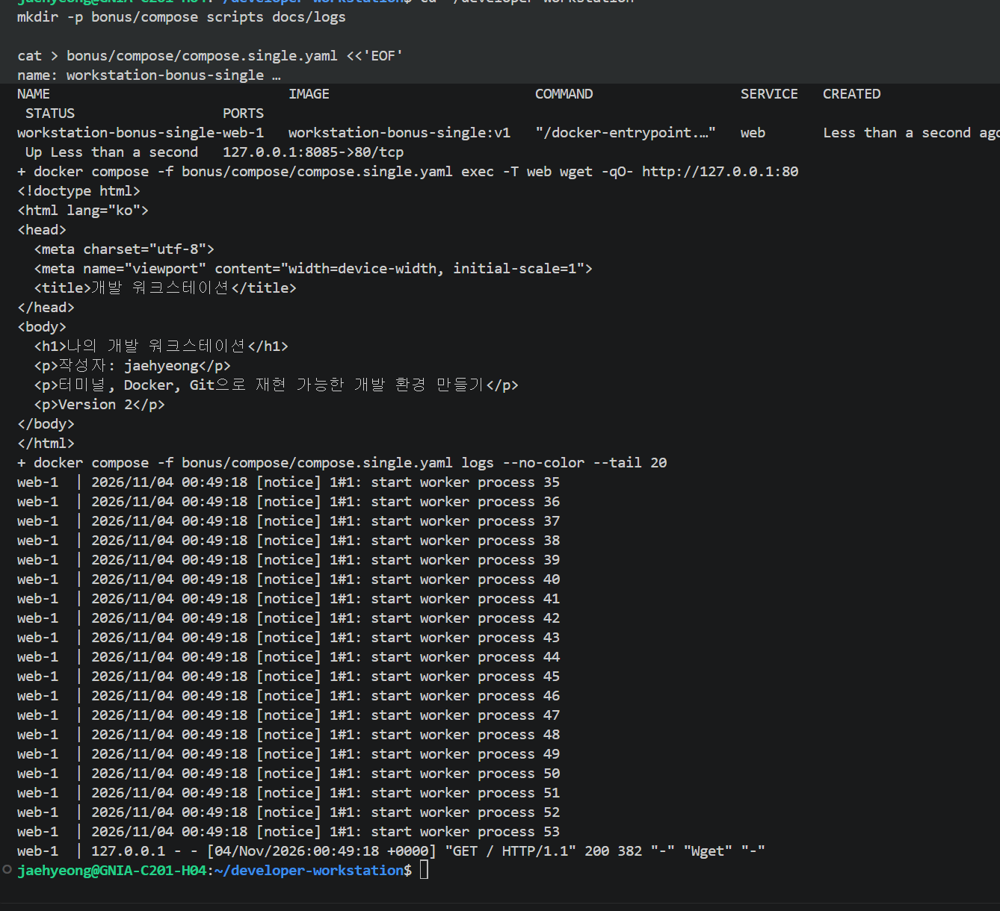
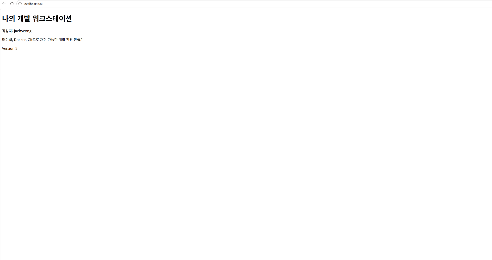
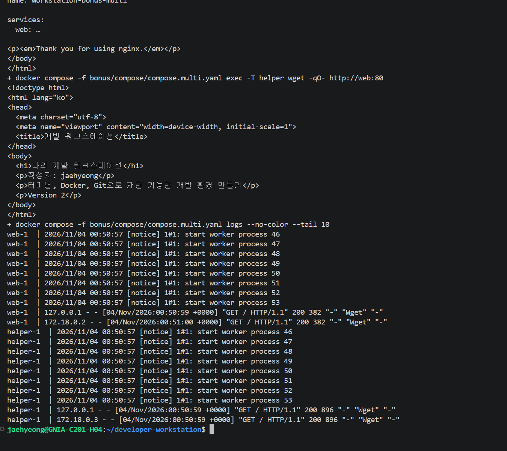
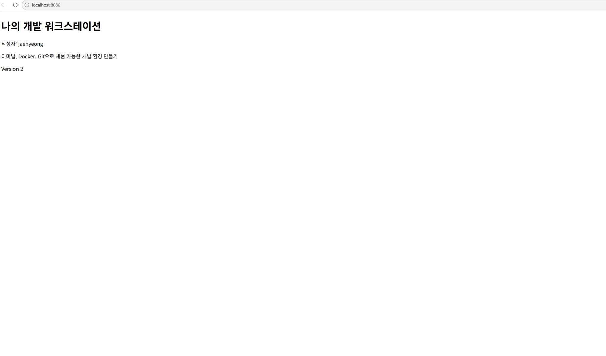
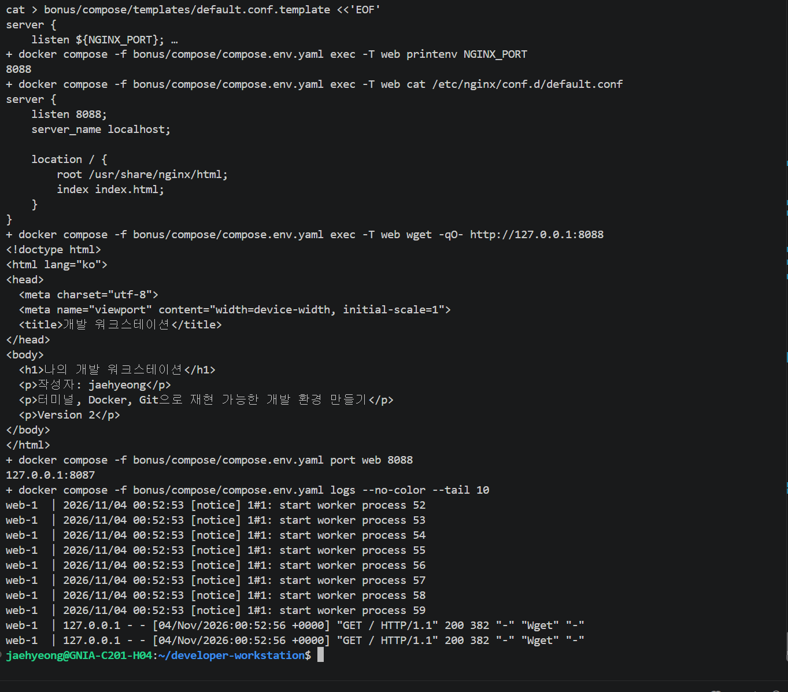
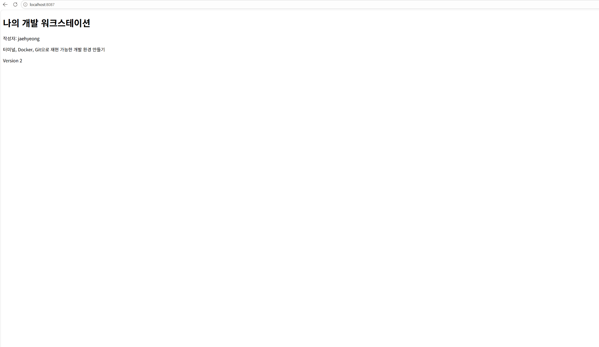
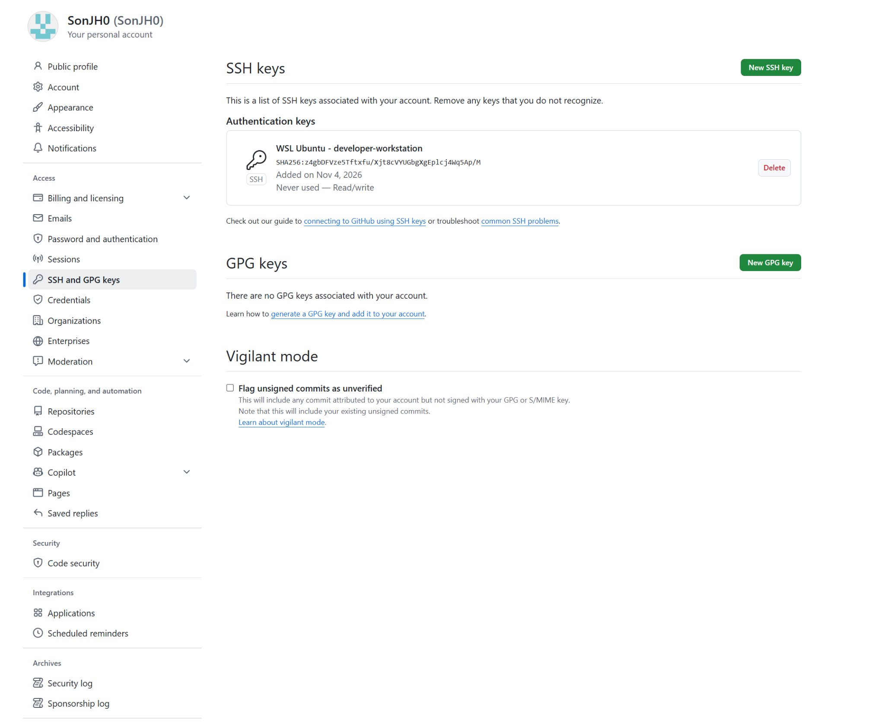
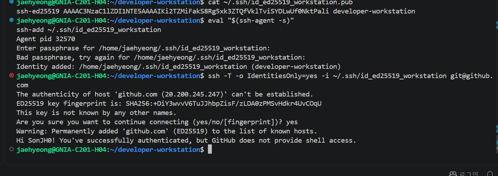
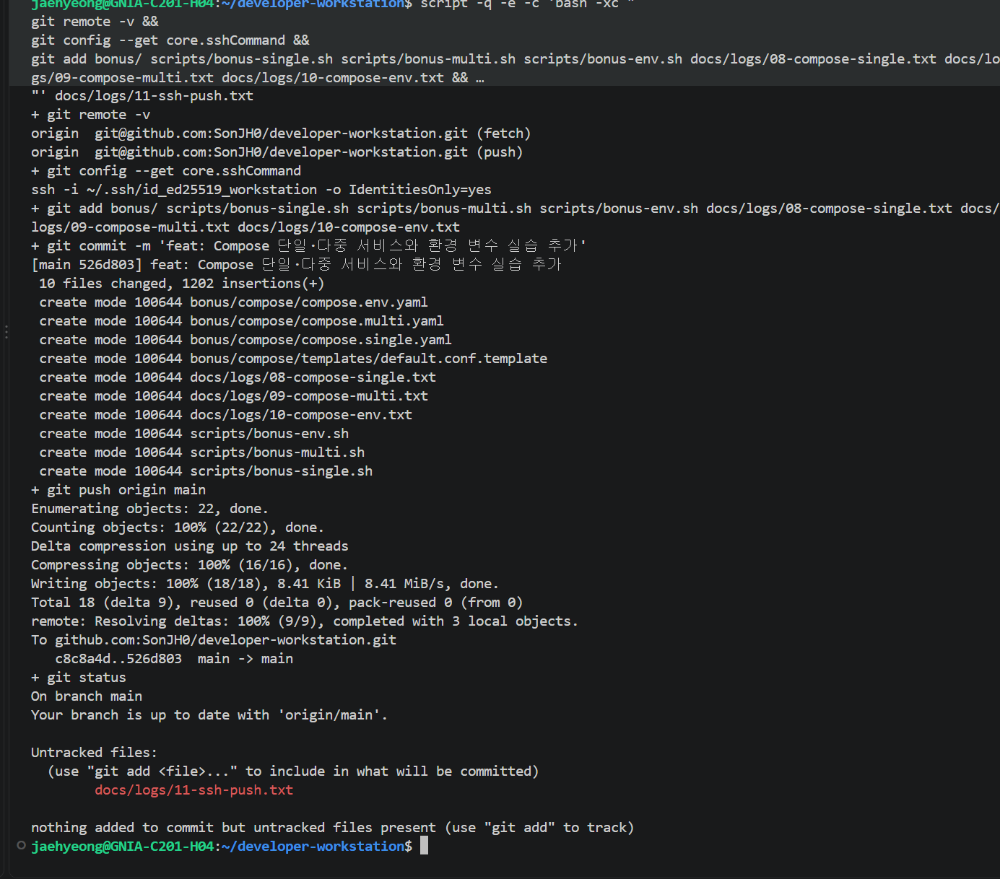

# 보너스 실습 결과

2026-11-04 한국 시간에 사용자 PC의 WSL Ubuntu에서 실행했다. Docker Compose v5.6.1을 사용했다.

| 보너스 | 확인 결과 | 증거 |
|---|---|---|
| Compose 단일 서비스 | web 실행, 8085 접속, Version 2 응답 | [08 로그](evidence/08-compose-single.md) |
| 멀티 컨테이너 | web과 helper 실행, 서비스 이름으로 양방향 HTTP 통신 | [09 로그](evidence/09-compose-multi.md) |
| 운영 명령 | up, ps, logs, down 실행, 종료 후 ps -a 목록이 비어 있음 | 08·09·10 로그 |
| 환경 변수 | NGINX_PORT 80 → 8088, 실제 listen 설정과 HTTP 응답 확인 | [10 로그](evidence/10-compose-env.md) |
| GitHub SSH | SonJH0 인증 성공, SSH 원격으로 커밋 526d803 push 성공 | [실제 push 로그](logs/11-ssh-push.txt), 아래 캡처 |

## 구성 기준과 파일

- [compose.single.yaml](../bonus/compose/compose.single.yaml): 단일 web 서비스, 호스트 8085 → 내부 80.
- [compose.multi.yaml](../bonus/compose/compose.multi.yaml): web과 helper, 호스트 8086 → web 내부 80. helper에는 호스트 포트를 게시하지 않았다.
- [compose.env.yaml](../bonus/compose/compose.env.yaml): 환경 변수로 web의 내부 수신 포트와 매핑 대상을 함께 변경. 호스트 포트는 8087로 유지.
- [default.conf.template](../bonus/compose/templates/default.conf.template): NGINX_PORT를 수신 포트에 적용하는 템플릿.
- [단일 실행 스크립트](../scripts/bonus-single.sh), [다중 실행 스크립트](../scripts/bonus-multi.sh), [환경 변수 실행 스크립트](../scripts/bonus-env.sh): 실행 명령을 재현할 수 있게 보관.

Compose는 이미지, 포트, 환경 변수, 상태 점검을 YAML에 선언한다. 긴 docker run 명령을 매번 다시 작성하는 대신 설정 파일을 Git으로 관리하고 같은 up 명령으로 실행할 수 있다. 파일 작성만으로 성공을 판정하지 않고 실행 상태·HTTP 응답·로그로 확인했다.

## 재현 방법과 정리

프로젝트 최상위에서 Docker Desktop이 실행되고 docker compose version이 성공하는지 확인한다. 기존에 같은 보너스 프로젝트가 실행 중이거나 8085·8086·8087이 사용 중이면 상태를 확인하고 충돌을 해결한 뒤 진행한다.

```bash
bash scripts/bonus-single.sh
# 브라우저 http://localhost:8085 확인
docker compose -f bonus/compose/compose.single.yaml down
docker compose -f bonus/compose/compose.single.yaml ps -a

bash scripts/bonus-multi.sh
# 브라우저 http://localhost:8086 확인
docker compose -f bonus/compose/compose.multi.yaml down
docker compose -f bonus/compose/compose.multi.yaml ps -a

bash scripts/bonus-env.sh
# 브라우저 http://localhost:8087 확인
NGINX_PORT=8088 docker compose -f bonus/compose/compose.env.yaml down
NGINX_PORT=8088 docker compose -f bonus/compose/compose.env.yaml ps -a
```

각 스크립트는 config로 적용 설정을 확인하고 up으로 실행한 뒤 ps와 logs로 상태를 확인한다. --wait와 healthcheck를 이용해 응답 가능한 상태를 기다린다. 스크립트 종료 후에도 브라우저 확인을 위해 서버는 유지되므로 위 down 명령으로 정리한다. down은 해당 프로젝트의 컨테이너와 기본 네트워크를 제거하며, 이번 보너스에는 이름 있는 데이터 볼륨을 추가하지 않았다.

## 단일 서비스 결과

컨테이너 Up, 내부 HTTP 요청 200, 브라우저 8085에서 Version 2를 확인했다. 기존 HTML이 Version 2인 상태에서 새로 빌드했으므로 이 표시가 정상이다.





## 두 컨테이너와 서비스 디스커버리

같은 Compose 기본 네트워크에서 서비스 이름을 통해 상대 주소를 찾는다. web에서 http://helper:80으로 요청해 NGINX 기본 환영 HTML을 받고, helper에서 http://web:80으로 요청해 프로젝트 HTML을 받았다. 고정 컨테이너 IP를 코드에 넣지 않았다. 양쪽 로그에 HTTP 200이 기록됐다. 서로 내부 80 포트를 사용해도 네트워크 공간이 분리돼 충돌하지 않는다.

```bash
docker compose -f bonus/compose/compose.multi.yaml exec -T web wget -qO- http://helper:80
docker compose -f bonus/compose/compose.multi.yaml exec -T helper wget -qO- http://web:80
```





## 환경 변수: 설정과 코드의 분리

NGINX 공식 이미지의 시작 스크립트가 /etc/nginx/templates/default.conf.template에 있는 환경 변수 참조를 치환하고 /etc/nginx/conf.d/default.conf를 생성한다. NGINX_PORT라는 이름을 임의로 전달하기만 한 것이 아니라, 템플릿의 listen 항목에 명시적으로 연결했다.

| 주입한 값 | 생성된 실제 설정 | 호스트와 내부 포트 |
|---|---|---|
| NGINX_PORT=80 | listen 80; | 8087 → 80 |
| NGINX_PORT=8088 | listen 8088; | 8087 → 8088 |

스크립트는 이미지를 한 번 빌드한 뒤 두 설정값으로 컨테이너를 재생성한다. HTML과 이미지를 수정하지 않고 실행 설정을 바꿨다. printenv, 생성된 설정 파일, 각 내부 포트의 HTTP 응답, docker compose port로 변경을 검증했다. 최종 브라우저 주소는 localhost:8087이며 서버 내부 수신 포트는 8088이다.





## SSH 인증과 실제 push

암호로 보호한 Ed25519 키를 WSL 홈의 .ssh에 만들고 공개키만 GitHub Authentication Key로 등록했다. ssh-agent에 키를 추가하고 GitHub 서버의 ED25519 지문을 공식 문서와 비교한 뒤 최초 접속을 승인했다. Hi SonJH0! 메시지로 인증을 확인했다. GitHub는 대화형 셸을 제공하지 않으므로 ssh -T는 인증에 성공해도 종료 코드 1을 반환할 수 있다. 실제 업로드 성공은 별도로 git push 결과로 확인했다.

개인키와 암호는 저장소에 포함하지 않는다. 아래 파일명은 작성자가 선택한 로컬 키 경로이며 다른 사용자는 자신의 키를 생성·등록하고 해당 경로를 바꿔야 한다. 작성자의 키를 복사해서 재현하는 방식이 아니다.

```bash
ssh -T -o IdentitiesOnly=yes -i ~/.ssh/id_ed25519_workstation git@github.com
git config --local core.sshCommand 'ssh -i ~/.ssh/id_ed25519_workstation -o IdentitiesOnly=yes'
git remote set-url origin git@github.com:SonJH0/developer-workstation.git
git remote -v
git push origin main
```

위 push 대상은 작성자의 저장소다. 다른 평가자는 자신의 쓰기 권한이 있는 저장소 또는 fork를 대상으로 인증·push를 확인한다. 새 터미널에서 필요하면 ssh-agent를 시작하고 ssh-add로 자신의 키를 추가한다. 계정 인증과 커밋 작성자 이름 설정은 별개다.







## 참고 자료

- [Docker Compose 개요](https://docs.docker.com/compose/)
- [Compose 네트워크](https://docs.docker.com/compose/how-tos/networking/)
- [NGINX 공식 이미지의 환경 변수 템플릿](https://hub.docker.com/_/nginx)
- [GitHub SSH 연결 확인](https://docs.github.com/en/authentication/connecting-to-github-with-ssh/testing-your-ssh-connection)

