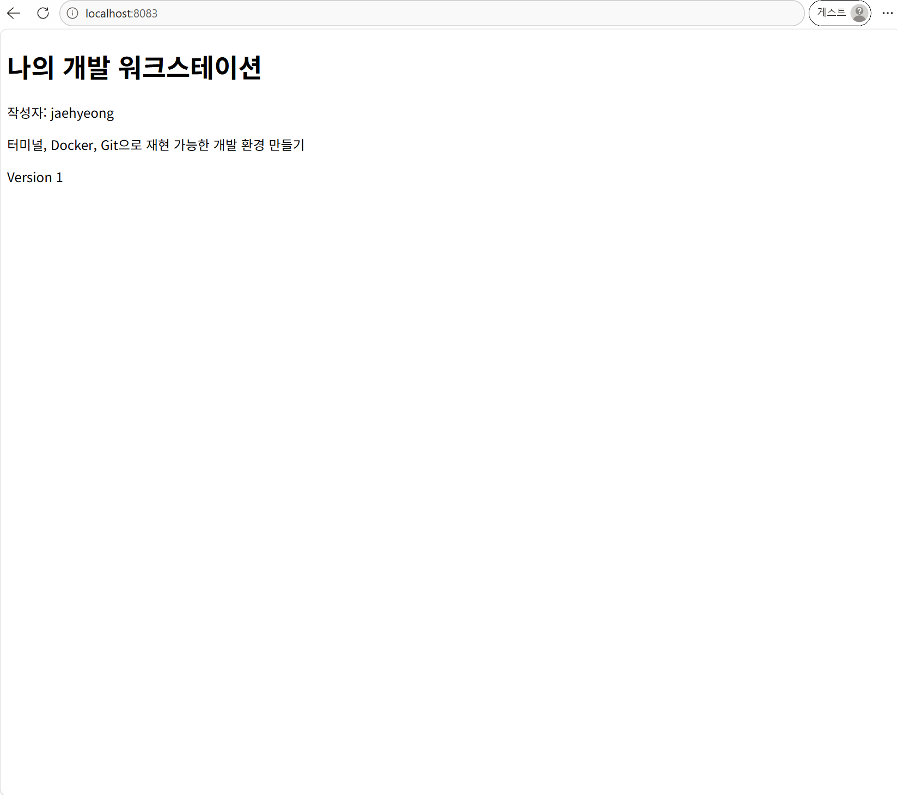
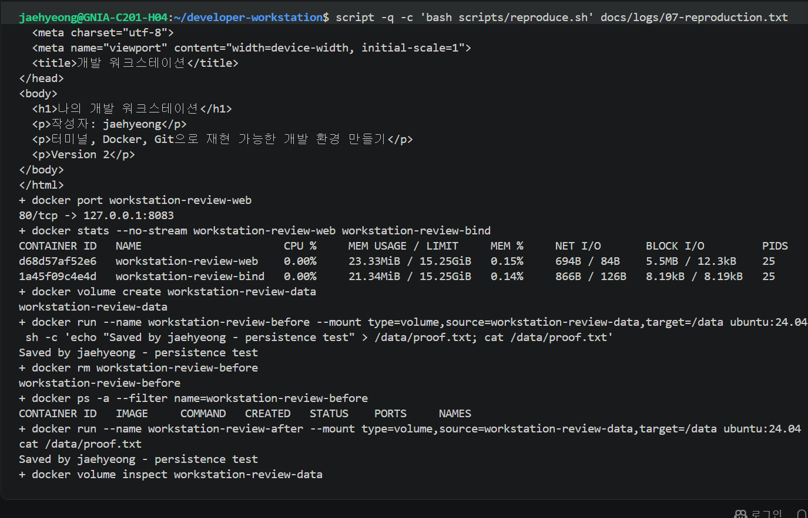
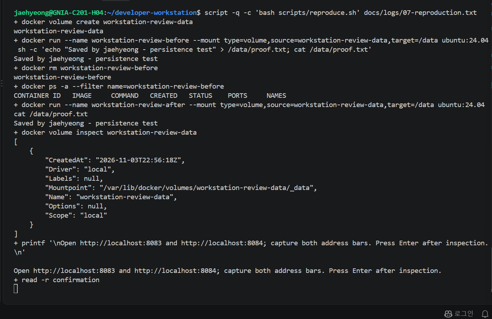
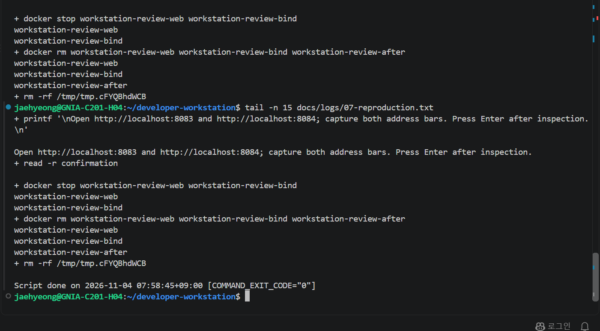

# 추가 재현 실행 결과

사용자 PC의 WSL Ubuntu에서 `scripts/reproduce.sh`를 실행했다. 아래 내용은 실제 실행 화면과 브라우저 화면에서 확인한 결과다.

| 확인 항목 | 관찰한 결과 |
| --- | --- |
| 이미지 빌드 | workstation-review:v1 빌드 완료 |
| COPY 컨테이너 | localhost:8083에서 Version 1 유지 |
| 바인드 마운트 컨테이너 | 임시 호스트 파일 수정 후 localhost:8084에서 Version 2 표시 |
| 볼륨 영속성 | 첫 컨테이너 삭제 후 새 컨테이너에서 동일한 proof.txt 내용 출력 |
| 마무리 | 테스트 컨테이너 stop/rm, 임시 폴더 삭제, COMMAND_EXIT_CODE="0" |

전체 명령과 출력은 사용자 PC에서 생성한 [07-reproduction.txt](../logs/07-reproduction.txt)에 기록했다. 이름 있는 검증 볼륨은 스크립트 설계에 따라 유지했다. 이번 검증은 같은 PC에서 새 임시 빌드 경로와 별도 컨테이너로 수행했으며, 다른 PC에서의 검증 결과는 아니다.

## COPY 결과

## 바인드 마운트 결과

## 볼륨 데이터 유지

## 볼륨 조회와 브라우저 확인 대기

## 정리 및 정상 종료

